# NeuralSS: neural super-sampling and frame generation for games

NeuralSS is a research project for open, hardware-agnostic neural reconstruction in games. It has two networks:

- **Temporal super-resolution (TSR):** a small recurrent network that turns low-resolution frames (3x and 2x, for example 640x360 to 1920x1080) into full-resolution frames, using its own history. It takes jittered game renders with motion vectors and depth, or ordinary video with no side information, in which case a built-in motion estimator supplies the motion.
- **Frame generation (FG):** a network that creates in-between frames at any time (interpolation, so 2x to 6x frame generation) or a future frame (extrapolation) from two real frames. It estimates motion from the colour frames alone (an IFNet with the design and pre-trained weights of RIFE 4.26) and uses engine motion vectors, depth and camera input when they exist. It copies HUD and subtitles from the newest real frame instead of blending them, and skips generation on scene cuts.

Both networks use only convolutions, transposed convolutions, resizing and grid sampling, and export to ONNX. Everything is trained and evaluated in three Kaggle notebooks (GPU T4 x2) built from one shared Python library. All three notebooks have run on Kaggle, and their downloaded outputs (metrics, plots, logs, weights) are in this repository. The two training notebooks were then changed on 3 November 2026 to fix what those runs revealed; that version has not run on Kaggle yet (see [Project status](#project-status)).

The full research plan, design rationale, competitive analysis and dataset licences are in [RESEARCH.md](RESEARCH.md). This README covers how the repository works, how to run it, and what each notebook produced.

## Table of contents

- [Quick start](#quick-start)
- [Project status](#project-status)
- [How it works](#how-it-works)
- [Tech stack](#tech-stack)
- [Repository structure](#repository-structure)
- [Local development](#local-development)
- [Notebook 1: data pipeline](#notebook-1-data-pipeline)
- [Notebook 2: temporal super-resolution](#notebook-2-temporal-super-resolution)
- [Notebook 3: frame generation](#notebook-3-frame-generation)
- [Weights and exported models](#weights-and-exported-models)
- [Known limitations](#known-limitations)
- [Troubleshooting](#troubleshooting)
- [Licence](#licence)
- [Documentation](#documentation)

## Quick start

The notebooks run on Kaggle, not locally. Training and evaluation need two GPUs and the attached datasets.

1. **Create the data-pipeline notebook on Kaggle.** Upload [neural-data-pipeline/neural-data-pipeline.ipynb](neural-data-pipeline/neural-data-pipeline.ipynb). In the notebook settings choose **Accelerator: GPU T4 x2** and turn **Internet on**. Attach these Kaggle datasets (**Add Input**): `soumikrakshit/div2k-high-resolution-images`, `daehoyang/flickr2k`, `amithkesavmrajagiri/reds-dataset`, `wangsally/vimeo-90k-7`, `chenshu123/vimeo-triplet`, `artemmmtry/mpi-sintel-dataset`, `uom200647r/vid4-dataset`. An optional Kaggle secret `HF_TOKEN` raises Hugging Face download limits.
2. **Run it** with **Save Version > Save & Run All**. Expected result: about 0.6 hours; the output contains `nss_data/nss_manifest.parquet` and `outputs.zip`.
3. **Create the two training notebooks** from [neural-supersampling/neural-supersampling.ipynb](neural-supersampling/neural-supersampling.ipynb) and [neural-frame-generation/neural-frame-generation.ipynb](neural-frame-generation/neural-frame-generation.ipynb) with the same accelerator, Internet and datasets, and also attach the pipeline notebook's output (**Add Input > Notebook output**).
4. **Run each one** with **Save & Run All**. Expected result: about 10.3 hours each, within the notebooks' 10.8-hour ceiling (Kaggle's 12-hour session limit minus a 72-minute margin); `outputs.zip` and every file appear in the notebook's **Output** tab. This is an estimate: the runs of 2 to 3 November 2026 took 7.46 and 6.59 hours with shorter training budgets, and the current notebooks add 2.75 and 3.4 hours of training. Together the two runs use about 21 hours of Kaggle's weekly GPU quota (about 30 hours). Both notebooks download the RIFE 4.26 weights (23 MB) from `huggingface.co/hzwer/RIFE`, so Internet must be on.
5. **Optional smoke test:** set `QUICK_RUN = True` in the configuration cell for a short run of every cell (about 40 minutes).

Common errors:

| Problem                                                            | Fix                                                                                                                                                                                                  |
| :----------------------------------------------------------------- | :--------------------------------------------------------------------------------------------------------------------------------------------------------------------------------------------------- |
| `AssertionError: Select the GPU T4 x2 accelerator`                 | Set **Accelerator** to **GPU T4 x2**; the notebooks run one training process per GPU                                                                                                                 |
| The version shows no logs and ends with `ERRORED_MOUNTING_DATASET` | One attached dataset failed to mount, so no code ran. Remove or re-add that dataset and save again; the notebooks leave out sources that are not attached                                            |
| `No texture sources found`                                         | Neither the pipeline output nor the Kaggle datasets are attached                                                                                                                                     |
| A pip install fails                                                | Internet is off. `lpips`, `flip-evaluator` and `onnxruntime` are optional; their absence is logged and the matching metric or check is skipped                                                       |
| `RIFE 4.26 weights unavailable` in the log                         | No Internet, Hugging Face unreachable, or the file changed (hash mismatch). The run continues with randomly initialised motion networks, far below the intended quality; fix the cause and run again |

## Project status

| Notebook                  | Kaggle run           | Duration | Result                                                                                                                                                                                                                |
| :------------------------ | :------------------- | :------- | :-------------------------------------------------------------------------------------------------------------------------------------------------------------------------------------------------------------------- |
| `neural-data-pipeline`    | 18 October 2026      | 0.63 h   | 12,300 items split into 8,874 train, 1,087 val and 1,432 test with zero cross-split duplicates                                                                                                                        |
| `neural-supersampling`    | 2 to 3 November 2026 | 7.46 h   | On ordinary video (no motion vectors) the 3x student beats bicubic on all five suites by 1.2 to 2.1 dB PSNR-Y; with engine data it beats every baseline; static scenes now converge (35.63 dB at frame 16, was 33.97) |
| `neural-frame-generation` | 2 to 3 November 2026 | 6.59 h   | The fine-tuned `high` tier beats unchanged RIFE 4.26; the `low` and `igpu` students do not work on ordinary video; plain-video scores are distorted by a cut-detector defect (fixed since, see below)                 |

Both training runs started at about 20:41 UTC on 2 November 2026 (Kaggle clock, from the notebook logs and saved notebook metadata) and ended at about 04:08 UTC on 3 November. No training run failed in either notebook (`metrics/failed_runs.json` is empty). Image: Python 3.13.16, PyTorch 2.11.0 with CUDA 13.0, 2 Tesla T4, 4 CPU cores, 31.3 GB RAM.

**What these runs measured.** They are the first runs of the redesign of 3 November 2026 ([RESEARCH.md section 21](RESEARCH.md#21-redesign-for-plain-video-and-dlss-4-class-quality-3-november-2026)): a built-in motion estimator in TSR, plain-video training and evaluation in both notebooks, 16-frame TSR unrolls, an FG rebuilt around RIFE 4.26's IFNet with its pre-trained weights, and RIFE 4.26 unchanged as an FG reference. The notebooks that ran are the versions of commit `a7fb282`; their exact library code is in each `outputs/code/` folder, and the executed notebooks with every output are kept at [neural-supersampling/outputs/neural-supersampling.executed.ipynb](neural-supersampling/outputs/neural-supersampling.executed.ipynb) and [neural-frame-generation/outputs/neural-frame-generation.executed.ipynb](neural-frame-generation/outputs/neural-frame-generation.executed.ipynb).

- **TSR works on ordinary video.** In plain mode (bicubic downscale, no jitter, depth or motion vectors) the 3x student leads bicubic by 2.10 dB on synthetic game scenes, 1.63 on TartanAir, 1.20 on Sintel, 1.75 on Vid4 and 1.17 on Vimeo-1080p, and wins 27 of 28 real clips. The 16-frame unrolls removed the late static-scene decline: the ablation without them falls from 31.6 dB at frame 4 to 29.6 dB at frame 15, while the student holds 35.6 dB.
- **FG: RIFE fine-tuning helps, the small tiers fail.** Measured after the run on the independent Middlebury interpolation set (12 sequences, colour only, CPU; `.agent-local` script, see [RESEARCH.md section 22](RESEARCH.md#22-analysis-of-the-runs-of-2-to-3-november-2026-and-changes)): `high` 34.30 dB, `mid` 33.65, RIFE 4.26 33.34, frame averaging 28.02, `low` 28.38, `igpu` 28.48. The `low` and `igpu` tiers estimated flow at half resolution even on 256-pixel training crops (flow at 128 pixels).
- **FG plain-video defect.** Without motion vectors the scene-cut detector compared raw frames against a threshold calibrated with motion compensation, so it flagged ordinary motion as cuts and replaced 35 to 100 percent of the real plain-video samples with frame repeat (all of Vid4). The plain-video FG tables below are therefore mostly frame repeat; tables on the samples the detector left alone are given as well.

**Changes of 3 November 2026 after these runs, not yet run on Kaggle** ([RESEARCH.md section 22](RESEARCH.md#22-analysis-of-the-runs-of-2-to-3-november-2026-and-changes)):

1. **FG cut detector:** without motion vectors it now scores the luma-histogram distance alone, with its own calibrated threshold, and the notebook saves the share of gated samples per suite (`metrics/cut_gate_rates.csv`).
2. **FG flow resolution per frame height:** each tier estimates flow at no more than 576 (`igpu`, `low`) or 1152 (`mid`, `high`) image lines, halving taller frames. 1080p cost is unchanged; training crops and sub-576-line clips now run the flow at full resolution. A native-1080p Vimeo suite (`vimeo1080p_native`) measures the half-resolution path as deployed.
3. **Full use of the Kaggle session:** the run ceiling rises from 9.5 to 10.8 hours and training budgets from 6.6 and 5.9 to 9.3 hours per notebook (TSR teacher 170, student 190, pair 110, ablations 30 minutes; FG 150, 200, 120, 30).
4. **Latency timing** with cuDNN autotuning in both notebooks.

Their effect on quality is `Not measured in the current repository.` until the next Kaggle run. The weights and numbers below are from the runs of 2 to 3 November 2026.

## How it works

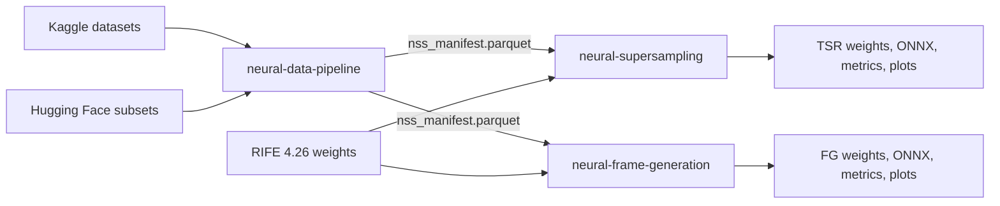

1. **Data pipeline.** Discovers images and videos on Kaggle and Hugging Face, filters unusable items, detects copies across all sources with hashes, DINOv2 embeddings and SIFT verification, and writes a leakage-safe train / validation / test manifest.
2. **Training data.** Both training notebooks decode the manifest into memory-mapped caches. Each training batch mixes _synthetic_ game-like scenes, rendered on the GPU from still images with exact motion vectors, disocclusions, thin geometry, particles and HUD overlays, with _real_ sequences (TartanAir and Sintel with exact flow; video with RAFT-estimated motion). Part of every batch is turned into plain video (no jitter, depth or motion vectors).
3. **Training.** DDP on both GPUs with FP16, EMA weights and a wall-clock cosine schedule: the largest model first (for FG, RIFE 4.26 fine-tuned; for TSR, the teacher tier), then the main student (for FG distilled from the largest model), then smaller tiers and ablations, two runs in parallel (one per GPU). Engine data are withheld at random, so every model also learns to work on plain video.
4. **Evaluation.** Test-split suites only, each with engine data and as plain video, against analytic baselines (and RIFE 4.26 unchanged for FG), with spatial, temporal, region, UI and latency metrics, then fusion to plain convolutions and ONNX export.

**Library and build.** The library lives once in [src/neuralss/](src/neuralss/). [tools/build_notebooks.py](tools/build_notebooks.py) turns the percent-format sources in [notebooks/](notebooks/) into `.ipynb` files and embeds every library module as a `%%writefile` cell, so each notebook is self-contained on Kaggle.

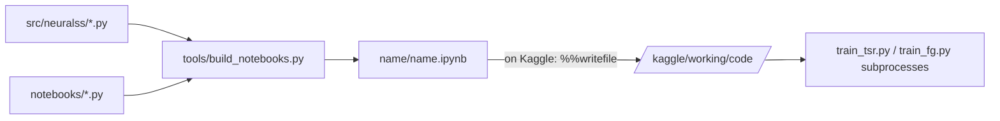

## Tech stack

| Component                              | Version (where known)                                                   | Purpose and where used                                                                                                           |
| :------------------------------------- | :---------------------------------------------------------------------- | :------------------------------------------------------------------------------------------------------------------------------- |
| Python                                 | 3.10.12 (data pipeline), 3.13.16 (TSR and FG runs)                      | Notebook and library language                                                                                                    |
| PyTorch with CUDA                      | 2.0.0 / CUDA 11.8 (data pipeline), 2.11.0 / CUDA 13.0 (TSR and FG runs) | Models, GPU renderer, DDP training (`torch.distributed.run`), FP16 autocast; the library supports 2.0 and later                  |
| torchvision                            | Kaggle image                                                            | RAFT-small optical flow (motion labels for video, tOF metric), AlexNet weights for the LPIPS fallback                            |
| RIFE 4.26 weights                      | `RIFEv4.26_0921.zip` from `huggingface.co/hzwer/RIFE` (MIT)             | Initial weights of the FG motion network and the TSR motion estimators; unchanged FG reference (`nss_models.fetch_rife_weights`) |
| Hugging Face Transformers              | Kaggle image                                                            | DINOv2-small embeddings for copy detection (`nss_dedup.py`)                                                                      |
| OpenCV, Pillow, NumPy, pandas, PyArrow | Kaggle image                                                            | Decoding, SIFT features, HUD text tiles, caches, manifest (`nss_manifest.parquet`)                                               |
| matplotlib, tqdm                       | Kaggle image                                                            | Plots and progress bars                                                                                                          |
| `lpips`                                | installed by the notebooks                                              | Perceptual loss and metric (optional)                                                                                            |
| `flip-evaluator`                       | installed by the notebooks                                              | NVIDIA FLIP metric for static convergence (optional)                                                                             |
| `onnxruntime`                          | installed by the notebooks                                              | ONNX export parity check (optional)                                                                                              |
| nbformat                               | 5.11.1 (local `.venv`)                                                  | Local notebook build and check (`tools/build_notebooks.py`)                                                                      |
| black, pyflakes                        | 26.10.1, 4.1.0 (local `.venv`)                                          | Local formatting and lint checks                                                                                                 |
| PyTorch CPU, onnx, onnxruntime         | 2.15.0, 1.23.2, 1.31.1 (local `.venv`, optional)                        | Importing and checking the library on CPU; not needed to build the notebooks                                                     |

## Repository structure

```text
.
|-- README.md
|-- RESEARCH.md
|-- src/
|   `-- neuralss/
|       |-- nss_common.py
|       |-- nss_data.py
|       |-- nss_dedup.py
|       |-- nss_pipeline.py
|       |-- nss_cache.py
|       |-- nss_synth.py
|       |-- nss_models.py
|       |-- nss_metrics.py
|       |-- nss_train.py
|       |-- nss_eval.py
|       |-- train_tsr.py
|       `-- train_fg.py
|-- notebooks/
|-- tools/
|   `-- build_notebooks.py
|-- neural-data-pipeline/
|   |-- neural-data-pipeline.ipynb
|   `-- outputs/
|-- neural-supersampling/
|   |-- neural-supersampling.ipynb
|   `-- outputs/
|-- neural-frame-generation/
|   |-- neural-frame-generation.ipynb
|   `-- outputs/
|-- .gitignore
|-- .gitattributes
`-- .prettierrc.json
```

| Path                                                | Contents                                                                                                                                                                                                                                                                                                                                                                                                                                                                                                                                                                                   |
| :-------------------------------------------------- | :----------------------------------------------------------------------------------------------------------------------------------------------------------------------------------------------------------------------------------------------------------------------------------------------------------------------------------------------------------------------------------------------------------------------------------------------------------------------------------------------------------------------------------------------------------------------------------------- |
| `src/neuralss/`                                     | The single source of the shared library, embedded into every notebook: run folders and launcher (`nss_common`), data sources and decoding (`nss_data`), copy detection and split (`nss_dedup`, `nss_pipeline`), training caches (`nss_cache`), the synthetic renderer and batch builders including the plain-video degradation (`nss_synth`), the IFNet motion estimator with RIFE weight loading and the TSR and FG networks (`nss_models`), losses, metrics and baselines (`nss_metrics`), the DDP loop (`nss_train`), evaluation helpers (`nss_eval`) and the two training entry points |
| `notebooks/`                                        | Percent-format notebook sources                                                                                                                                                                                                                                                                                                                                                                                                                                                                                                                                                            |
| `tools/build_notebooks.py`                          | Builds the `.ipynb` files from `notebooks/` and `src/neuralss`                                                                                                                                                                                                                                                                                                                                                                                                                                                                                                                             |
| `neural-data-pipeline/`                             | The executed data-pipeline notebook (run of 18 October 2026) and its outputs, including `nss_data/nss_manifest.parquet`                                                                                                                                                                                                                                                                                                                                                                                                                                                                    |
| `neural-supersampling/`, `neural-frame-generation/` | The current notebook (with the changes made after the last run, no outputs) and the outputs of the runs of 2 to 3 November 2026, including `<name>.executed.ipynb` with every output                                                                                                                                                                                                                                                                                                                                                                                                       |
| `.gitignore`, `.gitattributes`, `.prettierrc.json`  | Ignored local folders and archives, line-ending rules, Markdown / JSON formatting                                                                                                                                                                                                                                                                                                                                                                                                                                                                                                          |

Inside every `outputs/` folder: `code/` holds the library and per-run JSON configs exactly as written on Kaggle, `logs/` the notebook log and one log per training run, `metrics/` every CSV and JSON result, `plots/` every figure, and for the training notebooks `predictions/` full-size sample frames and `weights/` checkpoints and ONNX models.

## Local development

There is no local training or test suite: the notebooks are verified on Kaggle. Local work is editing the library or notebook sources and rebuilding the notebooks.

```powershell
python -m venv .venv
.venv\Scripts\python -m pip install nbformat black pyflakes --cache-dir .cache\pip
```

| Command (repository root)                                            | What it does                                                                                                                                  |
| :------------------------------------------------------------------- | :-------------------------------------------------------------------------------------------------------------------------------------------- |
| `.venv\Scripts\python tools\build_notebooks.py`                      | Rebuilds every notebook whose sources changed (written without outputs); unchanged notebooks, including executed copies, are left as they are |
| `.venv\Scripts\python tools\build_notebooks.py --check`              | Exits with code 1 and lists stale notebooks if any `.ipynb` cell id, type or source differs from a fresh build; outputs are ignored           |
| `.venv\Scripts\python -m pyflakes src\neuralss tools notebooks`      | Lint (no output means clean)                                                                                                                  |
| `.venv\Scripts\python -m black --check src\neuralss tools notebooks` | Formatting check                                                                                                                              |

Workflow: edit `src/neuralss/*.py` or `notebooks/*.py`, run the build, then `--check`, pyflakes and black. Never edit the `.ipynb` files by hand; they are generated. Note that the build rewrites a notebook without outputs whenever its sources change, so copy an executed notebook into its `outputs/` folder first if its outputs must be kept.

## Notebook 1: data pipeline

[neural-data-pipeline/neural-data-pipeline.ipynb](neural-data-pipeline/neural-data-pipeline.ipynb) keeps its saved outputs from the run of 18 October 2026 (Kaggle GPU T4 x2, PyTorch 2.0.0, 4 CPU cores, 31.3 GB RAM). All numbers below are printed in the notebook or saved in [neural-data-pipeline/outputs/metrics/](neural-data-pipeline/outputs/metrics/).

**Sections 1 to 4: library, setup, hardware, configuration.** Writes the four library modules used by the pipeline (`nss_common`, `nss_data`, `nss_dedup`, `nss_pipeline`), loads the `HF_TOKEN` secret, and reports 2 Tesla T4 GPUs (14.56 GB each). Hugging Face caps: game stills (1,200 train, 250 test), TartanAir 120 frames per environment in sequences of 24, GameIR (40, 30) clips, Vimeo-1080p (160, 40) videos. Copy-detection settings: 16 neighbours, retrieval recall 0.98, 400 SIFT features, audit with 5 neighbours and at most 3 rounds.

**Section 5: Kaggle discovery (1.7 min).** Saved to `discovery_kaggle.csv`.

| Source          | Files listed | Items | Test items |
| :-------------- | -----------: | ----: | ---------: |
| div2k           |          900 |   900 |        100 |
| flickr2k        |        2,650 | 2,650 |          0 |
| reds            |       22,100 |   221 |          0 |
| vimeo_septuplet |       40,005 | 5,715 |          0 |
| vimeo_triplet   |        3,000 | 1,000 |      1,000 |
| sintel          |        3,256 |    46 |         10 |
| vid4            |          171 |     4 |          4 |

**Section 6: Hugging Face materialisation (14.2 min).** 1,764 items, 13.64 GB: 1,200 + 250 game stills, 12 TartanAir training environments and 2 test environments (`japanesealley`, `seasidetown`), 40 + 30 GameIR clips, 134 + 40 Vimeo-1080p videos. Catalogue (`catalogue_summary.csv`): 12,300 items; exact motion for Sintel and TartanAir, depth for TartanAir and GameIR.

**Section 7: catalogue overview.**

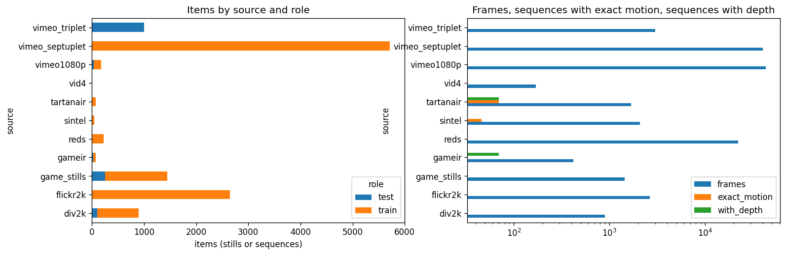

_Items and frames per source, split by training and test role._

**Section 8: keyframe statistics (12.0 min).** 13,322 keyframes, 0 decode failures (`keyframe_stats.csv`). Median size per source ranges from 448x256 (Vimeo-90K) to 2040x1356 (DIV2K, Flickr2K); median sharpness from 216 (Vimeo-90K septuplet) to 1,704 (Vid4).

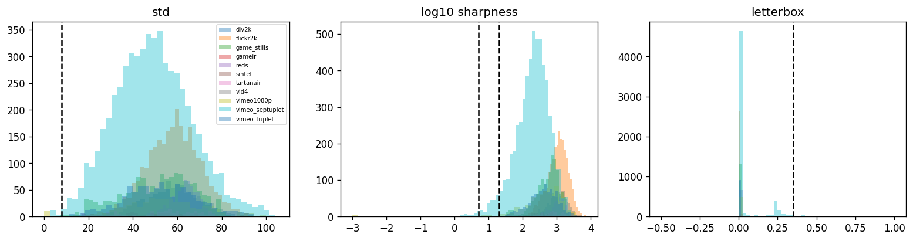

_Distributions of size, contrast, sharpness, letterboxing and colourfulness per source._

**Section 9: filtering (0.3 min).** Kept 12,149 of 12,300 items. Rejections by reason (an item can have several): Vimeo-90K septuplet 43 blurry, 17 flat, 71 letterboxed; game stills 2, 3, 26; Vimeo-1080p 1, 2, 2; Vimeo-90K triplet 1, 0, 2.

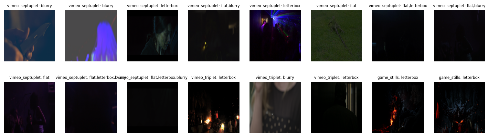

_Examples of rejected keyframes with their reasons._

**Sections 10 to 12: hashes, embeddings, local features.** pHash mean bit 0.500 and dHash 0.480 (balanced). DINOv2 embeddings (13,322 x 384) on both GPUs in 16 s. SIFT: median 368 keypoints per keyframe; 273 keyframes have fewer than 20.

**Section 13: threshold calibration (0.9 min).** 1,500 synthetic copies against 2,930 random and 998 hard negatives (`dedup_calibration.json`, `calibration_scores.csv`).

| Signal            | Threshold               | Recall                            | Most similar negative              |
| :---------------- | :---------------------- | :-------------------------------- | :--------------------------------- |
| DINOv2 retrieval  | `t_ret` 0.6075          | 0.98                              | cosine 0.9348                      |
| DINOv2 strong     | `t_strong` 0.9648       | 0.038                             | cosine 0.9348                      |
| SIFT verification | `t_cells` 10            | 0.9493                            | 8 cells                            |
| pHash             | `h_exact` 6, `h_cand` 6 | 0.9987 (light copies)             | Hamming 18                         |
| Combined rule     |                         | 0.9673 (light 0.9947, heavy 0.94) | 1 false positive, precision 0.9993 |

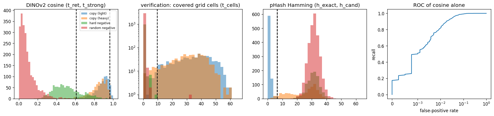

_Score distributions of synthetic copies against negatives, with the chosen thresholds._

**Section 14: copy detection (1.4 min).** 13,165 keyframes searched; 45,213 embedding and 849 pHash candidates, 27,044 unique pairs; 3,346 edges (3,304 verified, 37 strong embedding, 5 exact hash). Most edges join game frames to each other (2,873); cross-source edges link Vimeo-90K septuplets to Vimeo-1080p (78) and to Vimeo-90K triplet test clips (104). Pairs are in `duplicate_pairs.csv`.

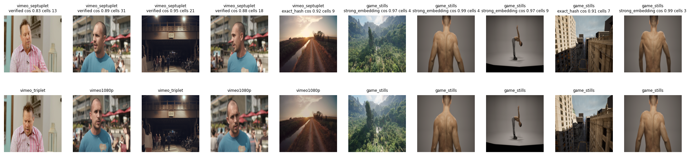

_Examples of detected duplicate pairs with the rule that matched them._

**Section 15: leakage-safe split with audit (1.3 min).** Audit round 1 found 24 cross-split duplicates (added as edges and re-split); round 2 found none. Final: 3,370 edges, largest duplicate cluster 50 items, 3,956 train and validation components (largest 2,936).

| Source          |     Train |       Val |      Test |    Drop | Filtered |
| :-------------- | --------: | --------: | --------: | ------: | -------: |
| div2k           |       755 |        43 |       100 |       2 |        0 |
| flickr2k        |     2,497 |       153 |         0 |       0 |        0 |
| game_stills     |       502 |        41 |       243 |     636 |       28 |
| gameir          |        40 |         0 |        30 |       0 |        0 |
| reds            |       209 |        12 |         0 |       0 |        0 |
| sintel          |        36 |         0 |        10 |       0 |        0 |
| tartanair       |        60 |         0 |        10 |       0 |        0 |
| vid4            |         0 |         0 |         4 |       0 |        0 |
| vimeo1080p      |       120 |         3 |        38 |      10 |        3 |
| vimeo_septuplet |     4,655 |       835 |         0 |     108 |      117 |
| vimeo_triplet   |         0 |         0 |       997 |       0 |        3 |
| **Total**       | **8,874** | **1,087** | **1,432** | **756** |  **151** |

Every dropped item is a duplicate of a test item (`split_report.json`, `split_by_source.csv`).

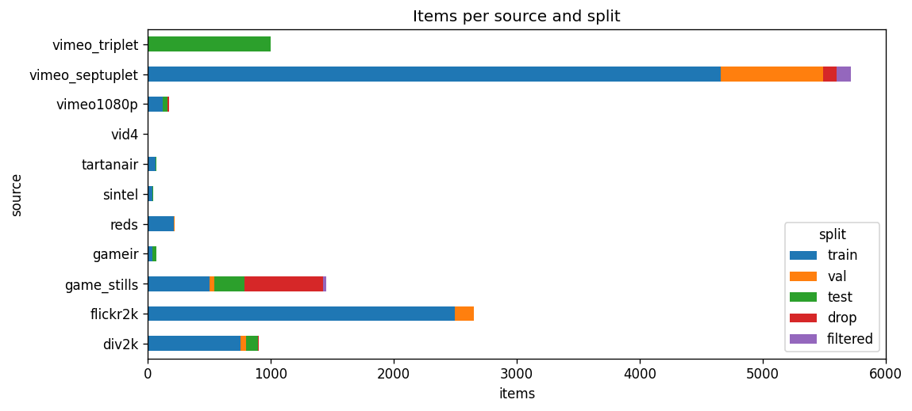

_Items per split and source after the audit._

**Section 16: audit statistics.** `leakage_audit.csv`; `leakage_violations.csv` has a header and no rows (no cross-split duplicate after round 2).

| Split | Reference | Max cosine (median) | Max verified cells (median) | Min pHash Hamming (median) |
| :---- | :-------- | :------------------ | :-------------------------- | :------------------------- |
| val   | train     | 0.9614 (0.5757)     | 9 (0)                       | 8 (16)                     |
| test  | train+val | 0.9570 (0.5745)     | 9 (0)                       | 0 (16)                     |

The pHash distance of 0 is not a duplicate under the rule (untextured keyframe or rejected by dHash).

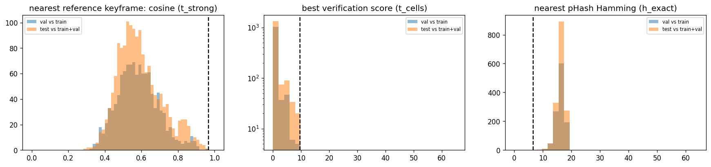

_Nearest-neighbour similarity of validation and test keyframes to the training split, against the thresholds._

**Sections 17 to 19: manifest, summary, packaging.** Writes `nss_data/nss_manifest.parquet` and `dataset_card.csv` (source, host, licence, counts per split), `summary.json`, and a 31-file `outputs.zip`. Stage times (`stage_times.csv`, minutes): discovery 1.66, Hugging Face 14.24, keyframe stats 11.95, filters 0.26, hashes 0.13, embeddings 0.36, SIFT 5.09, calibration 0.94, duplicate search 1.38, split and audit 1.34.

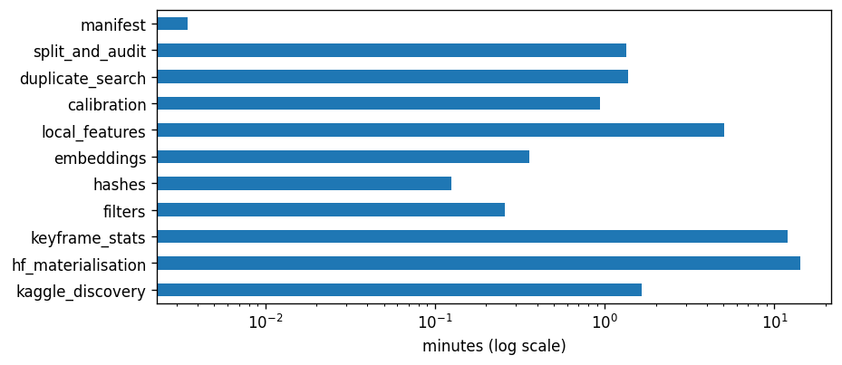

_Minutes per pipeline stage._

## Notebook 2: temporal super-resolution

Run of 2 to 3 November 2026 (PyTorch 2.11.0, CUDA 13.0, Python 3.13.16, 2 x Tesla T4, 4 CPU cores, 31.3 GB RAM; 7.46 hours; no failed runs). Outputs: [neural-supersampling/outputs/](neural-supersampling/outputs/); executed notebook: [neural-supersampling.executed.ipynb](neural-supersampling/outputs/neural-supersampling.executed.ipynb). The current notebook differs from the one that ran only in its budgets (section 12 below plans 170 / 190 / 110 / 30 minutes) and in cuDNN autotuning for the latency timing.

Every suite is evaluated in two modes. **Engine**: jittered render-like input with motion vectors and depth (exact on synthetic, TartanAir and Sintel; on video suites RAFT motion from the full-resolution frames, the protocol of earlier runs). **Plain**: the clip as ordinary video (bicubic downscale, no jitter, depth or motion vectors), so the built-in motion estimator supplies the motion.

**Sections 1 to 4: library, setup, hardware, configuration.** Writes the ten library modules and `train_tsr.py`; `lpips`, `flip-evaluator` and `onnxruntime` all installed. Main settings (`metrics/config.json`): 3x primary and 2x secondary scale, 192-px output patches, 6-frame sequences and a 16-frame 96-px synthetic sequence every fourth step, 40 percent real windows per batch, plain video in 30 percent of synthetic and 60 percent of real samples, learning rate 2e-3 (teacher 1e-3), loss weights gradient 0.1, Fourier 0.05, temporal 0.5, motion 0.1, LPIPS 0.05, distillation 0. Budgets: teacher 140 min, student 120, pair 75, ablations 20 per pair; caches 30 min.

**Section 5: manifest.** Loaded from the attached pipeline output; every source was reachable (`reachable_sources.json`).

**Section 6: item selection.** 4,123 texture and 5,120 sequence items for training, 252 and 850 for validation.

**Section 7: caches (26.2 min, 9.30 GB).** 256 validation and 6,191 training still crops (4 decode failures; the stills' share of the decoding budget ended before 6,500), 192 validation and 3,600 training windows. Training windows by source: Vimeo-90K 3,267, REDS 149, Vimeo-1080p 91, TartanAir 39, Sintel 28, GameIR 26; validation windows: Vimeo-90K 188, REDS 4 (`caches.json`).

**Section 8: cache inspection.** 1.9 percent of windows have exact motion and 98.1 percent RAFT motion; 1.8 percent have depth; mean motion 1.50 px per frame.


_Random 512x512 still crops used as textures by the synthetic renderer._

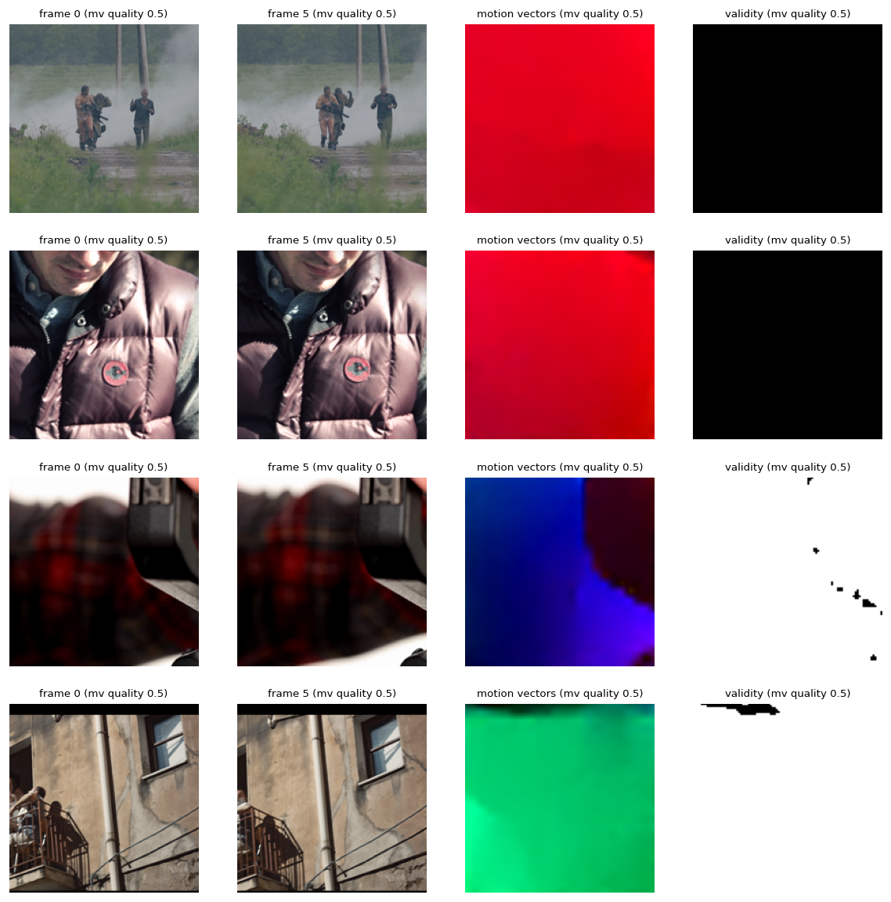

_Real windows: first and last frame, motion vectors (hue = direction, brightness = magnitude) and validity._

**Section 9: synthetic renderer preview.**

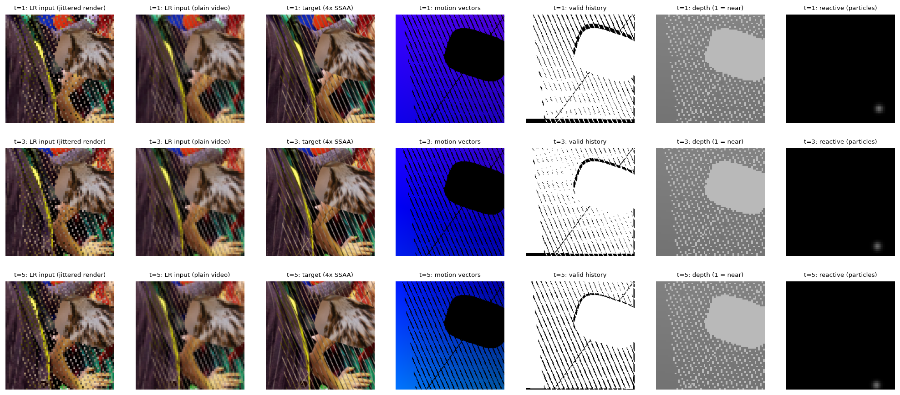

_One synthetic sequence at three time steps: aliased jittered input, anti-aliased target, exact motion vectors, valid history, depth and particle (reactive) mask._

**Section 10: model tiers.** RIFE 4.26 slices loaded into the `low` tier's motion estimator (11 exact, 42 sliced, 0 missing tensors). Measured with forward hooks (`model_tiers.csv`, motion estimator included); fused-versus-unfused parity 0.0 for every tier.

| Tier    | Scale | Train params | Fused params | GMAC per 1080p frame |
| :------ | ----: | -----------: | -----------: | -------------------: |
| igpu    |     3 |      144,564 |      137,844 |                 6.20 |
| igpu    |     2 |      138,544 |      132,784 |                11.34 |
| low     |     3 |      361,519 |      328,159 |                16.13 |
| low     |     2 |      352,499 |      320,579 |                30.70 |
| mid     |     3 |      727,647 |      653,343 |                28.10 |
| mid     |     2 |      715,627 |      643,243 |                56.32 |
| high    |     3 |    1,622,091 |    1,405,803 |                69.04 |
| high    |     2 |    1,604,071 |    1,390,663 |               144.99 |
| teacher |     3 |    3,942,295 |    3,395,095 |               156.09 |
| teacher |     2 |    3,918,275 |    3,374,915 |               337.38 |

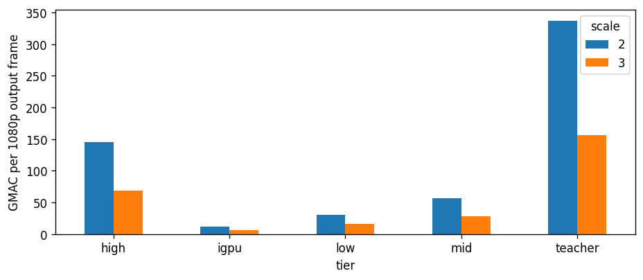

_GMAC per 1080p output frame for each tier at 3x and 2x._

**Section 11: batch probe (0.6 min).** Every size up to 48 fit with a finite loss at initialisation; 48 per GPU was chosen for all runs (`batch_probe.csv`).

| Batch | Teacher VRAM % | Teacher seq/s | Student VRAM % | Student seq/s |
| ----: | -------------: | ------------: | -------------: | ------------: |
|     4 |            5.0 |          10.6 |            2.4 |          13.6 |
|     8 |            8.6 |          19.1 |            3.9 |          24.1 |
|    12 |           12.2 |          24.0 |            5.5 |          30.8 |
|    16 |           15.8 |          27.0 |            7.0 |          34.8 |
|    24 |           23.3 |          29.7 |           10.1 |          39.8 |
|    32 |           30.3 |          31.0 |           13.2 |          42.5 |
|    48 |           45.1 |          31.5 |           19.5 |          43.1 |

**Section 12: launcher and budget.** 8.04 hours were available for training, so the budgets ran at full scale (scale 1.00).

**Sections 13 to 16: training.** Logs in `logs/<run>.log`, histories in `metrics/<run>_history.json` and `history_<run>.csv`, configs in `code/cfg_<run>.json`. No student was distilled. Ablations: `no_history` (single frame), `no_gbuffers` (colour-only render input, the estimator supplies motion), `no_motion_net` (colour only and no estimator), `no_video_training` (render samples only), `no_long_unroll` (no 16-frame steps).

| Stage             | Run                                           |        Steps | Train s      | Best validation PSNR-Y (round) |
| :---------------- | :-------------------------------------------- | -----------: | :----------- | :----------------------------- |
| A, both GPUs      | `tsr_teacher_s3`                              |        5,590 | 8,408        | 33.56 dB (17)                  |
| B, both GPUs      | `tsr_low_s3`                                  |        6,690 | 7,206        | 32.59 dB (14)                  |
| C, GPU 0 / GPU 1  | `tsr_igpu_s3`, `tsr_low_s2`                   | 4,970, 3,600 | 4,505, 4,511 | 31.65 (8), 36.46 (9)           |
| Ablations, pair 1 | `abl_reference`, `abl_no_history`             | 1,130, 1,330 | 1,204, 1,209 | 31.72 (5), 31.30 (5)           |
| Ablations, pair 2 | `abl_no_gbuffers`, `abl_no_motion_net`        | 1,130, 1,270 | 1,203, 1,204 | 31.31 (5), 31.15 (5)           |
| Ablations, pair 3 | `abl_no_video_training`, `abl_no_long_unroll` | 1,130, 1,110 | 1,206, 1,201 | 31.00 (5), 31.77 (5)           |

**Section 17: training curves.** The selection metric is the mean of validation PSNR-Y on a render copy and a plain-video copy of every validation batch (`best_validation.csv`):

| Run              |  Best | Render | Video | Last frame |    TCE | Samples/s | Peak memory (GB) |
| :--------------- | ----: | -----: | ----: | ---------: | -----: | --------: | ---------------: |
| `tsr_teacher_s3` | 33.56 |  33.50 | 33.61 |      33.83 | 0.0135 |      57.6 |             7.92 |
| `tsr_low_s3`     | 32.59 |  32.41 | 32.76 |      32.79 | 0.0148 |      80.4 |             4.19 |
| `tsr_igpu_s3`    | 31.65 |  31.27 | 32.02 |      31.82 | 0.0158 |      47.8 |             3.24 |
| `tsr_low_s2`     | 36.46 |  36.51 | 36.41 |      36.61 | 0.0110 |      34.6 |             5.73 |

Render-copy PSNR-Y per round: teacher 31.20 to 33.50 over 18 rounds (+0.03 dB over the last three), `low` 3x 30.87 to 32.41 over 15 (+0.03), `igpu` 30.60 to 31.27 over 10 (0.00), `low` 2x 34.81 to 36.51 over 10 (+0.07). The curves flatten as the cosine schedule ends, not because training has converged; the current notebook gives every run 30 to 60 percent more time. Each ablation validates on batches built with its own recipe, so ablation validation scores are not comparable; section 25 compares them on the test suites.

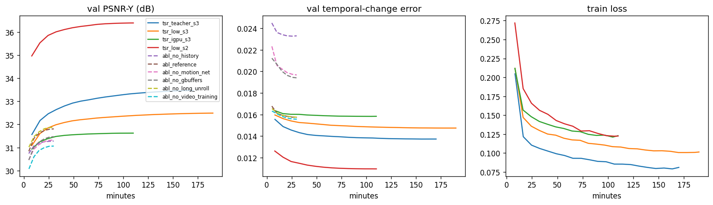

_Validation PSNR-Y, validation temporal-change error and train loss against minutes; dashed lines are ablations._

**Section 18: load and fuse.** Ten models loaded (teacher, three students, six ablations); fused FP32 parity 0.0 for every one.

**Section 19: test suites (2.5 min).** 24 synthetic test stills (6 per motion class), 8 TartanAir, 8 Sintel, 4 Vid4, 8 Vimeo-1080p and 4 GameIR native clips. Two blank Vimeo-1080p clips were skipped and replaced by the next clips of that source.

**Section 20: evaluation (18.5 min).** 23,480 per-frame metric rows (`test_per_frame.csv`): synthetic-game 5,760 engine and 5,040 plain, TartanAir, Sintel and Vimeo-1080p 1,920 and 1,680 each, Vid4 960 and 840, GameIR native 80.

**Section 21: results by suite and method** (`test_results.csv`, mean over frames after the first). Higher is better for PSNR and SSIM; lower is better for LPIPS, temporal-change error (TCE) and tOF. `bicubic` and `bilinear` sample at the true jittered positions in engine mode.

3x, engine mode:

| Suite          | Method        | PSNR-Y | SSIM-Y | PSNR disocc. | PSNR detail | LPIPS |    TCE |   tOF |
| :------------- | :------------ | -----: | -----: | -----------: | ----------: | ----: | -----: | ----: |
| synthetic-game | bilinear      |  29.80 |  0.833 |        34.47 |       23.87 | 0.273 | 0.0253 | 0.782 |
| synthetic-game | bicubic       |  29.50 |  0.832 |        34.08 |       23.53 | 0.288 | 0.0321 | 0.844 |
| synthetic-game | analytic_taau |  29.35 |  0.817 |        31.51 |       23.61 | 0.261 | 0.0110 | 0.790 |
| synthetic-game | igpu_s3       |  32.50 |  0.903 |        34.15 |       26.43 | 0.108 | 0.0127 | 0.612 |
| synthetic-game | student_s3    |  34.11 |  0.929 |        35.39 |       28.01 | 0.061 | 0.0111 | 0.538 |
| synthetic-game | teacher_s3    |  35.47 |  0.946 |        36.39 |       29.36 | 0.041 | 0.0093 | 0.392 |
| tartanair      | bilinear      |  31.52 |  0.890 |        30.85 |       24.64 | 0.216 | 0.0132 | 0.485 |
| tartanair      | bicubic       |  31.83 |  0.896 |        31.18 |       24.92 | 0.216 | 0.0149 | 0.486 |
| tartanair      | analytic_taau |  30.64 |  0.875 |        27.92 |       23.85 | 0.243 | 0.0104 | 0.415 |
| tartanair      | igpu_s3       |  32.95 |  0.920 |        29.78 |       26.07 | 0.107 | 0.0105 | 0.382 |
| tartanair      | student_s3    |  33.38 |  0.927 |        30.33 |       26.50 | 0.092 | 0.0103 | 0.393 |
| tartanair      | teacher_s3    |  33.79 |  0.933 |        30.64 |       26.95 | 0.074 | 0.0101 | 0.354 |
| sintel         | bilinear      |  32.55 |  0.874 |        30.49 |       26.61 | 0.269 | 0.0127 | 1.703 |
| sintel         | bicubic       |  32.82 |  0.881 |        30.84 |       26.86 | 0.275 | 0.0148 | 1.564 |
| sintel         | analytic_taau |  31.07 |  0.848 |        27.58 |       25.19 | 0.271 | 0.0092 | 1.519 |
| sintel         | igpu_s3       |  33.59 |  0.909 |        29.77 |       27.59 | 0.141 | 0.0093 | 1.317 |
| sintel         | student_s3    |  34.19 |  0.917 |        30.51 |       28.28 | 0.120 | 0.0088 | 1.648 |
| sintel         | teacher_s3    |  35.07 |  0.928 |        31.29 |       29.11 | 0.090 | 0.0082 | 1.390 |
| vid4           | bilinear      |  24.55 |  0.722 |        22.32 |       19.71 | 0.362 | 0.0368 | 0.397 |
| vid4           | bicubic       |  24.58 |  0.738 |        22.33 |       19.60 | 0.391 | 0.0433 | 0.398 |
| vid4           | analytic_taau |  23.96 |  0.679 |        20.53 |       19.29 | 0.382 | 0.0236 | 0.183 |
| vid4           | igpu_s3       |  26.65 |  0.839 |        22.20 |       21.47 | 0.154 | 0.0238 | 0.154 |
| vid4           | student_s3    |  27.32 |  0.866 |        22.39 |       22.03 | 0.116 | 0.0233 | 0.149 |
| vid4           | teacher_s3    |  28.15 |  0.886 |        23.36 |       22.86 | 0.086 | 0.0225 | 0.140 |
| vimeo1080p     | bilinear      |  34.80 |  0.899 |        40.65 |       28.19 | 0.189 | 0.0116 | 4.212 |
| vimeo1080p     | bicubic       |  35.21 |  0.902 |        41.50 |       28.67 | 0.191 | 0.0136 | 4.077 |
| vimeo1080p     | analytic_taau |  33.43 |  0.888 |        36.98 |       26.79 | 0.203 | 0.0076 | 6.128 |
| vimeo1080p     | igpu_s3       |  36.85 |  0.937 |        40.67 |       30.39 | 0.073 | 0.0076 | 2.715 |
| vimeo1080p     | student_s3    |  37.72 |  0.945 |        41.60 |       31.26 | 0.054 | 0.0073 | 3.683 |
| vimeo1080p     | teacher_s3    |  38.58 |  0.952 |        43.10 |       32.21 | 0.037 | 0.0068 | 2.757 |

3x, plain mode (ordinary video; no TAA baseline, which needs motion vectors):

| Suite          | Method     | PSNR-Y | SSIM-Y | PSNR disocc. | PSNR detail | LPIPS |    TCE |   tOF |
| :------------- | :--------- | -----: | -----: | -----------: | ----------: | ----: | -----: | ----: |
| synthetic-game | bilinear   |  30.36 |  0.826 |        35.22 |       24.79 | 0.256 | 0.0090 | 0.573 |
| synthetic-game | bicubic    |  31.23 |  0.850 |        35.95 |       25.60 | 0.260 | 0.0090 | 0.588 |
| synthetic-game | igpu_s3    |  32.51 |  0.885 |        36.85 |       26.93 | 0.104 | 0.0100 | 0.498 |
| synthetic-game | student_s3 |  33.34 |  0.902 |        37.68 |       27.74 | 0.083 | 0.0088 | 0.337 |
| synthetic-game | teacher_s3 |  34.11 |  0.916 |        38.42 |       28.57 | 0.065 | 0.0077 | 0.339 |
| tartanair      | bilinear   |  31.55 |  0.884 |        31.02 |       24.78 | 0.227 | 0.0107 | 0.379 |
| tartanair      | bicubic    |  32.34 |  0.897 |        31.77 |       25.49 | 0.227 | 0.0103 | 0.381 |
| tartanair      | igpu_s3    |  33.54 |  0.917 |        32.54 |       26.73 | 0.108 | 0.0106 | 0.444 |
| tartanair      | student_s3 |  33.97 |  0.923 |        32.93 |       27.18 | 0.089 | 0.0102 | 0.348 |
| tartanair      | teacher_s3 |  34.39 |  0.930 |        33.16 |       27.64 | 0.071 | 0.0099 | 0.315 |
| sintel         | bilinear   |  32.61 |  0.865 |        30.55 |       26.82 | 0.274 | 0.0084 | 1.316 |
| sintel         | bicubic    |  33.38 |  0.880 |        31.37 |       27.55 | 0.281 | 0.0081 | 1.354 |
| sintel         | igpu_s3    |  34.23 |  0.898 |        32.29 |       28.58 | 0.127 | 0.0094 | 1.325 |
| sintel         | student_s3 |  34.58 |  0.905 |        32.63 |       29.00 | 0.107 | 0.0090 | 1.154 |
| sintel         | teacher_s3 |  34.96 |  0.912 |        32.95 |       29.42 | 0.085 | 0.0087 | 1.014 |
| vid4           | bilinear   |  24.62 |  0.695 |        22.43 |       20.05 | 0.362 | 0.0229 | 0.151 |
| vid4           | bicubic    |  25.24 |  0.728 |        23.10 |       20.58 | 0.400 | 0.0222 | 0.145 |
| vid4           | igpu_s3    |  26.43 |  0.803 |        23.88 |       21.72 | 0.170 | 0.0229 | 0.137 |
| vid4           | student_s3 |  26.99 |  0.826 |        24.18 |       22.27 | 0.148 | 0.0218 | 0.130 |
| vid4           | teacher_s3 |  27.51 |  0.847 |        24.68 |       22.86 | 0.122 | 0.0213 | 0.123 |
| vimeo1080p     | bilinear   |  34.88 |  0.893 |        40.53 |       28.36 | 0.200 | 0.0062 | 3.409 |
| vimeo1080p     | bicubic    |  35.77 |  0.902 |        41.87 |       29.28 | 0.205 | 0.0059 | 3.652 |
| vimeo1080p     | igpu_s3    |  36.50 |  0.918 |        42.41 |       30.17 | 0.092 | 0.0063 | 3.170 |
| vimeo1080p     | student_s3 |  36.94 |  0.922 |        43.12 |       30.63 | 0.076 | 0.0060 | 2.947 |
| vimeo1080p     | teacher_s3 |  37.29 |  0.926 |        43.54 |       31.18 | 0.064 | 0.0057 | 1.721 |

Particle-region PSNR (synthetic-game, engine): bicubic 33.01, bilinear 33.13, analytic TAAU 29.64, `igpu` 33.76, student 35.06, teacher 37.04 dB. Warping error along exact motion (synthetic-game, engine): teacher 0.0111, student 0.0122, analytic TAAU 0.0092, bilinear 0.0268.

2x (`low` 2x student against baselines; GameIR native uses the engine's own 720p render as input and has no plain mode), PSNR-Y / LPIPS:

| Suite          | Mode   | Bilinear      | Bicubic       | Analytic TAAU | Student 2x    |
| :------------- | :----- | :------------ | :------------ | :------------ | :------------ |
| synthetic-game | engine | 33.35 / 0.108 | 33.41 / 0.126 | 30.85 / 0.193 | 38.17 / 0.024 |
| synthetic-game | plain  | 32.95 / 0.168 | 34.59 / 0.140 |               | 37.22 / 0.035 |
| tartanair      | engine | 33.98 / 0.121 | 34.71 / 0.115 | 31.44 / 0.212 | 35.47 / 0.061 |
| tartanair      | plain  | 33.66 / 0.166 | 34.86 / 0.136 |               | 36.64 / 0.051 |
| sintel         | engine | 35.45 / 0.142 | 36.37 / 0.139 | 31.70 / 0.220 | 37.50 / 0.068 |
| sintel         | plain  | 35.01 / 0.188 | 36.39 / 0.158 |               | 38.12 / 0.050 |
| vid4           | engine | 27.78 / 0.191 | 28.98 / 0.202 | 25.00 / 0.347 | 30.60 / 0.058 |
| vid4           | plain  | 27.07 / 0.261 | 28.59 / 0.242 |               | 30.94 / 0.066 |
| vimeo1080p     | engine | 37.78 / 0.106 | 38.79 / 0.103 | 34.47 / 0.173 | 41.49 / 0.022 |
| vimeo1080p     | plain  | 37.32 / 0.144 | 38.68 / 0.123 |               | 40.31 / 0.037 |
| gameir-native  | engine | 32.30 / 0.190 | 32.33 / 0.169 | 30.83 / 0.227 | 32.59 / 0.146 |

What the numbers say:

- **Ordinary video works.** In plain mode the 3x student beats bicubic on every suite by 1.17 (Vimeo-1080p) to 2.10 dB (synthetic) PSNR-Y at less than half its LPIPS, and wins 27 of the 28 real clips (from `test_per_frame.csv`; the exception is the Vimeo-1080p clip `Soft Fangs` at above 50 dB, bicubic 52.80 against 51.14). The 2x student leads bicubic by 1.6 to 2.6 dB in plain mode. The student's plain-mode TCE is within 0.0009 of bicubic's (lower on synthetic, TartanAir and Vid4, higher on Sintel and Vimeo-1080p).
- **Engine mode is close to the previous design.** Against the run of 24 October 2026 (old design, same protocol) the 3x student gained 0.17 (synthetic), 0.25 (TartanAir), 0.37 (Vid4) and 0.49 dB (Vimeo-1080p) and lost 0.30 dB on Sintel; the teacher moved by -0.33 (Sintel) to +0.19 dB (Vid4). The student beats the analytic TAA upscaler by 2.7 to 4.8 dB, with a temporal-change error 0.0001 to 0.0004 lower on TartanAir, Sintel, Vid4 and Vimeo-1080p and 0.0001 higher on synthetic scenes.
- **Plain gains are smaller than engine gains**, as expected: plain inputs carry no jitter, so there is no sub-pixel information to accumulate, and the teacher leads the student by only 0.35 to 0.78 dB there (0.4 to 1.4 dB in engine mode).
- The `igpu` student (137,844 fused parameters) is 0.35 to 0.83 dB behind the student in plain mode.

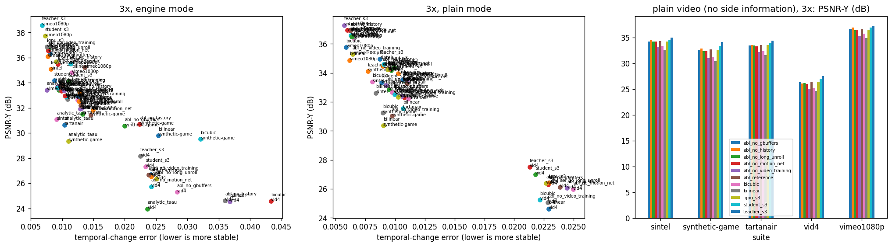

_PSNR-Y against temporal-change error per suite and method; top-left is sharp and stable._

**Section 22: motion classes and regions (synthetic-game, 3x).** Measured motion per class: static 0.0, slow 2.65, medium 10.44, fast 17.62 output px per frame. PSNR-Y (dB), engine / plain:

| Method        | Static        | Slow          | Medium        | Fast          |
| :------------ | :------------ | :------------ | :------------ | :------------ |
| bilinear      | 26.70 / 27.49 | 30.37 / 30.64 | 25.56 / 26.55 | 36.58 / 36.76 |
| bicubic       | 26.25 / 28.21 | 30.19 / 31.66 | 24.93 / 27.12 | 36.65 / 37.95 |
| analytic_taau | 27.68 /       | 29.40 /       | 25.48 /       | 34.85 /       |
| igpu_s3       | 31.27 / 28.58 | 32.58 / 33.87 | 27.43 / 28.31 | 38.72 / 39.30 |
| student_s3    | 32.98 / 28.88 | 34.72 / 35.12 | 28.50 / 29.06 | 40.25 / 40.28 |
| teacher_s3    | 34.48 / 29.33 | 36.43 / 35.90 | 29.49 / 29.85 | 41.51 / 41.37 |

Static content gains most from jittered engine input (the student leads the best baseline on static scenes by 5.3 dB in engine mode and by 0.7 dB in plain mode). The fast class scores higher than medium for every method, including bicubic, so the classes also differ in texture content; compare methods within a class.

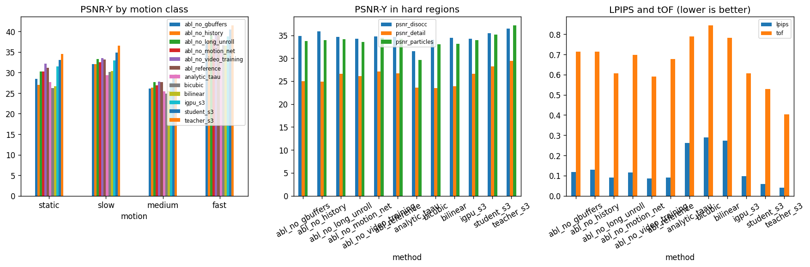

_PSNR-Y by motion class, PSNR-Y inside disocclusions, fine detail and particles, and LPIPS / tOF per method._

**Section 23: static-scene convergence** (`static_convergence.csv`, 16 frames, static camera with sub-pixel jitter, engine mode):

| Method             | Last-frame PSNR-Y (dB) | Last-frame FLIP |
| :----------------- | ---------------------: | --------------: |
| bilinear           |                  27.29 |          0.0679 |
| analytic_taau      |                  28.42 |          0.0621 |
| student_s3         |                  35.63 |          0.0259 |
| igpu_s3            |                  32.96 |          0.0346 |
| teacher_s3         |                  38.11 |          0.0205 |
| abl_reference      |                  32.14 |          0.0365 |
| abl_no_long_unroll |                  29.64 |          0.0454 |
| abl_no_history     |                  27.98 |          0.0572 |

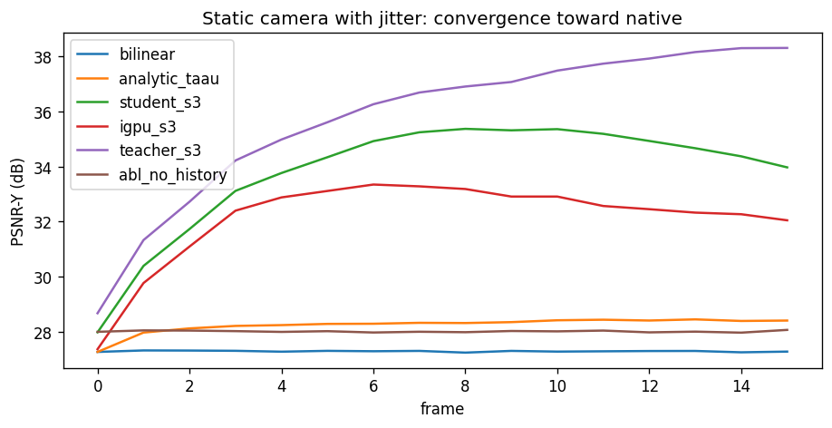

_PSNR-Y against frame index with a static camera. The teacher rises to about 38.2 dB by frame 13 and the student to about 35.8 dB by frame 13, both holding to frame 15; `igpu` levels at about 33.2 dB. The ablation without 16-frame unrolls peaks at frame 4 (31.6 dB) and falls to 29.6 dB, the decline the students showed on 24 October 2026; the 20-minute reference with them stays at about 32 dB._

The 16-frame unrolls fixed the static-scene decline: the student's last-frame PSNR-Y rose from 33.97 to 35.63 dB and its FLIP halved (0.052 to 0.026) against the run of 24 October 2026.

**Section 24: visual comparisons.** Full last frames per method are saved in `predictions/`.

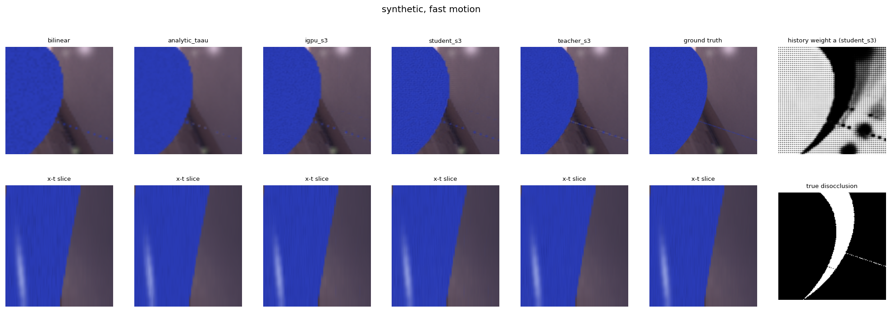

_Fast-motion synthetic sequence: last-frame crops per method, the student's history weight, x-t slices and the true disocclusion mask._

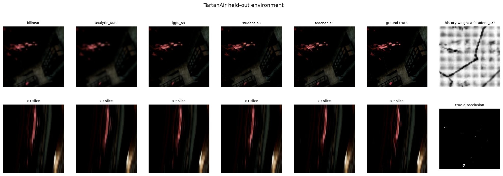

_TartanAir held-out environment: the networks recover window frames and railings that bilinear and analytic TAAU blur._

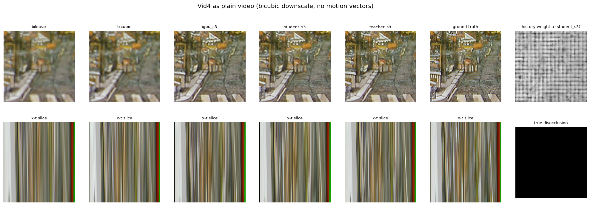

_Vid4 as plain video (bicubic downscale, no motion vectors): the networks restore the fence lattice and roof edges that bilinear and bicubic blur, with stable x-t slices. The student's history weight shows a regular grid at the 3x sub-pixel period._

| Prediction frame | Synthetic fast motion                                                                     | TartanAir                                                                            | Vid4, plain video                                                                     |
| :--------------- | :---------------------------------------------------------------------------------------- | :----------------------------------------------------------------------------------- | :------------------------------------------------------------------------------------ |
| Ground truth     | 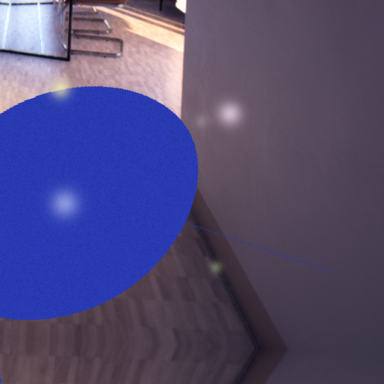    |     |     |
| Bilinear         |   | 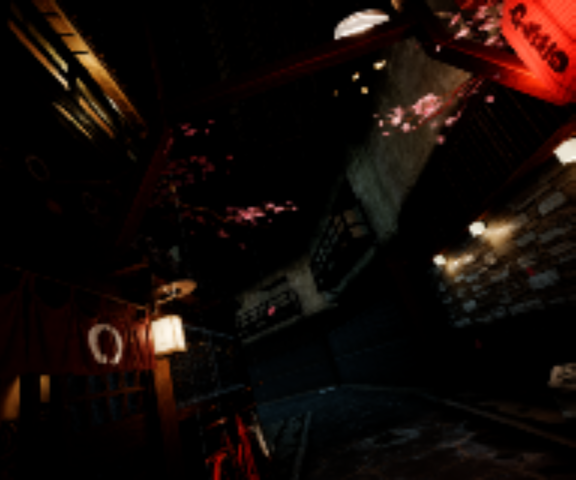  |   |
| Bicubic          | Not saved                                                                                 | Not saved                                                                            |     |
| Analytic TAAU    | 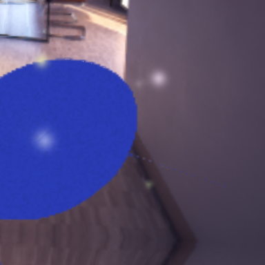 |  | Not applicable (needs motion vectors)                                                 |
| `igpu` 3x        | 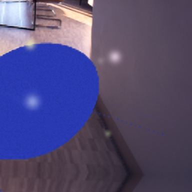       |        |        |
| `low` 3x student | 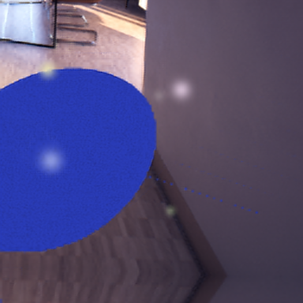 |  |  |
| 3x teacher       |  |  |  |

**Section 25: ablations** (`ablations.csv`, `low` 3x, 20 minutes each). PSNR-Y delta to `abl_reference` (reference: synthetic 32.31 engine / 32.66 plain, TartanAir 32.90 / 33.50, Vid4 26.54 / 26.38 dB):

| Ablation          | Synthetic engine | Synthetic plain | TartanAir engine | TartanAir plain | Vid4 engine | Vid4 plain |
| :---------------- | ---------------: | --------------: | ---------------: | --------------: | ----------: | ---------: |
| no G-buffers      |            -1.76 |           -0.04 |            -0.97 |           -0.03 |       -1.25 |      -0.07 |
| no history        |            -1.63 |           +0.20 |            -0.70 |           +0.04 |       -1.91 |      -0.33 |
| no long unroll    |            -0.34 |           -0.36 |            -0.08 |           -0.08 |       -0.20 |      -0.25 |
| no motion net     |            -0.89 |           -0.28 |            -0.21 |           -0.22 |       -0.80 |      -0.42 |
| no video training |            +0.30 |           -1.64 |            +0.06 |           -1.30 |       +0.16 |      -1.32 |

Plain-video training is what makes plain video work (1.3 to 1.6 dB) and costs at most 0.3 dB on render input. Without the motion estimator the model loses 0.2 to 0.4 dB on plain video. History is worth 0.7 to 1.9 dB with jittered input and little on plain video at this budget. The long unrolls add 0.1 to 0.4 dB on average and 2.5 dB at frame 16 of a static scene (section 23). Differences of about 0.2 dB are within the unmeasured run-to-run noise.

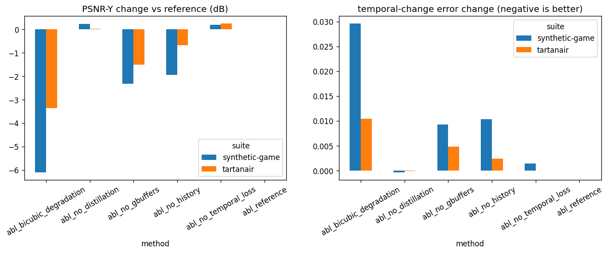

_PSNR-Y change and temporal-change error change against the reference per ablation, suite and mode._

**Section 26: latency** (`latency.csv`, fused FP16 step, batch 1, PyTorch eager on one T4, cuDNN default heuristics; `t4_mean_ms` runs the motion estimator (plain video), `t4_mean_ms_engine_mv` skips it; the estimate columns assume a sustained FP16 throughput and are not measurements):

| Model      | Scale | Output    | Plain, T4 mean (ms) | Plain, p95 (ms) | Engine MV, T4 mean (ms) |   GMAC | Estimate at 4 TFLOPS (ms) |
| :--------- | ----: | :-------- | ------------------: | --------------: | ----------------------: | -----: | ------------------------: |
| igpu_s3    |     3 | 1920x1080 |               17.00 |           17.77 |                   10.32 |   6.20 |                      3.10 |
| igpu_s3    |     3 | 3840x2160 |               64.22 |           65.13 |                   41.30 |  24.80 |                     12.40 |
| student_s3 |     3 | 1920x1080 |               27.57 |           28.10 |                   20.88 |  16.13 |                      8.06 |
| student_s3 |     3 | 3840x2160 |              106.74 |          107.53 |                   81.68 |  64.52 |                     32.26 |
| student_s2 |     2 | 1920x1080 |               43.08 |           43.62 |                   29.41 |  30.70 |                     15.35 |
| teacher_s3 |     3 | 1920x1080 |               58.26 |           59.04 |                   49.54 | 156.09 |                     78.04 |
| teacher_s3 |     3 | 3840x2160 |              227.23 |          228.45 |                  196.77 | 624.36 |                    312.18 |

With engine motion vectors the student takes 20.9 ms at 1080p, against 14.1 ms for the old design (cause not isolated; the output-resolution refinement is new); the motion estimator adds about 7 ms. The current notebook times with cuDNN autotuning.

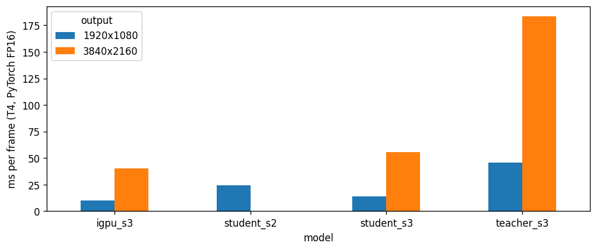

_Mean T4 milliseconds per frame for each model and output size._

**Section 27: ONNX export** (`onnx_export.json`, opset 17, static shapes): `student_s3` 1.475 MB, ONNX Runtime max difference 1.6e-5; `igpu_s3` 0.706 MB, 9.8e-6.

**Section 28: summary** (`summary.json`, `stage_times.csv`). Stage minutes: manifest 0.07, caches 26.15, batch probe 0.58, teacher 140.48, student 120.30, pair 75.33, ablations 60.75, test suites 2.48, evaluation 18.50.

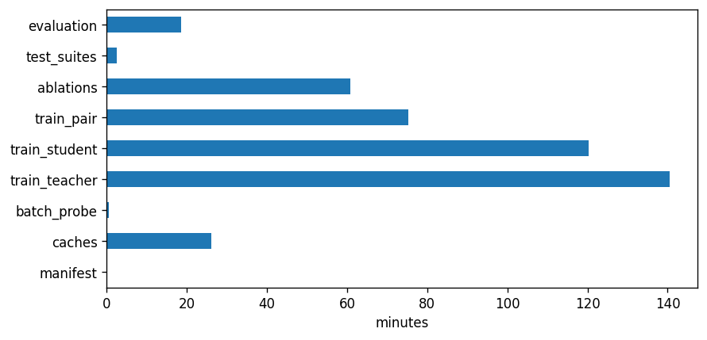

_Minutes per stage of the TSR run._

**Sections 29 and 30.** Deleted 9.30 GB of caches and zipped 133 files (0.12 GB) into `outputs.zip`.

## Notebook 3: frame generation

Run of 2 to 3 November 2026 (PyTorch 2.11.0, CUDA 13.0, Python 3.13.16, 2 x Tesla T4, 4 CPU cores, 31.3 GB RAM; 6.59 hours; no failed runs). Outputs: [neural-frame-generation/outputs/](neural-frame-generation/outputs/); executed notebook: [neural-frame-generation.executed.ipynb](neural-frame-generation/outputs/neural-frame-generation.executed.ipynb). The current notebook differs from the one that ran in the cut detector, the per-resolution flow scale of the tiers, the native-1080p suite, the budgets and cuDNN autotuning for latency ([Project status](#project-status)).

Every suite is evaluated with engine data (**engine**: motion vectors of I1, exact on TartanAir and Sintel, RAFT on video; depth and camera on synthetic suites) and without any (**plain**: ordinary video). Tiers: `igpu` and `low` (the main student, flow at half resolution in this run), `mid`, and `high`, which is RIFE 4.26's network fine-tuned (the run named `fg_teacher`). `rife_4.26` is the pre-trained RIFE 4.26 unchanged, from the two frames alone.

**Sections 1 to 4: library, setup, hardware, configuration.** All three optional packages installed. Settings (`metrics/config.json`): 256-px patches, 40 percent real quads, 40 percent extrapolation, random in-between times in half of synthetic interpolation samples, 3x multi-frame samples in a quarter of real interpolation samples, motion vectors withheld from 30 percent of synthetic and 50 percent of real samples, HUD in 50 percent, menus and cuts 3 percent, camera reversals 20 percent; learning rate 4e-4 (`high` 1e-4); loss weights census 0.5, LPIPS 0.1, flow 0.01, UI 0.2, distillation 0.5. Budgets: teacher 100, student 120, pair 75, ablations 20 min; caches 30 min.

**Sections 5 and 6: manifest and items.** Same manifest as the TSR run (all sources reachable). 4,083 texture and 5,080 quad items for training, 252 and 850 for validation. GameIR is not used (its frames are 10 rendered frames apart).

**Section 7: caches (26.3 min, 14.35 GB).** 256 validation and 6,000 training still crops (2 decode failures), 256 validation and 6,000 training quads, all with RAFT flows. Training quads: Vimeo-90K 5,494, REDS 252, Vimeo-1080p 141, TartanAir 70, Sintel 43; validation quads: Vimeo-90K 251, REDS 5.

**Section 8: synthetic preview.**

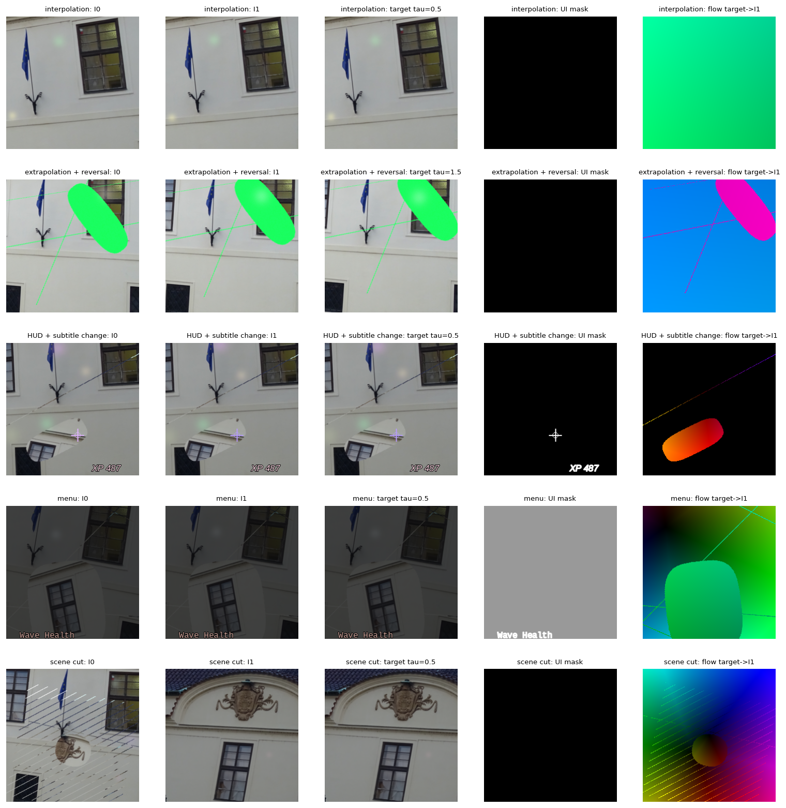

_Interpolation, extrapolation with a camera reversal, HUD with a subtitle change, a menu and a scene cut: I0, I1, target, UI mask and exact target-to-I1 flow._

**Section 9: model tiers** (`model_tiers.csv`, parity 0.0 for every tier). RIFE 4.26 loaded into the `high` tier with 153 exact and 5 sliced tensors (the five hint-extended inputs) and 0 missing.

| Tier             |    Params | Flow scale (this run) | GMAC per generated 1080p frame | Of which per-frame encoder |
| :--------------- | --------: | --------------------: | -----------------------------: | -------------------------: |
| igpu             |   454,320 |                   0.5 |                           9.40 |                       1.57 |
| low              |   952,988 |                   0.5 |                          12.71 |                       1.57 |
| mid              | 2,287,088 |                   1.0 |                          44.30 |                       6.29 |
| high (`teacher`) | 5,714,508 |                   1.0 |                          76.73 |                       6.29 |

**Section 10: batch probe (0.7 min).** Every size up to 64 fit; the teacher got 48 per GPU (64 used 85.3 percent of VRAM) and the student 64 (`batch_probe.csv`).

| Batch | Teacher VRAM % | Teacher samples/s | Student + teacher VRAM % | Student samples/s |
| ----: | -------------: | ----------------: | -----------------------: | ----------------: |
|     4 |            7.3 |              19.5 |                      5.9 |              25.6 |
|     8 |           12.4 |              27.7 |                     10.0 |              31.3 |
|    12 |           17.7 |              29.8 |                     14.3 |              33.2 |
|    16 |           22.8 |              30.5 |                     18.5 |              34.9 |
|    24 |           33.2 |              31.6 |                     26.8 |              36.0 |
|    32 |           43.7 |              32.2 |                     35.1 |              36.3 |
|    48 |           64.5 |              33.1 |                     51.9 |              36.8 |
|    64 |           85.3 |              33.3 |                     68.6 |              36.7 |

**Sections 11 to 15: training** (budgets at full scale, scale 1.00). The `low`, `igpu` and `mid` tiers were distilled from the fine-tuned `high` tier. Ablations (all `low` tier): `no_ui_training`, `no_motion_prior` (never any engine motion or camera), `extrap_only`, `no_distillation`, `no_inheritance` (random initialisation instead of RIFE slices).

| Stage             | Run                                         |        Steps | Train s      | Best validation PSNR (round) |
| :---------------- | :------------------------------------------ | -----------: | :----------- | :--------------------------- |
| A, both GPUs      | `fg_teacher` (`high`)                       |        4,490 | 6,012        | 30.81 dB (10)                |
| B, both GPUs      | `fg_low`                                    |        4,640 | 7,207        | 27.60 dB (14)                |
| C, GPU 0 / GPU 1  | `fg_igpu`, `fg_mid`                         | 2,920, 4,560 | 4,507, 4,507 | 26.60 (9), 29.98 (9)         |
| Ablations, pair 1 | `abl_reference`, `abl_no_ui_training`       |     770, 830 | 1,210, 1,213 | 26.08 (5), 26.57 (5)         |
| Ablations, pair 2 | `abl_no_motion_prior`, `abl_extrap_only`    |     770, 770 | 1,208, 1,209 | 25.92 (5), 24.95 (5)         |
| Ablations, pair 3 | `abl_no_distillation`, `abl_no_inheritance` |     910, 780 | 1,211, 1,215 | 25.89 (5), 25.54 (5)         |

**Section 16: training curves.** The selection metric is the mean of validation PSNR with the engine data drawn for each sample and without any (`best_validation.csv`):

| Run          |  Best | Engine | Plain | Interp | Extrap | UI region | Samples/s | Peak memory (GB) |
| :----------- | ----: | -----: | ----: | -----: | -----: | --------: | --------: | ---------------: |
| `fg_teacher` | 30.81 |  30.88 | 30.75 |  32.06 |  29.25 |     30.76 |      71.9 |             8.91 |
| `fg_low`     | 27.60 |  28.16 | 27.04 |  28.66 |  27.48 |     27.98 |      82.5 |             9.36 |
| `fg_mid`     | 29.98 |  30.06 | 29.90 |  30.84 |  28.99 |     31.87 |      32.5 |             5.67 |
| `fg_igpu`    | 26.60 |  27.28 | 25.92 |  27.64 |  26.79 |     27.14 |      41.5 |             9.25 |

Engine-copy PSNR per round: `high` 29.91 to 30.87 over 13 rounds, `low` 26.19 to 28.16 over 15 (still +0.06 dB over its last three rounds), `mid` 28.52 to 30.06 over 10, `igpu` 26.24 to 27.28 over 10. As for TSR, each ablation validates on its own recipe, so ablation validation scores are not comparable.

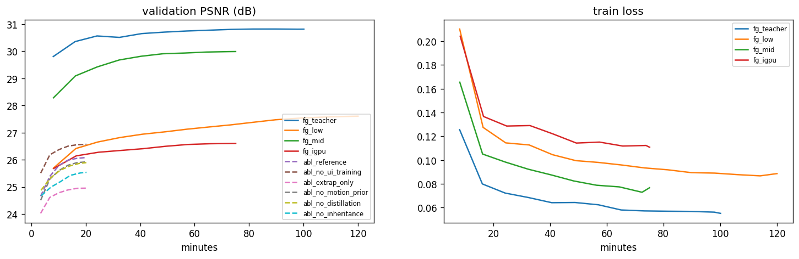

_Validation PSNR and train loss against minutes for every run._

**Section 17: load and fuse.** Ten models fused to FP16 (`high`, student, `igpu`, `mid`, six ablations).

**Section 18: cut detector** (`cut_detector.json`): threshold 0.1224 on the motion-compensated score for 1 percent false alarms on continuous synthetic pairs; detection rate 1.0. The same threshold was applied without motion vectors, where the score has no motion compensation; see section 20.

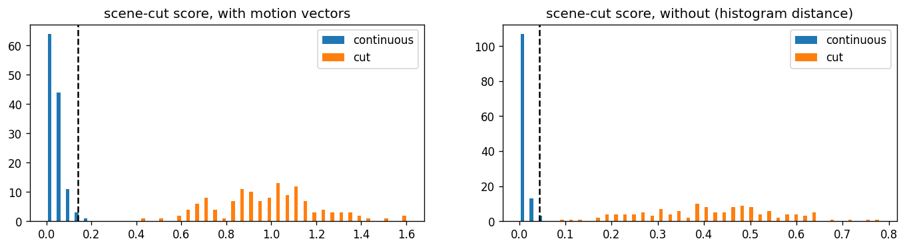

_Scene-cut score for continuous and cut pairs, with the chosen threshold._

**Section 19: test suites (1.4 min).** 48 synthetic test stills; 48 Vimeo-90K triplets, 10 TartanAir, 10 Sintel, 12 Vimeo-1080p and 4 Vid4 clips. Four Vimeo-1080p clips were skipped (blank, frozen or with a cut) and replaced by the next clips of that source.

**Section 20: evaluation (5.5 min).** 24,048 metric rows (`test_per_sample.csv`).

**Cut-gate defect.** Every network and RIFE output is replaced by the newest real frame when the cut detector fires. Without motion vectors its score was the raw frame difference plus the histogram distance, compared with the threshold calibrated on motion-compensated scores, so ordinary motion read as a cut. Counted post hoc from `test_per_sample.csv` (a gated output equals frame repeat; `.agent-local` script), gated samples per suite: plain-video Vimeo-90K triplet 17 of 48, TartanAir 6 of 10, Sintel 8 of 10, Vimeo-1080p 4 of 12, Vid4 4 of 4, synthetic 73 of 192, and 3x multi-frame 50 to 100 percent; with engine data 0 to 20 percent on real suites (Sintel 2 of 10) and 5 percent on synthetic. The real test clips contain no cuts (`E.test_clips` rejects them), so every gated real sample is a false alarm. The current notebook uses the histogram distance alone, with its own threshold, when there are no motion vectors.

**Section 21: results by suite, mode and method** (`test_results.csv`). PSNR in dB, as saved (gated). With engine data:

| Suite         | Mode   | Repeat | Average | MV reprojection | RIFE 4.26 | `igpu` | Student | `mid` | `high` |
| :------------ | :----- | -----: | ------: | --------------: | --------: | -----: | ------: | ----: | -----: |
| vimeo_triplet | interp |  23.06 |   26.03 |           31.83 |     34.59 |  32.19 |   32.63 | 34.08 |  34.72 |
| tartanair     | interp |  18.84 |   20.81 |           27.98 |     29.79 |  28.51 |   28.68 | 29.10 |  30.02 |
| tartanair     | extrap |  18.88 |   18.71 |           26.91 |     19.02 |  24.33 |   24.83 | 25.09 |  25.01 |
| sintel        | interp |  20.93 |   22.87 |           24.46 |     25.10 |  23.80 |   23.93 | 24.55 |  24.68 |
| sintel        | extrap |  20.95 |   20.50 |           23.29 |     21.00 |  22.63 |   22.42 | 22.70 |  22.80 |
| vid4          | interp |  20.69 |   24.09 |           27.35 |     28.21 |  26.52 |   26.66 | 28.27 |  29.12 |
| vid4          | extrap |  21.41 |   19.73 |           25.89 |     21.95 |  24.57 |   24.32 | 25.31 |  25.95 |
| vimeo1080p    | interp |  27.54 |   30.77 |           32.84 |     33.73 |  30.27 |   30.88 | 33.37 |  33.96 |
| vimeo1080p    | extrap |  29.46 |   26.79 |           30.72 |     27.23 |  30.45 |   29.52 | 32.11 |  32.11 |
| synthetic     | interp |  29.41 |   34.93 |           36.00 |     40.15 |  34.72 |   35.74 | 37.39 |  38.72 |
| synthetic     | extrap |  29.38 |   26.91 |           32.48 |     27.89 |  31.56 |   32.18 | 33.04 |  33.44 |

Plain video, on the samples the cut detector did not gate (post hoc from `test_per_sample.csv`; Vid4 has none left; the Sintel and TartanAir rows rest on 2 to 4 samples):

| Suite         | Mode   | Samples | Repeat | Average | RIFE 4.26 | `igpu` | Student | `mid` | `high` |
| :------------ | :----- | ------: | -----: | ------: | --------: | -----: | ------: | ----: | -----: |
| vimeo_triplet | interp |      31 |  25.28 |   28.46 |     36.25 |  29.87 |   31.74 | 35.80 |  36.47 |
| vimeo1080p    | interp |       8 |  32.06 |   35.00 |     37.67 |  32.41 |   32.67 | 37.50 |  38.24 |
| vimeo1080p    | extrap |       8 |  32.67 |   30.29 |     29.32 |  31.39 |   28.40 | 34.34 |  34.54 |
| vimeo1080p    | mfg3x  |      12 |  33.38 |   35.93 |     37.68 |  32.77 |   33.27 | 37.55 |  38.12 |
| tartanair     | interp |       4 |  21.67 |   23.47 |     32.21 |  24.12 |   26.23 | 31.21 |  32.73 |
| tartanair     | extrap |       4 |  21.85 |   21.64 |     22.01 |  22.01 |   24.46 | 27.41 |  27.47 |
| tartanair     | mfg3x  |       4 |  22.71 |   24.29 |     31.71 |  24.60 |   25.45 | 30.07 |  32.11 |
| sintel        | interp |       2 |  23.74 |   25.70 |     29.13 |  25.36 |   25.98 | 27.49 |  28.25 |
| sintel        | extrap |       2 |  24.32 |   23.36 |     24.25 |  24.41 |   24.67 | 26.04 |  26.35 |
| synthetic     | interp |     119 |  35.90 |   43.27 |     46.66 |  37.09 |   38.93 | 42.70 |  44.72 |
| synthetic     | extrap |     119 |  35.86 |   32.34 |     33.39 |  33.80 |   34.21 | 37.80 |  38.74 |

The saved plain-video means (`test_results.csv`, `summary.json`) mix these with gated samples: for example Vimeo-90K triplet RIFE 30.15, `high` 30.29, student 27.23 dB, and every method 20.69 dB on Vid4 interpolation.

What the numbers say:

- **The fine-tuned `high` tier is the best model.** It beats RIFE 4.26 on every plain-video interpolation suite with enough samples (+0.22 dB on Vimeo-90K triplet, +0.57 on Vimeo-1080p, +0.44 on 3x multi-frame Vimeo-1080p; on the 2 remaining Sintel samples it is 0.88 dB below) and extrapolates far better than RIFE, which cannot extrapolate (Vimeo-1080p 34.54 against 29.32 dB). On the independent Middlebury set it scores 34.30 dB against RIFE's 33.34 ([Project status](#project-status)). It loses to RIFE on synthetic interpolation (44.72 against 46.66 dB, mostly static scenes where its residual head adds error: 50.3 against 57.4 dB with engine data).
- **The `low` and `igpu` students do not work on ordinary video.** On Vimeo-90K triplet they are 4.5 and 6.4 dB below RIFE, and on Vimeo-1080p interpolation they score below frame averaging (32.67 and 32.41 against 35.00 dB). Their flow ran at half resolution on 256-pixel training crops; the current notebook removes that (section 22 of RESEARCH.md).
- **Engine motion vectors barely help interpolation**: with them `high` is -0.53 (Sintel) to +0.91 dB (Vid4) from RIFE on the ungated real samples, about what it gains without them; plain reprojection with exact motion vectors stays below RIFE on interpolation. For **extrapolation they matter**: with them `high` is 1.8 to 6.0 dB above RIFE, and plain reprojection with exact engine motion is still best on TartanAir (26.91 against 25.01 dB) and Sintel (23.29 against 22.80).

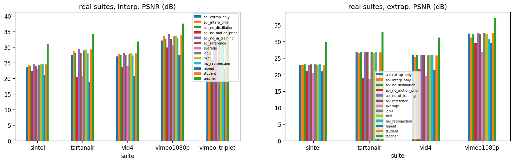

_PSNR per method on the real suites for interpolation, extrapolation and 3x multi-frame generation, with and without engine data (as saved, so the plain panels include the gated samples)._

**Section 22: motion, UI, menus, cuts and reversals.** Measured motion between real frames per synthetic class: static 0.0, slow 1.65, medium 5.53, fast 13.79 px. Synthetic PSNR by motion class with engine data (dB, as saved):

| Mode   | Method          | Static |  Slow | Medium |  Fast |
| :----- | :-------------- | -----: | ----: | -----: | ----: |
| interp | repeat          |  46.23 | 28.45 |  22.88 | 20.07 |
| interp | MV reprojection |  52.32 | 34.44 |  30.54 | 26.69 |
| interp | RIFE 4.26       |  57.35 | 37.54 |  35.95 | 29.78 |
| interp | `igpu`          |  45.39 | 35.69 |  31.57 | 26.22 |
| interp | student         |  48.26 | 36.36 |  31.98 | 26.38 |
| interp | `mid`           |  47.77 | 38.95 |  34.75 | 28.08 |
| interp | `high`          |  50.30 | 39.60 |  35.55 | 29.43 |
| extrap | repeat          |  46.23 | 28.41 |  22.89 | 19.99 |
| extrap | MV reprojection |  42.92 | 32.73 |  29.13 | 25.14 |
| extrap | RIFE 4.26       |  40.27 | 28.40 |  22.99 | 19.89 |
| extrap | `igpu`          |  41.72 | 32.38 |  28.36 | 23.80 |
| extrap | student         |  43.40 | 32.77 |  28.58 | 23.97 |
| extrap | `mid`           |  43.24 | 34.26 |  30.28 | 24.39 |
| extrap | `high`          |  44.22 | 34.66 |  30.31 | 24.56 |

UI suite with engine data (`ui_results.csv`; ghosting = share of UI pixels off by more than 10 percent):

| Mode   | Method           |  PSNR | UI PSNR | UI ghosting rate |
| :----- | :--------------- | ----: | ------: | ---------------: |
| interp | repeat           | 26.39 |   47.86 |            0.026 |
| interp | average          | 26.12 |   31.67 |            0.300 |
| interp | MV reprojection  | 25.48 |   16.66 |            0.302 |
| interp | RIFE 4.26        | 28.10 |   24.96 |            0.180 |
| interp | `igpu`           | 29.65 |   30.09 |            0.091 |
| interp | student          | 29.93 |   31.37 |            0.078 |
| interp | `mid`            | 32.28 |   34.41 |            0.052 |
| interp | `high`           | 32.58 |   33.36 |            0.049 |
| interp | student+ui_layer | 31.57 |   51.40 |            0.012 |
| interp | `igpu`+ui_layer  | 31.14 |   51.12 |            0.012 |
| extrap | repeat           | 26.96 |   46.69 |            0.020 |
| extrap | MV reprojection  | 24.37 |   18.50 |            0.363 |
| extrap | RIFE 4.26        | 26.23 |   32.54 |            0.047 |
| extrap | student          | 28.67 |   31.80 |            0.083 |
| extrap | `high`           | 30.02 |   33.69 |            0.052 |
| extrap | student+ui_layer | 29.80 |   48.29 |            0.014 |

The learned UI mask cuts ghosting from 0.18 (RIFE) and 0.30 (reprojection) to 0.05 to 0.09; with the engine's separate UI layer it is 0.012, below frame repeat. The student's interpolation ghosting is higher than the old design's 0.046.

Menus (engine, interpolation): student 35.42 dB, with the UI layer 40.95, `high` 35.31, `mid` 37.29, RIFE 33.72, repeat 34.82, MV reprojection 26.69. Cuts: every gated method outputs the newest real frame (PSNR capped at 100 dB), against 26.87 (interpolation) and 26.20 (extrapolation) for MV reprojection and about 15.0 for averaging.

Camera reversal (extrapolation, engine), without / with the late-latched camera prior: student 25.05 / 26.10 dB, `igpu` 24.93 / 25.99, `mid` 25.95 / 26.77, `high` 26.30 / 26.85; frame repeat 25.91, RIFE 25.85, MV reprojection 24.71. **The camera prior now works** (+0.55 to +1.06 dB; it made no difference in the old design), and with it every tier beats frame repeat (25.91 dB) on this suite.

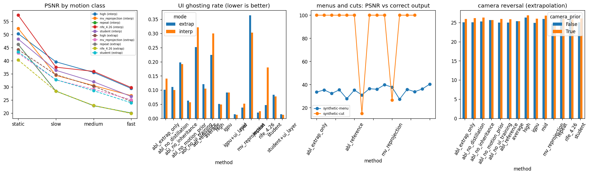

_PSNR by motion class, UI ghosting rate per method, menu and cut correctness, and camera reversal with and without the camera prior._

**Section 23: temporal consistency of the displayed sequence** (`temporal_consistency.csv`, tOF in px, lower is better; networks without engine data and without the cut gate; per clip in `temporal_consistency_per_clip.csv`):

| Suite         | Average | MV reprojection | RIFE 4.26 | `igpu` | Student | `mid` | `high` |
| :------------ | ------: | --------------: | --------: | -----: | ------: | ----: | -----: |
| tartanair     |   8.282 |           0.750 |     0.672 |  8.096 |   6.589 | 2.076 |  0.743 |
| vimeo1080p    |   6.369 |          11.477 |     8.738 | 10.417 |  10.245 | 9.620 |  9.927 |
| vimeo_triplet |   1.774 |           0.306 |     0.284 |  1.664 |   1.335 | 0.386 |  0.339 |

RIFE is the most consistent on TartanAir and Vimeo-90K triplet, with `high` close behind; the `low` and `igpu` students are closer to frame averaging than to RIFE, consistent with their image scores. On Vimeo-1080p frame averaging again has the lowest tOF.

**Section 24: visual comparisons.**

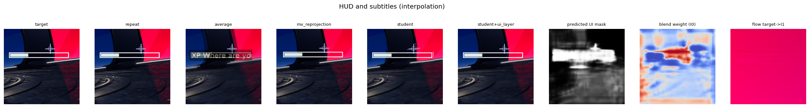

_HUD and subtitles (interpolation): averaging and RIFE 4.26 blend the subtitle plate of one real frame into the result, and reprojection drags the HUD bars. The student's predicted UI mask covers both HUD bars and the crosshair, so they are copied from the newest real frame, with or without engine data._

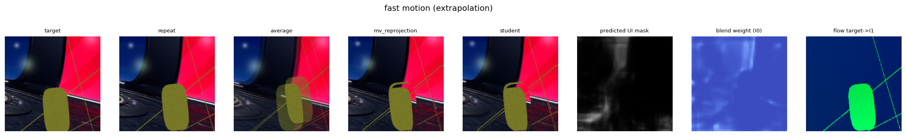

_Fast-motion extrapolation: target, baselines, RIFE 4.26 (never trained to extrapolate), the student with and without engine data, its UI mask, blend weight and flow. Reprojection leaves an outline of the moving object at its upper edge; the student moves the object close to its target position._

Full-size frames of both samples, saved in `predictions/`:

| Prediction frame        | HUD and subtitles (interpolation)                                                                  | Fast extrapolation                                                                                     |
| :---------------------- | :------------------------------------------------------------------------------------------------- | :----------------------------------------------------------------------------------------------------- |
| Target                  |                         | 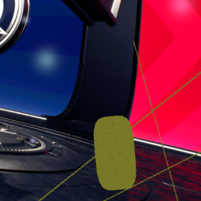                        |
| Repeat                  |                         |                         |
| Average                 |                       | 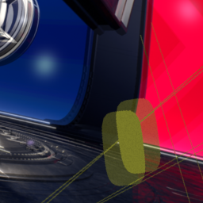                      |
| MV reprojection         |                    | 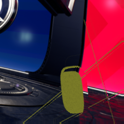                   |
| RIFE 4.26               | 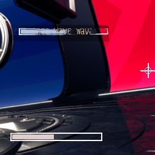                       | 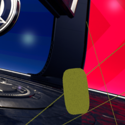                       |
| Student                 |                       | 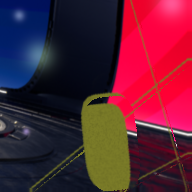                      |
| Student, no engine data | 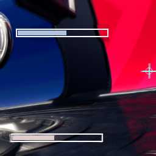 | 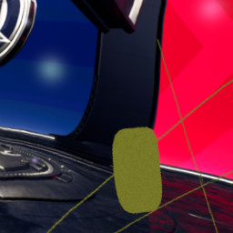 |
| Student + UI layer      |           | Not applicable (no UI in this sample)                                                                  |

**Section 25: ablations** (`ablations.csv`, `low` tier, 20 minutes each, as saved). PSNR in dB and UI ghosting rate:

| Ablation        | Vimeo-90K triplet interp, engine | Vimeo-90K triplet interp, plain | TartanAir interp, engine | TartanAir extrap, engine | Synthetic interp, engine | Synthetic extrap, engine | UI ghosting, interp, engine |
| :-------------- | -------------------------------: | ------------------------------: | -----------------------: | -----------------------: | -----------------------: | -----------------------: | --------------------------: |
| reference       |                            31.08 |                           25.53 |                    26.81 |                    22.94 |                    33.02 |                    30.51 |                       0.105 |
| no UI training  |                            32.01 |                           26.37 |                    27.69 |                    23.89 |                    35.25 |                    31.87 |                       0.321 |
| no motion prior |                            27.59 |                           26.12 |                    21.02 |                    19.22 |                    31.01 |                    27.79 |                       0.057 |
| extrap only     |                            22.17 |                           22.09 |                    19.14 |                    23.90 |                    23.30 |                    31.15 |                       0.141 |
| no distillation |                            31.10 |                           25.25 |                    26.70 |                    21.63 |                    32.68 |                    29.99 |                       0.100 |
| no inheritance  |                            30.60 |                           24.43 |                    27.08 |                    23.94 |                    33.62 |                    31.55 |                       0.191 |

At 20 minutes every ablation is far below RIFE, so these runs mostly show early-training effects. Engine motion priors are worth 3.5 to 5.8 dB with engine data on real suites. UI training costs 0.8 to 2.2 dB on scenes without UI and is what keeps ghosting low (0.105 against 0.321). Distillation adds 0.5 to 1.3 dB on extrapolation. Random initialisation is no worse than RIFE slices on several suites, so the slices give the narrow tiers little head start. The extrapolation-only model extrapolates 1.0 dB better on TartanAir than the shared one.

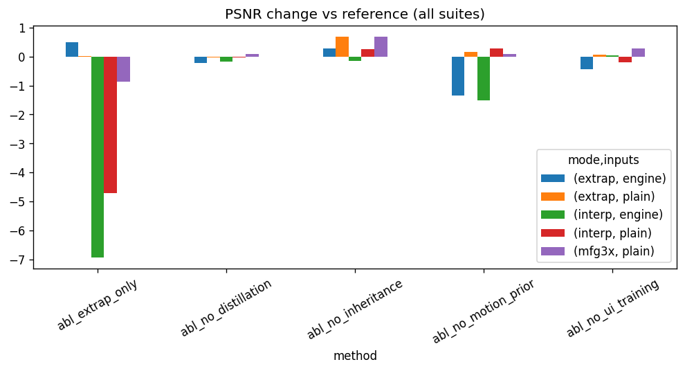

_PSNR change against the reference per ablation, mode and input mode, all suites._

**Section 26: latency and pacing model** (`latency.csv`, `pacing_model.csv`). T4 eager PyTorch, fused FP16, batch 1, every engine input present, cuDNN default heuristics:

| Model   | Output    | T4 mean (ms) | T4 p95 (ms) |   GMAC | Estimate at 4 TFLOPS (ms) |
| :------ | :-------- | -----------: | ----------: | -----: | ------------------------: |
| igpu    | 1920x1080 |        46.16 |       46.65 |   9.40 |                      4.70 |
| igpu    | 2560x1440 |        80.91 |       81.44 |  16.71 |                      8.36 |
| student | 1920x1080 |        47.53 |       48.09 |  12.71 |                      6.36 |
| student | 2560x1440 |        83.82 |       84.87 |  22.60 |                     11.30 |
| mid     | 1920x1080 |       104.62 |      105.20 |  44.30 |                     22.15 |
| mid     | 2560x1440 |       188.42 |      190.72 |  78.76 |                     39.38 |
| high    | 1920x1080 |       114.88 |      115.93 |  76.73 |                     38.37 |
| high    | 2560x1440 |       206.55 |      208.22 | 136.41 |                     68.20 |

The pacing model (`nss_metrics.simulate_latency`) is driven by the measured 47.53 ms student time:

| Base render (ms) | Mode        | Displayed fps | Game latency (ms) | Camera latency (ms) | Content age (ms) |
| ---------------: | :---------- | ------------: | ----------------: | ------------------: | ---------------: |
|             33.3 | native      |         30.01 |             38.33 |               38.33 |            38.33 |
|             33.3 | interp      |         24.74 |            126.29 |               85.86 |           106.08 |
|             33.3 | extrap      |         24.74 |             38.33 |               58.55 |            58.55 |
|             33.3 | extrap_late |         24.74 |             38.33 |               43.43 |            58.55 |
|             25.0 | native      |         39.97 |             30.02 |               30.02 |            30.02 |
|             25.0 | interp      |         27.57 |            113.83 |               77.55 |            95.69 |
|             25.0 | extrap      |         27.57 |             30.02 |               48.16 |            48.16 |
|             25.0 | extrap_late |         27.57 |             30.02 |               39.28 |            48.16 |
|             16.7 | native      |         59.84 |             21.72 |               21.72 |            21.72 |
|             16.7 | interp      |         31.13 |            101.37 |               69.24 |            85.31 |
|             16.7 | extrap      |         31.13 |             21.72 |               37.78 |            37.78 |
|             16.7 | extrap_late |         31.13 |             21.72 |               35.12 |            37.78 |

At 47.5 ms per generated frame on the same T4 that renders, frame generation lowers the displayed rate (30 to 24.7 fps) instead of raising it. The eager PyTorch time is 7.5 times the arithmetic estimate and about 3 times the old design's 16.1 ms; in-engine latency on target GPUs is `Not measured in the current repository.` The current notebook times with cuDNN autotuning.

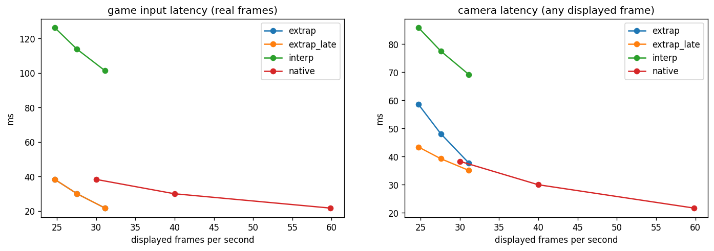

_Displayed frame rate against game input latency (left) and camera latency (right) for each mode and base render time._

**Section 27: ONNX export** (`onnx_export.json`): student 3.992 MB, ONNX Runtime max difference 8.7e-6; `igpu` 1.991 MB, 7.7e-6.

**Section 28: summary** (`summary.json`, `stage_times.csv`). Stage minutes: manifest 0.05, caches 26.32, batch probe 0.71, teacher 100.57, student 120.31, pair 75.26, ablations 61.01, test suites 1.40, evaluation 5.49. `summary.json` holds the gated plain-video means.

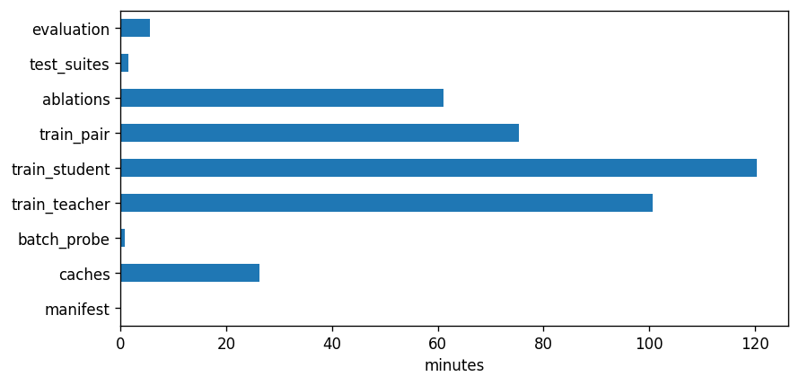

_Minutes per stage of the FG run._

**Sections 29 and 30.** Deleted the caches and zipped 130 files (0.23 GB) into `outputs.zip`.

## Weights and exported models

These are the weights of the runs of 2 to 3 November 2026. They load into the current `nss_models` networks: the FG change since then only sets at run time at what resolution each tier estimates flow (so the old `low` and `igpu` weights, trained with half-resolution flow, now run full-resolution flow below 576 lines and are no better there: 28.13 and 28.45 dB on Middlebury).

Each training run saved three PyTorch checkpoints in its notebook's `outputs/weights/`: `<run>_best.pt` (EMA weights of the best validation round, key `ema`), `<run>_last.pt` (model and EMA weights of the last round) and `<run>_fused.pt` (RepConv folded into plain convolutions, FP16). They are research weights trained on research-use data (see [RESEARCH.md](RESEARCH.md) section 16).

| File                                                             | Size (best / last / fused)     | Purpose                                                          |
| :--------------------------------------------------------------- | :----------------------------- | :--------------------------------------------------------------- |
| `neural-supersampling/outputs/weights/tsr_low_s3_*.pt`           | 1,457 / 2,911 / 672 KB         | Main 3x TSR student                                              |
| `neural-supersampling/outputs/weights/tsr_igpu_s3_*.pt`          | 596 / 1,189 / 292 KB           | Integrated-GPU 3x TSR student                                    |
| `neural-supersampling/outputs/weights/tsr_low_s2_*.pt`           | 1,421 / 2,840 / 658 KB         | 2x TSR student                                                   |
| `neural-supersampling/outputs/weights/tsr_teacher_s3_*.pt`       | 15,476 / 30,950 / 6,683 KB     | 3x TSR teacher (quality ceiling, no distillation)                |
| `neural-supersampling/outputs/weights/abl_*`                     | about 1,457 / 2,912 / 674 KB   | Six TSR ablation runs (`abl_no_motion_net` 545 / 1,087 / 208 KB) |
| `neural-supersampling/outputs/weights/tsr_student_s3_fused.onnx` | 1,440 KB                       | ONNX, one recurrent step of the 3x student                       |
| `neural-supersampling/outputs/weights/tsr_igpu_s3_fused.onnx`    | 690 KB                         | ONNX, one recurrent step of the `igpu` student                   |
| `neural-frame-generation/outputs/weights/fg_teacher_*.pt`        | 22,389 / 44,775 / 11,226 KB    | `high` tier: RIFE 4.26 fine-tuned, the best FG model, deployable |
| `neural-frame-generation/outputs/weights/fg_mid_*.pt`            | 8,988 / 17,973 / 4,518 KB      | `mid` FG tier                                                    |
| `neural-frame-generation/outputs/weights/fg_low_*.pt`            | 3,766 / 7,529 / 1,902 KB       | Main FG student (does not work on ordinary video, see above)     |
| `neural-frame-generation/outputs/weights/fg_igpu_*.pt`           | 1,812 / 3,621 / 922 KB         | Integrated-GPU FG tier (same limitation)                         |
| `neural-frame-generation/outputs/weights/abl_*`                  | about 3,767 / 7,532 / 1,903 KB | Six FG ablation runs                                             |
| `neural-frame-generation/outputs/weights/fg_student_fused.onnx`  | 3,898 KB                       | ONNX, FG student, 128x128 input                                  |
| `neural-frame-generation/outputs/weights/fg_igpu_fused.onnx`     | 1,944 KB                       | ONNX, FG `igpu`, 128x128 input                                   |

The ONNX files use static shapes; re-export at the target resolution with `nss_models.export_onnx` for deployment.

## Known limitations

A full list with reasons is in [RESEARCH.md](RESEARCH.md) section 15. The most important ones:

- **The changes of 3 November 2026 made after the last runs are unmeasured** (cut detector, per-resolution FG flow, longer budgets, cuDNN timing); every quality expectation for them is a hypothesis until the next Kaggle run. Whether the `low` and `igpu` FG tiers recover with full-resolution flow in training, or are limited by capacity, is the main open question.
- **The FG students do not work on ordinary video yet.** `low` and `igpu` scored at or below frame averaging on Vimeo-1080p and Middlebury; only `mid` (44 GMAC per 1080p frame) and `high` (77 GMAC) match or beat RIFE 4.26.
- **Saved FG plain-video means are distorted** by the cut-gate defect; use the ungated tables above, which rest on few samples for Sintel and TartanAir and none for Vid4.
- **FG is too slow on a T4 in eager PyTorch** (47.5 ms per 1080p frame for the student), so the pacing model shows frame generation lowering the displayed rate; TSR takes 27.6 ms (20.9 ms with engine motion vectors). T4 latencies are eager timings; in-engine latency on target GPUs is `Not measured in the current repository.`
- **Engine motion vectors add little to FG interpolation**; they help extrapolation, where plain reprojection with exact motion vectors is still best on TartanAir and Sintel.
- **Each configuration ran once**, so run-to-run variance is `Not measured in the current repository.`; differences of a few tenths of a dB between runs or ablations may be noise.
- **Real training data is mostly Vimeo-90K** (about 91 percent of real training windows and quads), and only about 2 percent of TSR windows have exact motion.
- **No comparison with FSR, DLSS or XeSS** yet; it needs engine captures, and DLSS needs RTX hardware.

## Troubleshooting

| Problem                                                                     | Likely cause                                                          | Diagnostic                                                                        | Resolution                                                                                                |
| :-------------------------------------------------------------------------- | :-------------------------------------------------------------------- | :-------------------------------------------------------------------------------- | :-------------------------------------------------------------------------------------------------------- |
| `build_notebooks.py --check` lists a stale notebook                         | A file in `src/neuralss/` or `notebooks/` changed without a rebuild   | `.venv\Scripts\python tools\build_notebooks.py --check`                           | Run `tools\build_notebooks.py`; copy an executed notebook to `outputs/` first if its outputs must be kept |
| A training run is listed in `metrics/failed_runs.json`                      | Out of memory twice, a non-finite loss for 200 steps, or a crash      | Read `outputs/logs/<run>.log` (and `<run>.oom.log` after an out-of-memory retry)  | Lower the batch, check the loss terms; later stages continue without that run                             |
| A run is killed past its budget                                             | Hung data-loader worker or NCCL collective                            | The run log ends with a timeout line from the watchdog                            | Re-run; reduce `workers_per_rank` in `run_cfg` if it repeats                                              |
| The Kaggle session ends before the zip cell                                 | Caches or evaluation took far longer than planned                     | Stage lines (`done: <stage> in <n> min (run total <h> h)`) in `logs/notebook.log` | Lower `RUN_BUDGET_H` in the configuration cell; stage budgets scale down with it                          |
| `evaluation <suite> / <method> skipped` in the notebook log                 | That method failed on that suite (for example out of memory)          | `outputs/logs/notebook.log`                                                       | Other methods and suites still run; the skipped rows are missing from the per-sample CSV                  |
| Many real FG samples equal frame repeat                                     | The cut detector fires on them (false alarms on real clips)           | `metrics/cut_gate_rates.csv` (current notebook)                                   | Real test clips have no cuts, so the share should be near 0; check the thresholds in `cut_detector.json`  |
| `<source> <item>: skipped (blank)` (or `frozen`, `cut`) in the notebook log | The test clip cannot measure the method (see `nss_eval.clip_defects`) | `outputs/logs/notebook.log`                                                       | Expected; the suite loads the next clip of that source (at most 4 n clips are tried)                      |
| Sources left out after the manifest cell                                    | Their Kaggle dataset is not attached or did not mount                 | `metrics/reachable_sources.json`                                                  | Attach the dataset and run again                                                                          |
| `ImportError: nbformat` locally                                             | Local tooling not installed                                           | `.venv\Scripts\python -c "import nbformat"`                                       | `.venv\Scripts\python -m pip install nbformat --cache-dir .cache\pip`                                     |

## Licence

The repository has no licence file, so no licence is granted for the code. Dataset and dependency licences, and the policy that released weights must be retrained on permissively licensed data, are in [RESEARCH.md](RESEARCH.md) section 16.

## Documentation

| File                       | Read when                                                                                                                                                                                                                |
| :------------------------- | :----------------------------------------------------------------------------------------------------------------------------------------------------------------------------------------------------------------------- |
| [RESEARCH.md](RESEARCH.md) | Design rationale, competitive analysis, datasets and licences, measured results of every run, limitations, the redesign of 3 November 2026 (section 21) and the analysis of its runs with the changes since (section 22) |
