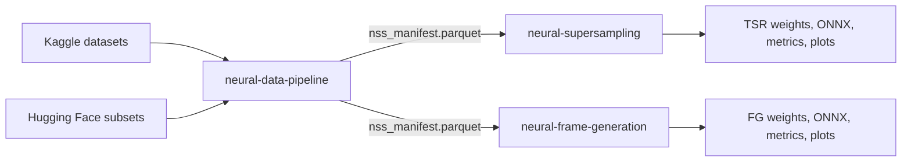
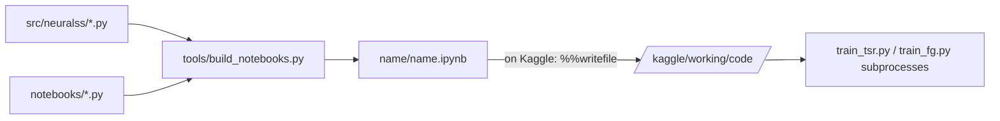

# NeuralSS: neural super-sampling and frame generation for games

NeuralSS is a research project for open, hardware-agnostic neural reconstruction in games. It has two networks:

- **Temporal super-resolution (TSR):** a small recurrent network that turns jittered low-resolution game frames (3x and 2x, for example 640x360 to 1920x1080) into full-resolution frames, using motion vectors, depth and its own history.
- **Frame generation (FG):** a small network that creates an in-between frame (interpolation) or a future frame (extrapolation) from two real frames, copies HUD and subtitles from the newest real frame instead of blending them, and skips generation on scene cuts.

Both networks fold into plain 3x3 convolution chains and export to ONNX. Everything is trained and evaluated in three Kaggle notebooks (GPU T4 x2) built from one shared Python library. All three notebooks have run on Kaggle, and their downloaded outputs (metrics, plots, logs, weights) are in this repository.

The full research plan, design rationale, competitive analysis and dataset licences are in [RESEARCH.md](RESEARCH.md). This README covers how the repository works, how to run it, and what each notebook produced.

## Table of contents

- [Quick start](#quick-start)
- [Project status](#project-status)
- [How it works](#how-it-works)
- [Tech stack](#tech-stack)
- [Repository structure](#repository-structure)
- [Local development](#local-development)
- [Notebook 1: data pipeline](#notebook-1-data-pipeline)
- [Notebook 2: temporal super-resolution](#notebook-2-temporal-super-resolution)
- [Notebook 3: frame generation](#notebook-3-frame-generation)
- [Weights and exported models](#weights-and-exported-models)
- [Known limitations](#known-limitations)
- [Troubleshooting](#troubleshooting)
- [Licence](#licence)

## Quick start

The notebooks run on Kaggle, not locally. Training and evaluation need two GPUs and the attached datasets.

1. **Create the data-pipeline notebook on Kaggle.** Upload [neural-data-pipeline/neural-data-pipeline.ipynb](neural-data-pipeline/neural-data-pipeline.ipynb). In the notebook settings choose **Accelerator: GPU T4 x2** and turn **Internet on**. Attach these Kaggle datasets (**Add Input**): `soumikrakshit/div2k-high-resolution-images`, `daehoyang/flickr2k`, `amithkesavmrajagiri/reds-dataset`, `wangsally/vimeo-90k-7`, `chenshu123/vimeo-triplet`, `artemmmtry/mpi-sintel-dataset`, `uom200647r/vid4-dataset`. An optional Kaggle secret `HF_TOKEN` raises Hugging Face download limits.
2. **Run it** with **Save Version > Save & Run All**. Expected result: about 0.6 hours; the output contains `nss_data/nss_manifest.parquet` and `outputs.zip`.
3. **Create the two training notebooks** from [neural-supersampling/neural-supersampling.ipynb](neural-supersampling/neural-supersampling.ipynb) and [neural-frame-generation/neural-frame-generation.ipynb](neural-frame-generation/neural-frame-generation.ipynb) with the same accelerator, Internet and datasets, and also attach the pipeline notebook's output (**Add Input > Notebook output**).
4. **Run each one** with **Save & Run All**. Expected result: about 5 to 6 hours each; `outputs.zip` and every file appear in the notebook's **Output** tab.
5. **Optional smoke test:** set `QUICK_RUN = True` in the configuration cell for a short run of every cell (about 40 minutes).

Common errors:

| Problem                                                            | Fix                                                                                                                                                       |
| :----------------------------------------------------------------- | :-------------------------------------------------------------------------------------------------------------------------------------------------------- |
| `AssertionError: Select the GPU T4 x2 accelerator`                 | Set **Accelerator** to **GPU T4 x2**; the notebooks run one training process per GPU                                                                      |
| The version shows no logs and ends with `ERRORED_MOUNTING_DATASET` | One attached dataset failed to mount, so no code ran. Remove or re-add that dataset and save again; the notebooks leave out sources that are not attached |
| `No texture sources found`                                         | Neither the pipeline output nor the Kaggle datasets are attached                                                                                          |
| A pip install fails                                                | Internet is off. `lpips`, `flip-evaluator` and `onnxruntime` are optional; their absence is logged and the matching metric or check is skipped            |

## Project status

| Notebook                  | Kaggle run      | Duration | Result                                                                                                                                                            |
| :------------------------ | :-------------- | :------- | :---------------------------------------------------------------------------------------------------------------------------------------------------------------- |
| `neural-data-pipeline`    | 18 October 2026 | 0.63 h   | 12,300 items split into 8,874 train, 1,087 val and 1,432 test with zero cross-split duplicates                                                                    |
| `neural-supersampling`    | 20 October 2026 | 5.48 h   | 3x student 33.66 dB PSNR-Y on synthetic game scenes against 29.36 dB for an analytic TAA upscaler; the teacher diverged and GameIR native tests ran out of memory |
| `neural-frame-generation` | 20 October 2026 | 4.98 h   | Interpolation beats motion-vector reprojection on 5 of 6 test suites; UI ghosting rate 0.052 against 0.396                                                        |

The run dates come from the timestamps inside each run's `outputs.zip`.

**Changes made after the runs, not yet measured on Kaggle.** The notebooks in this repository contain fixes for problems found in the runs:

1. **TSR teacher divergence.** The teacher's loss was NaN from step 10 for its whole 100-minute budget (`neural-supersampling/outputs/logs/tsr_teacher_s3.log`), so no checkpoint was saved and no student was distilled. Cause: with PyTorch's default initialisation, each RepConv block multiplies activation size by about 1.9, which overflows FP16 in the 15-block teacher. The 1x1 and edge branches of every RepConv now start at zero, and training stops any run whose loss stays non-finite for 200 steps.
2. **GameIR native-render evaluation out of memory.** The tOF metric ran RAFT on 1440x1920 frames (6.95 GiB correlation volume). RAFT now runs at most 1024 px on the longer side and rescales its flow.
3. **FG evaluation on TartanAir and Sintel** now feeds the exact motion vectors (as an engine would) instead of RAFT motion.
4. Smaller fixes: fusion parity is checked for the 2x model, the batch probe reports whether the loss is finite, the distillation ablation logs when it equals the reference, and stills copied from read-only memory maps no longer trigger a PyTorch warning.

Because the code changed, the two training notebooks in the repository have no saved outputs. The executed notebooks, with every output of the 20 October runs, are kept at [neural-supersampling/outputs/neural-supersampling.executed.ipynb](neural-supersampling/outputs/neural-supersampling.executed.ipynb) and [neural-frame-generation/outputs/neural-frame-generation.executed.ipynb](neural-frame-generation/outputs/neural-frame-generation.executed.ipynb). The exact library code each run used is in its `outputs/code/` folder (the FG run used the library from before commit `792f2cc`, which changed HUD tile drawing and the live plot).

## How it works



1. **Data pipeline.** Discovers images and videos on Kaggle and Hugging Face, filters unusable items, detects copies across all sources with hashes, DINOv2 embeddings and SIFT verification, and writes a leakage-safe train / validation / test manifest.
2. **Training data.** Both training notebooks decode the manifest into memory-mapped caches. Each training batch mixes _synthetic_ game-like scenes, rendered on the GPU from still images with exact motion vectors, disocclusions, thin geometry, particles and HUD overlays, with _real_ sequences (TartanAir and Sintel with exact flow; video with RAFT-estimated motion).
3. **Training.** DDP on both GPUs with FP16, EMA weights and a wall-clock cosine schedule: a teacher first, then students that learn from the teacher and the ground truth, then smaller tiers and ablations, two runs in parallel (one per GPU).
4. **Evaluation.** Test-split suites only, against analytic baselines, with spatial, temporal, region, UI and latency metrics, then fusion to plain convolutions and ONNX export.

**Library and build.** The library lives once in [src/neuralss/](src/neuralss/). [tools/build_notebooks.py](tools/build_notebooks.py) turns the percent-format sources in [notebooks/](notebooks/) into `.ipynb` files and embeds every library module as a `%%writefile` cell, so each notebook is self-contained on Kaggle.



## Tech stack

| Component                              | Version (where known)                                      | Purpose and where used                                                                                          |
| :------------------------------------- | :--------------------------------------------------------- | :-------------------------------------------------------------------------------------------------------------- |
| Python                                 | 3.10.12 (TSR, pipeline runs), 3.13 (FG run)                | Notebook and library language                                                                                   |
| PyTorch with CUDA                      | 2.0.0 / CUDA 11.8 (TSR, pipeline), 2.11.0 / CUDA 12.8 (FG) | Models, GPU renderer, DDP training (`torch.distributed.run`), FP16 autocast; the library supports 2.0 and later |
| torchvision                            | Kaggle image                                               | RAFT-small optical flow (motion for video, tOF metric), AlexNet weights for the LPIPS fallback                  |
| Hugging Face Transformers              | Kaggle image                                               | DINOv2-small embeddings for copy detection (`nss_dedup.py`)                                                     |
| OpenCV, Pillow, NumPy, pandas, PyArrow | Kaggle image                                               | Decoding, SIFT features, HUD text tiles, caches, manifest (`nss_manifest.parquet`)                              |
| matplotlib, tqdm                       | Kaggle image                                               | Plots and progress bars                                                                                         |
| `lpips`                                | installed by the notebooks                                 | Perceptual loss and metric (optional)                                                                           |
| `flip-evaluator`                       | installed by the notebooks                                 | NVIDIA FLIP metric for static convergence (optional)                                                            |
| `onnxruntime`                          | installed by the notebooks                                 | ONNX export parity check (optional)                                                                             |
| nbformat                               | 5.11.1 (local `.venv`)                                     | Local notebook build and check (`tools/build_notebooks.py`)                                                     |
| black, pyflakes                        | 26.10.1, 4.0.3 (local `.venv`)                             | Local formatting and lint checks                                                                                |

## Repository structure

```text
.
|-- README.md                       this file
|-- RESEARCH.md                     research plan, design, datasets, measured results, limitations, licences
|-- src/neuralss/                   single source of the shared library (embedded into every notebook)
|   |-- nss_common.py               run folders, logger, stage timer, hardware report, pip helper, training launcher with watchdog
|   |-- nss_data.py                 source registry, discovery, Hugging Face range access, decoding, manifest I/O
|   |-- nss_dedup.py                pHash / dHash, DINOv2 embeddings, GPU neighbour search, SIFT + RANSAC, leakage-safe split
|   |-- nss_pipeline.py             data-pipeline steps and the inline fallback used by the training notebooks
|   |-- nss_cache.py                memory-mapped training caches and RAFT teacher motion
|   |-- nss_synth.py                GPU renderer of synthetic game-like scenes and batch builders
|   |-- nss_models.py               RepConv, TSR and FG networks, tiers, fusion, ONNX wrappers
|   |-- nss_metrics.py              losses, PSNR / SSIM / LPIPS / FLIP, RAFT, temporal metrics, baselines, latency model
|   |-- nss_train.py                DDP training loop, batch streaming, EMA, checkpoints, retry launcher
|   |-- nss_eval.py                 test clips, input construction, method runners, metric rows
|   |-- train_tsr.py                TSR training entry point (one process per GPU)
|   `-- train_fg.py                 FG training entry point
|-- notebooks/                      percent-format notebook sources (markdown and code cells)
|-- tools/build_notebooks.py        builds the .ipynb files from notebooks/ and src/neuralss
|-- neural-data-pipeline/
|   |-- neural-data-pipeline.ipynb  executed notebook with saved outputs (run of 18 October 2026)
|   `-- outputs/                    code/, logs/, metrics/, plots/, nss_data/nss_manifest.parquet
|-- neural-supersampling/
|   |-- neural-supersampling.ipynb  current notebook, no outputs
|   `-- outputs/                    run of 20 October 2026: code/, logs/, metrics/, plots/, predictions/, weights/,
|                                   neural-supersampling.executed.ipynb
|-- neural-frame-generation/
|   |-- neural-frame-generation.ipynb  current notebook, no outputs
|   `-- outputs/                    run of 20 October 2026: code/, logs/, metrics/, plots/, weights/,
|                                   neural-frame-generation.executed.ipynb
|-- .gitignore                      ignores .venv/, caches, *.zip archives and Kaggle __notebook__.ipynb copies
|-- .gitattributes                  line-ending normalisation
`-- .prettierrc.json                Markdown / JSON formatting settings
```

Inside every `outputs/` folder: `code/` holds the library and per-run JSON configs exactly as written on Kaggle, `logs/` the notebook log and one log per training run, `metrics/` every CSV and JSON result, `plots/` every figure.

## Local development

There is no local training or test suite: the notebooks are verified on Kaggle. Local work is editing the library or notebook sources and rebuilding the notebooks.

```powershell
python -m venv .venv
.venv\Scripts\python -m pip install nbformat black pyflakes --cache-dir .cache\pip
```

| Command (repository root)                                            | What it does                                                                                                                                  |
| :------------------------------------------------------------------- | :-------------------------------------------------------------------------------------------------------------------------------------------- |
| `.venv\Scripts\python tools\build_notebooks.py`                      | Rebuilds every notebook whose sources changed (written without outputs); unchanged notebooks, including executed copies, are left as they are |
| `.venv\Scripts\python tools\build_notebooks.py --check`              | Exits with code 1 and lists stale notebooks if any `.ipynb` cell id, type or source differs from a fresh build; outputs are ignored           |
| `.venv\Scripts\python -m pyflakes src\neuralss tools notebooks`      | Lint (no output means clean)                                                                                                                  |
| `.venv\Scripts\python -m black --check src\neuralss tools notebooks` | Formatting check                                                                                                                              |

Workflow: edit `src/neuralss/*.py` or `notebooks/*.py`, run the build, then `--check`, pyflakes and black. Never edit the `.ipynb` files by hand; they are generated. Note that the build rewrites a notebook without outputs whenever its sources change, so copy an executed notebook into its `outputs/` folder first if its outputs must be kept.

## Notebook 1: data pipeline

[neural-data-pipeline/neural-data-pipeline.ipynb](neural-data-pipeline/neural-data-pipeline.ipynb) keeps its saved outputs from the run of 18 October 2026 (Kaggle GPU T4 x2, PyTorch 2.0.0, 4 CPU cores, 31.3 GB RAM). All numbers below are printed in the notebook or saved in [neural-data-pipeline/outputs/metrics/](neural-data-pipeline/outputs/metrics/).

**Sections 1 to 4: library, setup, hardware, configuration.** Writes the four library modules used by the pipeline (`nss_common`, `nss_data`, `nss_dedup`, `nss_pipeline`), loads the `HF_TOKEN` secret, and reports 2 Tesla T4 GPUs (14.56 GB each). Hugging Face caps: game stills (1,200 train, 250 test), TartanAir 120 frames per environment in sequences of 24, GameIR (40, 30) clips, Vimeo-1080p (160, 40) videos. Copy-detection settings: 16 neighbours, retrieval recall 0.98, 400 SIFT features, audit with 5 neighbours and at most 3 rounds.

**Section 5: Kaggle discovery (1.7 min).** Saved to `discovery_kaggle.csv`.

| Source          | Files listed | Items | Test items |
| :-------------- | -----------: | ----: | ---------: |
| div2k           |          900 |   900 |        100 |
| flickr2k        |        2,650 | 2,650 |          0 |
| reds            |       22,100 |   221 |          0 |
| vimeo_septuplet |       40,005 | 5,715 |          0 |
| vimeo_triplet   |        3,000 | 1,000 |      1,000 |
| sintel          |        3,256 |    46 |         10 |
| vid4            |          171 |     4 |          4 |

**Section 6: Hugging Face materialisation (14.2 min).** 1,764 items, 13.64 GB: 1,200 + 250 game stills, 12 TartanAir training environments and 2 test environments (`japanesealley`, `seasidetown`), 40 + 30 GameIR clips, 134 + 40 Vimeo-1080p videos. Catalogue (`catalogue_summary.csv`): 12,300 items; exact motion for Sintel and TartanAir, depth for TartanAir and GameIR.

**Section 7: catalogue overview.**


_Items and frames per source, split by training and test role._

**Section 8: keyframe statistics (12.0 min).** 13,322 keyframes, 0 decode failures (`keyframe_stats.csv`). Median size per source ranges from 448x256 (Vimeo-90K) to 2040x1356 (DIV2K, Flickr2K); median sharpness from 216 (Vimeo-90K septuplet) to 1,704 (Vid4).


_Distributions of size, contrast, sharpness, letterboxing and colourfulness per source._

**Section 9: filtering (0.3 min).** Kept 12,149 of 12,300 items. Rejections by reason (an item can have several): Vimeo-90K septuplet 43 blurry, 17 flat, 71 letterboxed; game stills 2, 3, 26; Vimeo-1080p 1, 2, 2; Vimeo-90K triplet 1, 0, 2.


_Examples of rejected keyframes with their reasons._

**Sections 10 to 12: hashes, embeddings, local features.** pHash mean bit 0.500 and dHash 0.480 (balanced). DINOv2 embeddings (13,322 x 384) on both GPUs in 16 s. SIFT: median 368 keypoints per keyframe; 273 keyframes have fewer than 20.

**Section 13: threshold calibration (0.9 min).** 1,500 synthetic copies against 2,930 random and 998 hard negatives (`dedup_calibration.json`, `calibration_scores.csv`).

| Signal            | Threshold               | Recall                            | Most similar negative              |
| :---------------- | :---------------------- | :-------------------------------- | :--------------------------------- |
| DINOv2 retrieval  | `t_ret` 0.6075          | 0.98                              | cosine 0.9348                      |
| DINOv2 strong     | `t_strong` 0.9648       | 0.038                             | cosine 0.9348                      |
| SIFT verification | `t_cells` 10            | 0.9493                            | 8 cells                            |
| pHash             | `h_exact` 6, `h_cand` 6 | 0.9987 (light copies)             | Hamming 18                         |
| Combined rule     |                         | 0.9673 (light 0.9947, heavy 0.94) | 1 false positive, precision 0.9993 |


_Score distributions of synthetic copies against negatives, with the chosen thresholds._

**Section 14: copy detection (1.4 min).** 13,165 keyframes searched; 45,213 embedding and 849 pHash candidates, 27,044 unique pairs; 3,346 edges (3,304 verified, 37 strong embedding, 5 exact hash). Most edges join game frames to each other (2,873); cross-source edges link Vimeo-90K septuplets to Vimeo-1080p (78) and to Vimeo-90K triplet test clips (104). Pairs are in `duplicate_pairs.csv`.


_Examples of detected duplicate pairs with the rule that matched them._

**Section 15: leakage-safe split with audit (1.3 min).** Audit round 1 found 24 cross-split duplicates (added as edges and re-split); round 2 found none. Final: 3,370 edges, largest duplicate cluster 50 items, 3,956 train and validation components (largest 2,936).

| Source          |     Train |       Val |      Test |    Drop | Filtered |
| :-------------- | --------: | --------: | --------: | ------: | -------: |
| div2k           |       755 |        43 |       100 |       2 |        0 |
| flickr2k        |     2,497 |       153 |         0 |       0 |        0 |
| game_stills     |       502 |        41 |       243 |     636 |       28 |
| gameir          |        40 |         0 |        30 |       0 |        0 |
| reds            |       209 |        12 |         0 |       0 |        0 |
| sintel          |        36 |         0 |        10 |       0 |        0 |
| tartanair       |        60 |         0 |        10 |       0 |        0 |
| vid4            |         0 |         0 |         4 |       0 |        0 |
| vimeo1080p      |       120 |         3 |        38 |      10 |        3 |
| vimeo_septuplet |     4,655 |       835 |         0 |     108 |      117 |
| vimeo_triplet   |         0 |         0 |       997 |       0 |        3 |
| **Total**       | **8,874** | **1,087** | **1,432** | **756** |  **151** |

Every dropped item is a duplicate of a test item (`split_report.json`, `split_by_source.csv`).


_Items per split and source after the audit._

**Section 16: audit statistics.** `leakage_audit.csv`; `leakage_violations.csv` has a header and no rows (no cross-split duplicate after round 2).

| Split | Reference | Max cosine (median) | Max verified cells (median) | Min pHash Hamming (median) |
| :---- | :-------- | :------------------ | :-------------------------- | :------------------------- |
| val   | train     | 0.9614 (0.5757)     | 9 (0)                       | 8 (16)                     |
| test  | train+val | 0.9570 (0.5745)     | 9 (0)                       | 0 (16)                     |

The pHash distance of 0 is not a duplicate under the rule (untextured keyframe or rejected by dHash).


_Nearest-neighbour similarity of validation and test keyframes to the training split, against the thresholds._

**Sections 17 to 19: manifest, summary, packaging.** Writes `nss_data/nss_manifest.parquet` and `dataset_card.csv` (source, host, licence, counts per split), `summary.json`, and a 31-file `outputs.zip`. Stage times (`stage_times.csv`, minutes): discovery 1.66, Hugging Face 14.24, keyframe stats 11.95, filters 0.26, hashes 0.13, embeddings 0.36, SIFT 5.09, calibration 0.94, duplicate search 1.38, split and audit 1.34.


_Minutes per pipeline stage._

## Notebook 2: temporal super-resolution

[neural-supersampling/neural-supersampling.ipynb](neural-supersampling/neural-supersampling.ipynb), run of 20 October 2026 (PyTorch 2.0.0, CUDA 11.8, 2 x Tesla T4, 5.48 hours, no failed runs recorded). Outputs: [neural-supersampling/outputs/](neural-supersampling/outputs/); executed notebook: [neural-supersampling.executed.ipynb](neural-supersampling/outputs/neural-supersampling.executed.ipynb).

**Sections 1 to 4: library, setup, hardware, configuration.** Writes the ten library modules and `train_tsr.py`; `lpips`, `flip-evaluator` and `onnxruntime` all installed. Main settings (`metrics/config.json`): 3x primary and 2x secondary scale, 192-px output patches, 6-frame sequences, 40 percent real windows per batch, learning rate 2e-3 (teacher 1e-3), loss weights gradient 0.1, Fourier 0.05, temporal 0.5, LPIPS 0.05, distillation 0.5. Budgets: teacher 100 min, student 80, pair 50, ablations 20 per pair; caches 30 min.

**Section 5: manifest.** Loaded from the attached pipeline output; every source was reachable (`reachable_sources.json`).

**Section 6: item selection.** 4,123 texture and 5,120 sequence items for training, 252 and 850 for validation.

**Section 7: caches (27.2 min, 9.30 GB).** 256 validation and 6,017 training still crops (5 decode failures); 192 validation and 3,600 training windows. Training windows by source: Vimeo-90K 3,267, REDS 149, Vimeo-1080p 91, TartanAir 39, Sintel 28, GameIR 26; validation windows: Vimeo-90K 188, REDS 4 (`caches.json`).

**Section 8: cache inspection.** 1.9 percent of windows have exact motion and 98.1 percent RAFT motion; 1.8 percent have depth; mean motion 1.50 px per frame.


_Random 512x512 still crops used as textures by the synthetic renderer._


_Real windows: first and last frame, motion vectors (hue = direction, brightness = magnitude) and validity._

**Section 9: synthetic renderer preview.**


_One synthetic sequence at three time steps: aliased jittered input, anti-aliased target, exact motion vectors, valid history, depth and particle (reactive) mask._

**Section 10: model tiers.** Measured with forward hooks (`model_tiers.csv`); fused-versus-unfused parity 0.0 for every tier.

| Tier    | Scale | Train params | Fused params | GMAC per 1080p frame |
| :------ | ----: | -----------: | -----------: | -------------------: |
| igpu    |     3 |       27,852 |       21,196 |                 4.84 |
| igpu    |     2 |       21,832 |       16,136 |                 8.29 |
| low     |     3 |      132,284 |       99,020 |                12.91 |
| low     |     2 |      123,264 |       91,440 |                25.12 |
| mid     |     3 |      282,100 |      207,924 |                23.96 |
| mid     |     2 |      270,080 |      197,824 |                48.69 |
| high    |     3 |      783,316 |      567,220 |                62.57 |
| high    |     2 |      765,296 |      552,080 |               132.95 |
| teacher |     3 |    1,920,452 |    1,373,508 |               144.42 |
| teacher |     2 |    1,896,432 |    1,353,328 |               314.49 |


_GMAC per 1080p output frame for each tier at 3x and 2x._

**Section 11: batch probe (0.5 min).** Every size up to 48 fit; 48 per GPU was chosen for all runs (`batch_probe.csv`).

| Batch | Teacher VRAM % | Teacher seq/s | Student + teacher VRAM % | Student seq/s |
| ----: | -------------: | ------------: | -----------------------: | ------------: |
|     4 |            4.5 |          14.8 |                      1.9 |          15.3 |
|     8 |            7.2 |          25.9 |                      3.1 |          26.0 |
|    12 |            9.9 |          30.6 |                      4.3 |          32.6 |
|    16 |           12.5 |          33.4 |                      5.4 |          35.6 |
|    24 |           18.2 |          35.9 |                      7.6 |          39.7 |
|    32 |           23.9 |          37.1 |                      9.8 |          41.3 |
|    48 |           35.4 |          38.2 |                     14.3 |          42.6 |

**Section 12: launcher and budget.** 8.03 hours were available, so the budgets ran at full scale (teacher 100, student 80, pair 50, ablation 20 min).

**Sections 13 to 16: training.** Logs in `logs/<run>.log`, histories in `metrics/<run>_history.json` and `history_<run>.csv`, configs in `code/cfg_<run>.json`.

| Stage             | Run                                           |        Steps |      Train s | Best val PSNR-Y (round)     |
| :---------------- | :-------------------------------------------- | -----------: | -----------: | :-------------------------- |
| A, both GPUs      | `tsr_teacher_s3`                              |        4,760 |        6,004 | none: loss NaN from step 10 |
| B, both GPUs      | `tsr_low_s3`                                  |        5,430 |        4,801 | 32.33 dB (9)                |
| C, GPU 0          | `tsr_igpu_s3`                                 |        2,900 |        3,001 | 31.41 dB (6)                |
| C, GPU 1          | `tsr_low_s2`                                  |        3,600 |        3,007 | 36.63 dB (6)                |
| Ablations, pair 1 | `abl_reference`, `abl_no_history`             | 1,350, 1,400 | 1,205, 1,208 | 31.43 (5), 30.63 (5)        |
| Ablations, pair 2 | `abl_bicubic_degradation`, `abl_no_gbuffers`  | 1,340, 1,320 | 1,201, 1,202 | 33.21 (5), 30.29 (5)        |
| Ablations, pair 3 | `abl_no_temporal_loss`, `abl_no_distillation` | 1,340, 1,340 | 1,202, 1,204 | 31.62 (5), 31.43 (5)        |

Because the teacher produced no checkpoint, the notebook logged "students train without distillation", and `abl_no_distillation` used the same recipe as `abl_reference`.

**Section 17: training curves.** Validation PSNR-Y and temporal-change error per round (`best_validation.csv`):

| Run           | Rounds 0 to last, val PSNR-Y (dB)                                    | Val temporal-change error, first to last | Peak memory (GB) | Samples/s |
| :------------ | :------------------------------------------------------------------- | :--------------------------------------- | ---------------: | --------: |
| `tsr_low_s3`  | 31.09, 31.70, 31.97, 32.11, 32.19, 32.24, 32.28, 32.31, 32.32, 32.33 | 0.0160 to 0.0148                         |             3.66 |     108.6 |
| `tsr_low_s2`  | 35.42, 36.08, 36.36, 36.52, 36.60, 36.63, 36.63                      | 0.0121 to 0.0110                         |             4.76 |      46.4 |
| `tsr_igpu_s3` | 30.79, 31.16, 31.29, 31.37, 31.40, 31.41, 31.41                      | 0.0164 to 0.0160                         |             3.19 |      57.5 |

Main-student train loss fell from 0.0518 to 0.0376. Each ablation validates on batches built with its own recipe, so ablation validation scores are not comparable with each other (the bicubic ablation validates on easier bicubic inputs).


_Validation PSNR-Y, validation temporal-change error and train loss against minutes; dashed lines are ablations. The teacher is missing because its validation scores were NaN._

**Section 18: load and fuse.** Nine models loaded (no teacher). Fused FP32 parity 0.0 for every 3x model; the 2x model was not checked in this run (fixed since).

**Section 19: test suites (2.8 min).** 24 synthetic test stills (6 per motion class), 8 TartanAir, 8 Sintel, 4 Vid4, 8 Vimeo-1080p and 4 GameIR native clips.

**Section 20: evaluation (5.7 min).** 11,700 per-frame metric rows (`test_per_frame.csv`; synthetic-game 5,400, TartanAir 1,800, Sintel 1,800, Vimeo-1080p 1,800, Vid4 900). Every GameIR native-render method was skipped with CUDA out of memory (RAFT tOF at 1440x1920), so the `gameir-native` rows are missing and its summary entries are `None`.

**Section 21: results by suite and method** (`test_results.csv`, mean over frames after the first). Higher is better for PSNR and SSIM; lower is better for LPIPS, temporal-change error (TCE) and tOF.

3x, main methods:

| Suite          | Method        | PSNR-Y | SSIM-Y | PSNR disocc. | PSNR detail | LPIPS |   TCE |   tOF |
| :------------- | :------------ | -----: | -----: | -----------: | ----------: | ----: | ----: | ----: |
| synthetic-game | bicubic       |  27.40 |  0.782 |        32.26 |       21.45 | 0.294 | 0.044 | 2.381 |
| synthetic-game | bilinear      |  29.81 |  0.833 |        34.47 |       23.88 | 0.273 | 0.025 | 0.782 |
| synthetic-game | analytic_taau |  29.36 |  0.817 |        31.51 |       23.62 | 0.261 | 0.011 | 0.790 |
| synthetic-game | igpu_s3       |  32.37 |  0.899 |        34.18 |       26.38 | 0.112 | 0.012 | 0.644 |
| synthetic-game | student_s3    |  33.66 |  0.924 |        35.13 |       27.71 | 0.068 | 0.011 | 0.518 |
| tartanair      | bicubic       |  29.59 |  0.864 |        29.14 |       22.68 | 0.220 | 0.023 | 2.194 |
| tartanair      | bilinear      |  31.52 |  0.890 |        30.85 |       24.64 | 0.216 | 0.013 | 0.485 |
| tartanair      | analytic_taau |  30.64 |  0.874 |        27.92 |       23.85 | 0.243 | 0.010 | 0.415 |
| tartanair      | igpu_s3       |  32.76 |  0.918 |        29.45 |       25.95 | 0.104 | 0.011 | 0.433 |
| tartanair      | student_s3    |  33.00 |  0.923 |        29.99 |       26.22 | 0.085 | 0.011 | 0.409 |
| sintel         | bicubic       |  30.60 |  0.839 |        28.52 |       24.55 | 0.280 | 0.024 | 3.213 |
| sintel         | bilinear      |  32.55 |  0.874 |        30.49 |       26.61 | 0.268 | 0.013 | 1.703 |
| sintel         | analytic_taau |  31.07 |  0.848 |        27.58 |       25.19 | 0.271 | 0.009 | 1.519 |
| sintel         | igpu_s3       |  33.37 |  0.900 |        29.62 |       27.58 | 0.171 | 0.010 | 1.461 |
| sintel         | student_s3    |  34.00 |  0.912 |        30.40 |       28.10 | 0.126 | 0.010 | 1.394 |
| vid4           | bicubic       |  22.76 |  0.657 |        34.17 |       17.71 | 0.399 | 0.081 | 2.299 |
| vid4           | bilinear      |  24.55 |  0.722 |        39.01 |       19.71 | 0.362 | 0.058 | 0.397 |
| vid4           | analytic_taau |  23.17 |  0.635 |        34.37 |       18.50 | 0.362 | 0.067 | 1.687 |
| vid4           | igpu_s3       |  23.70 |  0.702 |        36.16 |       18.62 | 0.220 | 0.063 | 1.744 |
| vid4           | student_s3    |  23.33 |  0.680 |        35.31 |       18.33 | 0.248 | 0.063 | 1.660 |
| vimeo1080p     | bicubic       |  43.30 |  0.942 |        51.24 |       37.13 | 0.100 | 0.016 | 5.568 |
| vimeo1080p     | bilinear      |  45.83 |  0.957 |        54.55 |       39.87 | 0.104 | 0.010 | 3.767 |
| vimeo1080p     | analytic_taau |  43.13 |  0.941 |        49.90 |       37.07 | 0.117 | 0.014 | 5.977 |
| vimeo1080p     | igpu_s3       |  40.93 |  0.951 |        47.48 |       34.97 | 0.063 | 0.011 | 7.364 |
| vimeo1080p     | student_s3    |  42.34 |  0.952 |        49.49 |       36.36 | 0.057 | 0.010 | 6.614 |

Particle-region PSNR (synthetic-game only): bicubic 29.77, bilinear 33.13, analytic TAAU 29.64, `igpu` 33.33, student 34.13 dB. Warping error along exact motion (synthetic-game): student 0.012, analytic TAAU 0.009, bilinear 0.027.

2x (`low` 2x student against baselines):

| Suite          | Method        | PSNR-Y | SSIM-Y | LPIPS |   TCE |
| :------------- | :------------ | -----: | -----: | ----: | ----: |
| synthetic-game | bilinear      |  33.35 |  0.916 | 0.108 | 0.017 |
| synthetic-game | analytic_taau |  30.86 |  0.871 | 0.193 | 0.008 |
| synthetic-game | student_s2    |  38.25 |  0.970 | 0.025 | 0.008 |
| tartanair      | bilinear      |  33.98 |  0.931 | 0.121 | 0.010 |
| tartanair      | analytic_taau |  31.44 |  0.896 | 0.212 | 0.010 |
| tartanair      | student_s2    |  35.23 |  0.948 | 0.067 | 0.009 |
| sintel         | bilinear      |  35.45 |  0.929 | 0.142 | 0.008 |
| sintel         | analytic_taau |  31.70 |  0.875 | 0.220 | 0.008 |
| sintel         | student_s2    |  38.02 |  0.961 | 0.043 | 0.007 |
| vid4           | bilinear      |  27.78 |  0.854 | 0.190 | 0.037 |
| vid4           | student_s2    |  27.95 |  0.868 | 0.098 | 0.038 |
| vimeo1080p     | bilinear      |  48.71 |  0.975 | 0.056 | 0.006 |
| vimeo1080p     | student_s2    |  48.12 |  0.981 | 0.016 | 0.006 |

What the numbers say: on suites with exact motion (synthetic, TartanAir, Sintel) the students clearly beat every baseline on PSNR-Y and LPIPS; the analytic TAAU keeps a slightly lower temporal-change error on TartanAir and Sintel. On video with RAFT-estimated motion (Vid4, Vimeo-1080p) the jitter-aware bilinear upsample has the best PSNR-Y, while the students have the lowest LPIPS.


_PSNR-Y against temporal-change error per suite and method, 3x (left) and 2x (right); top-left is sharp and stable._

**Section 22: motion classes and regions (synthetic-game, 3x).** Measured motion per class: static 0.0, slow 2.65, medium 10.44, fast 17.62 output px per frame. PSNR-Y (dB):

| Method        | Static |  Slow | Medium |  Fast |
| :------------ | -----: | ----: | -----: | ----: |
| bicubic       |  24.66 | 27.84 |  23.63 | 33.48 |
| bilinear      |  26.72 | 30.37 |  25.56 | 36.58 |
| analytic_taau |  27.70 | 29.40 |  25.48 | 34.85 |
| igpu_s3       |  30.69 | 32.71 |  27.41 | 38.66 |
| student_s3    |  32.49 | 34.10 |  28.27 | 39.78 |

The fast class scores higher than medium for every method, including bicubic, so the classes also differ in texture content; compare methods within a class, not classes with each other.


_PSNR-Y by motion class, PSNR-Y inside disocclusions, fine detail and particles, and LPIPS / tOF per method._

**Section 23: static-scene convergence** (`static_convergence.csv`, 16 frames, static camera with sub-pixel jitter):

| Method         | Last-frame PSNR-Y (dB) | Last-frame FLIP |
| :------------- | ---------------------: | --------------: |
| bilinear       |                  27.29 |          0.0679 |
| analytic_taau  |                  28.42 |          0.0621 |
| student_s3     |                  33.69 |          0.0373 |
| igpu_s3        |                  31.95 |          0.0399 |
| abl_no_history |                  28.01 |          0.0555 |


_PSNR-Y against frame index with a static camera: the recurrent models accumulate detail, single-frame methods stay flat._

**Section 24: visual comparisons.** Full last frames per method are saved in `predictions/`.


_Fast-motion synthetic sequence: last-frame crops per method, the student's history weight, x-t slices and the true disocclusion mask._


_TartanAir held-out environment: the students recover the window frames and railings that bilinear and analytic TAAU blur. The history weight shows a regular grid at the 3x pixel-shuffle period._

| Prediction frame | Synthetic fast motion                                                                     | TartanAir                                                                            |
| :--------------- | :---------------------------------------------------------------------------------------- | :----------------------------------------------------------------------------------- |
| Ground truth     |     |     |
| Bilinear         |   |   |
| Analytic TAAU    |  |  |
| `igpu` 3x        |        |        |
| `low` 3x student |  |  |

**Section 25: ablations** (`ablations.csv`, `low` 3x, 20 minutes each). Delta to `abl_reference`:

| Ablation                                  | Synthetic PSNR-Y | Synthetic TCE | TartanAir PSNR-Y | TartanAir TCE | TartanAir PSNR disocc. |
| :---------------------------------------- | ---------------: | ------------: | ---------------: | ------------: | ---------------------: |
| no history                                |           -1.590 |        +0.010 |           -0.445 |        +0.002 |                 +1.617 |
| no G-buffers                              |           -2.528 |        +0.010 |           -1.458 |        +0.006 |                 +1.094 |
| bicubic degradation                       |           -5.544 |        +0.029 |           -2.847 |        +0.009 |                 -0.146 |
| no temporal loss                          |           +0.131 |        +0.002 |           +0.483 |        +0.000 |                 +0.663 |
| no distillation (no teacher, same recipe) |           +0.029 |        -0.000 |           +0.091 |        -0.000 |                 +0.073 |

Reference absolute values: synthetic-game 32.32 dB, TCE 0.013; TartanAir 32.66 dB, TCE 0.011. Render-like jittered training (against bicubic) matters most, then G-buffers, then history. Without history the network does better inside disocclusions (no stale history to reject) but worse overall. The no-temporal-loss run is slightly sharper and slightly less stable.


_PSNR-Y change and temporal-change error change against the reference per ablation and suite._

**Section 26: latency** (`latency.csv`, fused FP16 step, batch 1, PyTorch eager on one T4; the estimate columns assume a sustained FP16 throughput and are not measurements):

| Model      | Scale | Output    | T4 mean (ms) | T4 p95 (ms) |  GMAC | Estimate at 4 TFLOPS (ms) | Estimate at 8 TFLOPS (ms) |
| :--------- | ----: | :-------- | -----------: | ----------: | ----: | ------------------------: | ------------------------: |
| igpu_s3    |     3 | 1920x1080 |        10.14 |       11.08 |  4.84 |                      2.42 |                      1.21 |
| igpu_s3    |     3 | 3840x2160 |        39.84 |       40.51 | 19.36 |                      9.68 |                      4.84 |
| student_s3 |     3 | 1920x1080 |        14.03 |       14.21 | 12.91 |                      6.46 |                      3.23 |
| student_s3 |     3 | 3840x2160 |        56.06 |       56.82 | 51.64 |                     25.82 |                     12.91 |
| student_s2 |     2 | 1920x1080 |        24.16 |       24.60 | 25.12 |                     12.56 |                      6.28 |


_Mean T4 milliseconds per frame for each model and output size._

**Section 27: ONNX export** (`onnx_export.json`, opset 17, static shapes): `student_s3` 0.450 MB, ONNX Runtime max difference 6.26e-7; `igpu_s3` 0.136 MB, 1.01e-6.

**Section 28: summary** (`summary.json`, `stage_times.csv`). Stage minutes: manifest 0.05, caches 27.23, batch probe 0.46, teacher 100.32, student 80.20, pair 50.22, ablations 60.54, test suites 2.78, evaluation 5.73.


_Minutes per stage of the TSR run._

**Sections 29 and 30.** Deleted 9.30 GB of caches and zipped 122 files (0.04 GB) into `outputs.zip`.

## Notebook 3: frame generation

[neural-frame-generation/neural-frame-generation.ipynb](neural-frame-generation/neural-frame-generation.ipynb), run of 20 October 2026 (PyTorch 2.11.0, CUDA 12.8, Python 3.13, 2 x Tesla T4, 4.98 hours, no failed runs recorded). Outputs: [neural-frame-generation/outputs/](neural-frame-generation/outputs/); executed notebook: [neural-frame-generation.executed.ipynb](neural-frame-generation/outputs/neural-frame-generation.executed.ipynb).

**Sections 1 to 4: library, setup, hardware, configuration.** All three optional packages installed. Settings: 192-px patches, 40 percent real quads, 50 percent extrapolation, HUD in 50 percent of synthetic samples, menus 3, cuts 3 and camera reversals 10 percent; loss weights census 0.5, LPIPS 0.1, flow 0.01, UI 0.2, distillation 0.5; budgets teacher 70, student 80, pair 50, ablations 20 min.

**Sections 5 and 6: manifest and items.** Same manifest as the TSR run (all sources reachable). 4,083 texture and 5,080 quad items for training, 252 and 850 for validation. GameIR is not used (its frames are 10 rendered frames apart).

**Section 7: caches (30.8 min, 10.22 GB).** 256 validation and 4,616 training still crops (1 decode failure; the stills' share of the cache time budget ended at 4,616 of 6,000), 256 validation and 3,678 training quads (of 6,000). Training quads: Vimeo-90K 3,364, REDS 152, Vimeo-1080p 89, TartanAir 45, Sintel 28; validation quads: Vimeo-90K 251, REDS 5.

**Section 8: synthetic preview.**


_Interpolation, extrapolation with a camera reversal, HUD with a subtitle change, a menu and a scene cut: I0, I1, target, UI mask and exact target-to-I1 flow._

**Section 9: model tiers** (`model_tiers.csv`, parity 0.0 for every tier):

| Tier    | Train params | Fused params | GMAC per 1080p frame (network only) |
| :------ | -----------: | -----------: | ----------------------------------: |
| igpu    |       16,953 |       12,089 |                                1.55 |
| low     |       40,497 |       28,545 |                                3.67 |
| mid     |      134,610 |       94,546 |                               30.42 |
| high    |      342,066 |      238,770 |                               76.98 |
| teacher |      701,202 |      487,954 |                              157.51 |

**Section 10: batch probe.** Every size up to 96 fit; 96 per GPU was chosen (`batch_probe.csv`).

| Batch | Teacher VRAM % | Teacher samples/s | Student + teacher VRAM % | Student samples/s |
| ----: | -------------: | ----------------: | -----------------------: | ----------------: |
|     8 |            6.6 |              43.5 |                      5.4 |              56.5 |
|    16 |           11.9 |              59.6 |                      9.6 |              63.4 |
|    24 |           17.4 |              63.4 |                     13.9 |              67.9 |
|    32 |           22.8 |              64.2 |                     18.1 |              69.0 |
|    48 |           33.6 |              65.0 |                     26.6 |              70.1 |
|    64 |           44.5 |              65.1 |                     35.2 |              70.6 |
|    96 |           66.0 |              64.9 |                     52.2 |              71.4 |

**Sections 11 to 15: training** (budgets at full scale).

| Stage             | Run                                      |        Steps |      Train s | Best val PSNR (round) |
| :---------------- | :--------------------------------------- | -----------: | -----------: | :-------------------- |
| A, both GPUs      | `fg_teacher` (privileged)                |        3,270 |        4,212 | 33.84 dB (8)          |
| B, both GPUs      | `fg_low`                                 |        4,190 |        4,803 | 27.20 dB (9)          |
| C, GPU 0 / GPU 1  | `fg_igpu`, `fg_mid`                      | 2,640, 4,700 | 3,010, 3,000 | 26.89 (6), 27.69 (6)  |
| Ablations, pair 1 | `abl_reference`, `abl_no_ui_training`    | 1,040, 1,200 | 1,211, 1,201 | 26.45 (4), 28.51 (5)  |
| Ablations, pair 2 | `abl_no_motion_prior`, `abl_interp_only` | 1,050, 1,050 | 1,211, 1,211 | 24.77 (5), 28.26 (5)  |
| Ablations, pair 3 | `abl_no_distillation`, `abl_extrap_only` | 1,040, 1,170 | 1,206, 1,205 | 26.46 (5), 25.82 (4)  |

**Section 16: training curves** (`best_validation.csv`):

| Run          | Val PSNR per round (dB)                                              | Interp / extrap / UI at best | Train loss first to last | Peak memory (GB) |
| :----------- | :------------------------------------------------------------------- | :--------------------------- | :----------------------- | ---------------: |
| `fg_teacher` | 30.47, 31.89, 32.63, 33.00, 33.33, 33.58, 33.73, 33.81, 33.84        | 34.36 / 33.33 / 32.32        | 0.1515 to 0.0528         |             9.22 |
| `fg_low`     | 26.36, 26.53, 26.93, 27.02, 27.08, 27.13, 27.15, 27.18, 27.19, 27.20 | 28.48 / 25.96 / 26.71        | 0.1775 to 0.1077         |             7.21 |
| `fg_mid`     | 27.06, 27.35, 27.44, 27.57, 27.66, 27.69, 27.69                      | 29.29 / 26.15 / 29.26        | 0.1652 to 0.0948         |             4.05 |
| `fg_igpu`    | 26.25, 26.36, 26.44, 26.74, 26.86, 26.89, 26.89                      | 28.06 / 25.76 / 25.19        | 0.1837 to 0.1229         |             7.16 |

As for TSR, each ablation validates on its own recipe (for example `abl_no_ui_training` has no UI in its validation batches), so ablation validation scores are not comparable.


_Validation PSNR and train loss against minutes for every run._

**Section 17: load and fuse.** Ten models fused to FP16 (teacher, student, `igpu`, `mid`, six ablations).

**Section 18: cut detector** (`cut_detector.json`): threshold 0.1686 for 1 percent false alarms on continuous synthetic pairs; detection rate 1.0.


_Scene-cut score for continuous and cut pairs, with the chosen threshold._

**Section 19: test suites (2.4 min).** 48 synthetic test stills; 48 Vimeo-90K triplets, 10 TartanAir, 10 Sintel, 12 Vimeo-1080p and 4 Vid4 clips.

**Section 20: evaluation (1.2 min).** 11,928 metric rows (`test_per_sample.csv`). In this run every real suite used RAFT motion for the motion-vector input; the current notebook feeds exact motion on TartanAir and Sintel.

**Section 21: results by suite, mode and method** (`test_results.csv`). The privileged teacher sees the target frame, so it is an upper bound, not a deployable model. IE = interpolation error (lower is better).

| Suite         | Mode   | Repeat | Average | MV reprojection | `igpu` | `low` student | `mid` | Teacher |
| :------------ | :----- | -----: | ------: | --------------: | -----: | ------------: | ----: | ------: |
| vimeo_triplet | interp |  23.06 |   26.03 |           31.83 |  32.76 |         32.87 | 33.40 |   39.28 |
| tartanair     | interp |  18.84 |   20.81 |           28.06 |  29.08 |         29.30 | 29.32 |   34.27 |
| tartanair     | extrap |  18.88 |   18.71 |           26.97 |  26.87 |         26.87 | 26.83 |   33.04 |
| sintel        | interp |  20.93 |   22.87 |           24.16 |  24.31 |         24.22 | 24.47 |   31.24 |
| sintel        | extrap |  20.95 |   20.50 |           23.10 |  23.10 |         23.13 | 23.12 |   30.57 |
| vid4          | interp |  20.69 |   24.09 |           27.35 |  27.74 |         27.84 | 28.15 |   31.70 |
| vid4          | extrap |  21.41 |   19.73 |           25.89 |  25.88 |         25.80 | 25.78 |   31.32 |
| vimeo1080p    | interp |  41.16 |   43.90 |           44.38 |  43.80 |         44.25 | 41.57 |   44.17 |
| vimeo1080p    | extrap |  43.07 |   40.30 |           43.76 |  44.18 |         44.22 | 41.06 |   43.86 |
| synthetic     | interp |  28.10 |   33.86 |           34.87 |  35.25 |         35.79 | 35.18 |   38.97 |
| synthetic     | extrap |  28.08 |   25.66 |           30.86 |  31.84 |         31.78 | 31.63 |   36.83 |

PSNR in dB. SSIM / LPIPS / IE for the `low` student on Vimeo-90K triplet: 0.949 / 0.042 / 6.96 (MV reprojection 0.946 / 0.041 / 7.78). Occluded-region PSNR, student against MV reprojection: Vimeo-90K triplet 24.88 vs 23.43, TartanAir interpolation 32.42 vs 30.14, synthetic interpolation 25.09 vs 20.44 dB.


_PSNR per method on the real suites, interpolation (left) and extrapolation (right)._

**Section 22: motion, UI, menus, cuts and reversals.** Measured motion between real frames: static 0.0, slow 1.72, medium 6.65, fast 18.62 px. Synthetic PSNR by motion class (dB):

| Mode   | Method          | Static |  Slow | Medium |  Fast |
| :----- | :-------------- | -----: | ----: | -----: | ----: |
| interp | repeat          |  45.95 | 27.82 |  21.49 | 17.14 |
| interp | MV reprojection |  53.78 | 33.76 |  28.56 | 23.36 |
| interp | student         |  53.77 | 35.28 |  30.49 | 23.61 |
| interp | `igpu`          |  52.65 | 35.01 |  30.06 | 23.28 |
| extrap | repeat          |  45.96 | 27.79 |  21.49 | 17.08 |
| extrap | MV reprojection |  42.07 | 31.94 |  27.21 | 22.20 |
| extrap | student         |  45.33 | 32.87 |  27.71 | 21.20 |
| extrap | `igpu`          |  45.45 | 32.89 |  27.76 | 21.26 |

UI suite (`ui_results.csv`; ghosting = share of UI pixels off by more than 10 percent):

| Mode   | Method           |  PSNR | UI PSNR | UI ghosting rate |
| :----- | :--------------- | ----: | ------: | ---------------: |
| interp | repeat           | 25.26 |   42.24 |            0.029 |
| interp | average          | 24.44 |   27.43 |            0.294 |
| interp | MV reprojection  | 21.00 |   13.79 |            0.396 |
| interp | student          | 27.75 |   31.04 |            0.052 |
| interp | student+ui_layer | 29.55 |   47.03 |            0.025 |
| interp | `igpu`+ui_layer  | 29.31 |   46.65 |            0.025 |
| interp | `mid`            | 28.44 |   33.00 |            0.041 |
| extrap | MV reprojection  | 22.44 |   14.42 |            0.469 |
| extrap | student          | 28.19 |   32.14 |            0.079 |
| extrap | student+ui_layer | 29.30 |   56.84 |            0.009 |
| extrap | `mid`            | 28.65 |   34.33 |            0.050 |

Menus (interpolation): student 35.41 dB, student with the UI layer 38.85, repeat 33.09, MV reprojection 22.67. Cuts: every gated network outputs the newest real frame, so its PSNR is capped at 100 dB, against 25.61 (interpolation) for MV reprojection and 14.80 for averaging. Camera reversal (extrapolation): student 23.94 dB with and without the camera prior, `igpu` 24.02 / 24.01, frame repeat 24.86, MV reprojection 23.56; the camera prior made no measurable difference (see [Known limitations](#known-limitations)).


_PSNR by motion class, UI ghosting rate per method, menu and cut correctness, and camera reversal with and without the camera prior._

**Section 23: temporal consistency of the displayed sequence** (`temporal_consistency.csv`, tOF in px, lower is better):

| Suite         | Average | MV reprojection | `igpu` | Student |  `mid` |
| :------------ | ------: | --------------: | -----: | ------: | -----: |
| tartanair     |   8.282 |           0.690 |  0.843 |   0.854 |  0.801 |
| vimeo1080p    |  14.303 |          14.184 | 17.280 |  17.583 | 17.815 |
| vimeo_triplet |   1.774 |           0.306 |  0.308 |   0.328 |  0.294 |

MV reprojection is more temporally consistent than the networks on TartanAir and Vimeo-1080p.

**Section 24: visual comparisons.**


_HUD and subtitle sample (interpolation): averaging shows a half-faded subtitle and MV reprojection drags the HUD bar, while the student's predicted UI mask covers the HUD so it is copied from the newest real frame._


_Fast-motion extrapolation: target, baselines, student output, UI mask, blend weight and predicted flow._

**Section 25: ablations** (`ablations.csv`, `low` tier, 20 minutes each). PSNR in dB:

| Ablation        | Vimeo-90K triplet interp | TartanAir interp | TartanAir extrap | Synthetic interp | Synthetic extrap | UI ghosting interp |
| :-------------- | -----------------------: | ---------------: | ---------------: | ---------------: | ---------------: | -----------------: |
| reference       |                    31.86 |            28.19 |            26.94 |            33.15 |            31.56 |              0.078 |
| no UI training  |                    33.21 |            28.97 |            26.62 |            36.66 |            32.16 |              0.247 |
| no motion prior |                    25.88 |            20.44 |            19.09 |            31.59 |            27.45 |              0.051 |
| interp only     |                    32.88 |            29.23 |            26.50 |            35.50 |            29.62 |              0.085 |
| extrap only     |                    31.16 |            27.67 |            26.93 |            32.14 |            31.92 |              0.087 |
| no distillation |                    31.92 |            28.31 |            27.02 |            33.18 |            31.59 |              0.084 |

Engine motion vectors are the most valuable input (6 to 8 dB on real suites). Training with UI costs up to 3.5 dB on scenes without UI (1.35 dB on Vimeo-90K triplet) but is what keeps UI ghosting low (0.078 against 0.247). One model for both modes costs about 1 dB of interpolation quality against an interpolation-only model. Distillation from the privileged teacher has no measurable effect.


_PSNR change against the reference per ablation, interpolation and extrapolation, all suites._

**Section 26: latency and pacing model** (`latency.csv`, `pacing_model.csv`). T4 eager PyTorch, fused FP16, batch 1:

| Model   | Output    | T4 mean (ms) | T4 p95 (ms) |  GMAC | Estimate at 4 TFLOPS (ms) |
| :------ | :-------- | -----------: | ----------: | ----: | ------------------------: |
| igpu    | 1920x1080 |        15.37 |       15.46 |  1.55 |                      0.78 |
| igpu    | 2560x1440 |        26.88 |       26.97 |  2.76 |                      1.38 |
| student | 1920x1080 |        16.28 |       16.40 |  3.67 |                      1.84 |
| student | 2560x1440 |        28.56 |       28.86 |  6.52 |                      3.26 |
| mid     | 1920x1080 |        38.01 |       38.53 | 30.42 |                     15.21 |
| mid     | 2560x1440 |        67.15 |       67.73 | 54.08 |                     27.04 |

The pacing model is a simulation (`nss_metrics.simulate_latency`), driven by the measured 16.28 ms student time:

| Base render (ms) | Mode        | Displayed fps | Game latency (ms) | Camera latency (ms) | Content age (ms) |
| ---------------: | :---------- | ------------: | ----------------: | ------------------: | ---------------: |
|             33.3 | native      |         30.01 |             38.33 |               38.33 |            38.33 |
|             33.3 | interp      |         40.32 |             79.42 |               54.61 |            67.02 |
|             33.3 | extrap      |         40.32 |             38.33 |               50.73 |            50.73 |
|             33.3 | extrap_late |         40.32 |             38.33 |               27.81 |            50.73 |
|             25.0 | native      |         39.97 |             30.02 |               30.02 |            30.02 |
|             25.0 | interp      |         48.43 |             66.96 |               46.30 |            56.63 |
|             25.0 | extrap      |         48.43 |             30.02 |               40.35 |            40.35 |
|             25.0 | extrap_late |         48.43 |             30.02 |               23.65 |            40.35 |
|             16.7 | native      |         59.84 |             21.72 |               21.72 |            21.72 |
|             16.7 | interp      |         60.62 |             54.49 |               38.00 |            46.25 |
|             16.7 | extrap      |         60.62 |             21.72 |               29.97 |            29.97 |
|             16.7 | extrap_late |         60.62 |             21.72 |               19.50 |            29.97 |

With a 16 ms generation time the displayed rate rises only to 40 fps from a 30 fps base, and interpolation roughly doubles game latency (2.1x to 2.5x); extrapolation keeps native game latency.


_Displayed frame rate against game input latency (left) and camera latency (right) for each mode and base render time._

**Section 27: ONNX export** (`onnx_export.json`): student 0.325 MB, ONNX Runtime max difference 4.20e-6; `igpu` 0.259 MB, 2.86e-6.

**Section 28: summary** (`summary.json`, `stage_times.csv`). Stage minutes: manifest 0.07, caches 30.79, batch probe 0.48, teacher 70.52, student 80.24, pair 50.29, ablations 60.87, test suites 2.39, evaluation 1.19.


_Minutes per stage of the FG run._

**Sections 29 and 30.** Deleted 10.22 GB of caches and zipped 114 files (0.02 GB) into `outputs.zip`.

## Weights and exported models

Each training run saved three PyTorch checkpoints in its notebook's `outputs/weights/`: `<run>_best.pt` (EMA weights of the best validation round), `<run>_last.pt` (model and EMA weights of the last round) and `<run>_fused.pt` (RepConv folded into plain convolutions, FP16). They are research weights trained on research-use data (see [RESEARCH.md](RESEARCH.md) section 16).

| File                                                             | Size                                       | Purpose                                                    |
| :--------------------------------------------------------------- | :----------------------------------------- | :--------------------------------------------------------- |
| `neural-supersampling/outputs/weights/tsr_low_s3_*.pt`           | 538 / 1,074 / 203 KB (best / last / fused) | Main 3x TSR student                                        |
| `neural-supersampling/outputs/weights/tsr_igpu_s3_*.pt`          | 121 / 241 / 47 KB                          | Integrated-GPU 3x TSR student                              |
| `neural-supersampling/outputs/weights/tsr_low_s2_*.pt`           | 503 / 1,004 / 188 KB                       | 2x TSR student                                             |
| `neural-supersampling/outputs/weights/tsr_teacher_s3_last.pt`    | 15,086 KB                                  | Diverged teacher (NaN training); do not use                |
| `neural-supersampling/outputs/weights/abl_*`                     | about 538 / 1,075 / 203 KB each            | Six TSR ablation runs                                      |
| `neural-supersampling/outputs/weights/tsr_student_s3_fused.onnx` | 440 KB                                     | ONNX, one recurrent step of the 3x student, 64x36 input    |
| `neural-supersampling/outputs/weights/tsr_igpu_s3_fused.onnx`    | 133 KB                                     | ONNX, one recurrent step of the `igpu` student             |
| `neural-frame-generation/outputs/weights/fg_low_*.pt`            | 173 / 343 / 62 KB                          | Main FG student                                            |
| `neural-frame-generation/outputs/weights/fg_igpu_*.pt`           | 79 / 156 / 29 KB                           | Integrated-GPU FG student                                  |
| `neural-frame-generation/outputs/weights/fg_mid_*.pt`            | 554 / 1,106 / 198 KB                       | Two-level FG model                                         |
| `neural-frame-generation/outputs/weights/fg_teacher_*.pt`        | 2,777 / 5,552 / 970 KB                     | Privileged teacher (needs the target frame; training only) |
| `neural-frame-generation/outputs/weights/abl_*`                  | about 173 / 344 / 62 KB each               | Six FG ablation runs                                       |
| `neural-frame-generation/outputs/weights/fg_student_fused.onnx`  | 317 KB                                     | ONNX, FG student, 96x64 input                              |
| `neural-frame-generation/outputs/weights/fg_igpu_fused.onnx`     | 253 KB                                     | ONNX, FG `igpu`                                            |

The ONNX files use static shapes (the small export size); re-export at the target resolution with `nss_models.export_onnx` for deployment. These weights were trained with the RepConv initialisation of the runs; the current code only changes initialisation, so they still load into the current models.

## Known limitations

A full list with reasons is in [RESEARCH.md](RESEARCH.md) section 15. The most important ones, from the runs:

- **No TSR distillation and no native-render result yet.** The TSR teacher diverged and the GameIR native suite ran out of memory; both are fixed in code but not re-measured.
- **On video with estimated motion, TSR does not beat a jitter-aware bilinear upsample on PSNR-Y** (Vid4, Vimeo-1080p), although its LPIPS is lower.
- **The FG camera prior is unused.** `FGNet.priors` replaces the linear-motion flow with the camera flow only when no motion vector is available; with motion vectors, the network learned to ignore the camera channel, so late latching does not improve camera reversals.
- **FG distillation from the privileged teacher gave no gain** within these budgets.
- **T4 latencies are PyTorch eager timings**, 2.5x to 20x the arithmetic estimates for FG; in-engine latency on target GPUs is `Not measured in the current repository.`
- **Validation is not comparable across ablations**, and TSR validation has no exact-motion source (TartanAir and Sintel have no validation items).
- **Real training data is mostly Vimeo-90K** (about 91 percent of real training windows and quads), and only about 2 percent of TSR windows have exact motion.
- **No comparison with FSR, DLSS or XeSS** yet; it needs engine captures.

## Troubleshooting

| Problem                                                     | Likely cause                                                        | Diagnostic                                                                       | Resolution                                                                                                |
| :---------------------------------------------------------- | :------------------------------------------------------------------ | :------------------------------------------------------------------------------- | :-------------------------------------------------------------------------------------------------------- |
| `build_notebooks.py --check` lists a stale notebook         | A file in `src/neuralss/` or `notebooks/` changed without a rebuild | `.venv\Scripts\python tools\build_notebooks.py --check`                          | Run `tools\build_notebooks.py`; copy an executed notebook to `outputs/` first if its outputs must be kept |
| A training run is listed in `metrics/failed_runs.json`      | Out of memory twice, a non-finite loss for 200 steps, or a crash    | Read `outputs/logs/<run>.log` (and `<run>.oom.log` after an out-of-memory retry) | Lower the batch, check the loss terms; later stages continue without that run                             |
| A run is killed past its budget                             | Hung data-loader worker or NCCL collective                          | The run log ends with a timeout line from the watchdog                           | Re-run; reduce `workers_per_rank` in `run_cfg` if it repeats                                              |
| `evaluation <suite> / <method> skipped` in the notebook log | That method failed on that suite (for example out of memory)        | `outputs/logs/notebook.log`                                                      | Other methods and suites still run; the skipped rows are missing from `test_per_frame.csv`                |
| Sources left out after the manifest cell                    | Their Kaggle dataset is not attached or did not mount               | `metrics/reachable_sources.json`                                                 | Attach the dataset and run again                                                                          |
| `ImportError: nbformat` locally                             | Local tooling not installed                                         | `.venv\Scripts\python -c "import nbformat"`                                      | `.venv\Scripts\python -m pip install nbformat --cache-dir .cache\pip`                                     |

## Licence

The repository has no licence file, so no licence is granted for the code. Dataset and dependency licences, and the policy that released weights must be retrained on permissively licensed data, are in [RESEARCH.md](RESEARCH.md) section 16.
