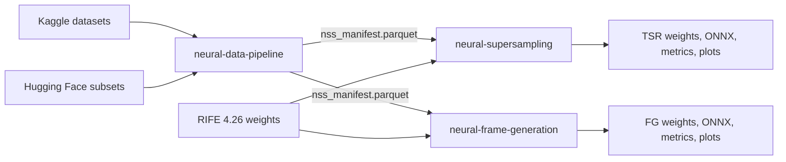
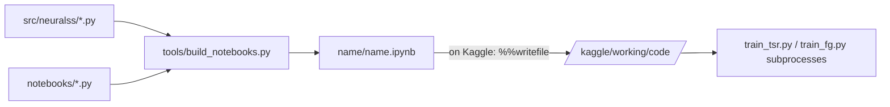

# NeuralSS: neural super-sampling and frame generation for games

NeuralSS is a research project for open, hardware-agnostic neural reconstruction in games. It has two networks:

- **Temporal super-resolution (TSR):** a small recurrent network that turns low-resolution frames (3x and 2x, for example 640x360 to 1920x1080) into full-resolution frames, using its own history. It takes jittered game renders with motion vectors and depth, or ordinary video with no side information, in which case a built-in motion estimator supplies the motion.
- **Frame generation (FG):** a network that creates in-between frames at any time (interpolation, so 2x to 6x frame generation) or a future frame (extrapolation) from two real frames. It estimates motion from the colour frames alone (an IFNet with the design and pre-trained weights of RIFE 4.26) and uses engine motion vectors, depth and camera input when they exist. It copies HUD and subtitles from the newest real frame instead of blending them, and skips generation on scene cuts.

Both networks use only convolutions, transposed convolutions, resizing and grid sampling, and export to ONNX. Everything is trained and evaluated in three Kaggle notebooks (GPU T4 x2) built from one shared Python library. All three notebooks have run on Kaggle, and their downloaded outputs (metrics, plots, logs, weights) are in this repository. The two training notebooks were changed on 3 November 2026 to fix what the runs of 2 to 3 November revealed, and the changed versions ran on Kaggle on 3 to 4 November 2026 (temporal super-resolution) and 8 November 2026 (frame generation) (see [Project status](#project-status)).

The full research plan, design rationale, competitive analysis and dataset licences are in [RESEARCH.md](RESEARCH.md). This README covers how the repository works, how to run it, and what each notebook produced.

## Table of contents

- [Quick start](#quick-start)
- [Project status](#project-status)
- [How it works](#how-it-works)
- [Tech stack](#tech-stack)
- [Repository structure](#repository-structure)
- [Local development](#local-development)
- [Notebook 1: data pipeline](#notebook-1-data-pipeline)
- [Notebook 2: temporal super-resolution](#notebook-2-temporal-super-resolution)
- [Notebook 3: frame generation](#notebook-3-frame-generation)
- [Weights and exported models](#weights-and-exported-models)
- [Known limitations](#known-limitations)
- [Troubleshooting](#troubleshooting)
- [Licence](#licence)
- [Documentation](#documentation)

## Quick start

The notebooks run on Kaggle, not locally. Training and evaluation need two GPUs and the attached datasets.

1. **Create the data-pipeline notebook on Kaggle.** Upload [neural-data-pipeline/neural-data-pipeline.ipynb](neural-data-pipeline/neural-data-pipeline.ipynb). In the notebook settings choose **Accelerator: GPU T4 x2** and turn **Internet on**. Attach these Kaggle datasets (**Add Input**): `soumikrakshit/div2k-high-resolution-images`, `daehoyang/flickr2k`, `amithkesavmrajagiri/reds-dataset`, `wangsally/vimeo-90k-7`, `chenshu123/vimeo-triplet`, `artemmmtry/mpi-sintel-dataset`, `uom200647r/vid4-dataset`. An optional Kaggle secret `HF_TOKEN` raises Hugging Face download limits.
2. **Run it** with **Save Version > Save & Run All**. Expected result: about 0.6 hours; the output contains `nss_data/nss_manifest.parquet` and `outputs.zip`.
3. **Create the two training notebooks** from [neural-supersampling/neural-supersampling.ipynb](neural-supersampling/neural-supersampling.ipynb) and [neural-frame-generation/neural-frame-generation.ipynb](neural-frame-generation/neural-frame-generation.ipynb) with the same accelerator, Internet and datasets, and also attach the pipeline notebook's output (**Add Input > Notebook output**).
4. **Run each one** with **Save & Run All**. Expected result: about 10 hours each, within the notebooks' 10.8-hour ceiling (Kaggle's 12-hour session limit minus a 72-minute margin); `outputs.zip` and every file appear in the notebook's **Output** tab. The runs of 3 to 4 November 2026 (temporal super-resolution) and 8 November 2026 (frame generation) took 10.13 and 10.07 hours. Together the two runs use about 20 hours of Kaggle's weekly GPU quota (about 30 hours). Both notebooks download the RIFE 4.26 weights (23 MB) from `huggingface.co/hzwer/RIFE`, so Internet must be on.
5. **Optional smoke test:** set `QUICK_RUN = True` in the configuration cell for a short run of every cell (about 40 minutes).

Common errors:

| Problem                                                            | Fix                                                                                                                                                                                                  |
| :----------------------------------------------------------------- | :--------------------------------------------------------------------------------------------------------------------------------------------------------------------------------------------------- |
| `AssertionError: Select the GPU T4 x2 accelerator`                 | Set **Accelerator** to **GPU T4 x2**; the notebooks run one training process per GPU                                                                                                                 |
| The version shows no logs and ends with `ERRORED_MOUNTING_DATASET` | One attached dataset failed to mount, so no code ran. Remove or re-add that dataset and save again; the notebooks leave out sources that are not attached                                            |
| `No texture sources found`                                         | Neither the pipeline output nor the Kaggle datasets are attached                                                                                                                                     |
| A pip install fails                                                | Internet is off. `lpips`, `flip-evaluator` and `onnxruntime` are optional; their absence is logged and the matching metric or check is skipped                                                       |
| `RIFE 4.26 weights unavailable` in the log                         | No Internet, Hugging Face unreachable, or the file changed (hash mismatch). The run continues with randomly initialised motion networks, far below the intended quality; fix the cause and run again |

## Project status

| Notebook                  | Kaggle run           | Duration | Result                                                                                                                                                                                                                                       |
| :------------------------ | :------------------- | :------- | :------------------------------------------------------------------------------------------------------------------------------------------------------------------------------------------------------------------------------------------- |
| `neural-data-pipeline`    | 18 October 2026      | 0.63 h   | 12,300 items split into 8,874 train, 1,087 val and 1,432 test with zero cross-split duplicates                                                                                                                                               |
| `neural-supersampling`    | 3 to 4 November 2026 | 10.13 h  | On ordinary video the 3x student beats bicubic on all five suites by 1.2 to 2.2 dB PSNR-Y; with engine data it beats analytic TAAU by 2.8 to 4.9 dB with lower temporal-change error on all five; within 0.3 dB of the previous, shorter run |
| `neural-frame-generation` | 8 November 2026      | 10.07 h  | The fine-tuned `high` tier beats unchanged RIFE 4.26; the `low` tier gained 3.4 dB on Middlebury but is still 1.8 dB below RIFE; the plain-video cut gate still false-alarms on 3x multi-frame samples; latency unchanged                    |

The TSR run started at 17:48 UTC on 3 November 2026 and ended at 03:56 UTC on 4 November. The FG run started at 02:30 UTC on 8 November 2026 and ended at 12:34 UTC (Kaggle clock, from the saved notebook metadata). No training run failed in either notebook (`metrics/failed_runs.json` is empty). Image: Python 3.13.16, PyTorch 2.11.0 with CUDA 13.0, 2 Tesla T4, 4 CPU cores, 31.3 GB RAM.

**What these runs measured.** They measure the changes made on 3 November 2026 after the first runs of the redesign ([RESEARCH.md section 22](RESEARCH.md#22-analysis-of-the-runs-of-2-to-3-november-2026-and-changes)): a histogram-only cut detector for plain video, FG flow resolution chosen per frame height so `igpu` and `low` train at full flow resolution, a native-1080p FG suite, cuDNN autotuning for latency, and training budgets that fill the 12-hour session. The notebooks that ran are the versions of commit `6f5c49b`, unchanged (since then only the FG results plot hides its empty multi-frame engine panel and tilts its suite labels); their library code as run is in each `outputs/code/` folder (snapshots, not the current `src/neuralss`), and the executed notebooks with every output are kept at [neural-supersampling/outputs/neural-supersampling.executed.ipynb](neural-supersampling/outputs/neural-supersampling.executed.ipynb) and [neural-frame-generation/outputs/neural-frame-generation.executed.ipynb](neural-frame-generation/outputs/neural-frame-generation.executed.ipynb). The analysis is in [RESEARCH.md section 23](RESEARCH.md#23-analysis-of-the-runs-of-3-to-4-and-8-november-2026-and-progress).

**Corrections of 9 November 2026 (code only; the saved outputs are not recomputed).** The sources in `src/neuralss` and `notebooks/` changed after these runs, and some saved numbers were produced by defects that are now fixed:

- **Masked PSNR.** `psnr_disocc` and `psnr_particles` used a batch-level test, so a sample with no pixels in its disocclusion or particle mask could score the 100 dB cap when another sample in the batch had pixels. Such samples now give a missing value (NaN) that the means skip. Saved means of these two columns can include the capped values.
- **Ablation inputs.** The TSR ablation `abl_no_motion_net` was trained on colour-only input (no depth, no motion vectors) but was evaluated with them. The FG ablation `abl_no_motion_prior` was trained without motion vectors and camera prior but was evaluated without depth too. Evaluation now reads the training flags of each ablation. The saved engine-mode results of these two runs (section 25 of the TSR run and of the FG run below) were measured with the wrong inputs and should not be read as the trained recipe.
- **ONNX reset input.** The TSR export takes a `reset` input. With 1, the step is exactly the first frame of a sequence (no warped history, hidden state or previous depth, the input motion, history weight 0), whatever the previous-state inputs hold; `test_models_cpu.py` checks this against PyTorch. The ONNX files of the saved runs have no such input.
- **GameIR in TSR training.** GameIR clips are sampled every 10 rendered frames, so from the next run they are left out of the TSR temporal training windows (they stay in the native test suite). The saved run of 3 to 4 November 2026 trained on them.
- **Fallback caps.** When the data-pipeline manifest is not attached, the TSR and FG notebooks now use the caps of the saved data-pipeline run (`neural-data-pipeline/outputs/metrics/config.json`).

- **TSR is stable and saturated.** Every test mean is within 0.3 dB of the run of 2 to 3 November 2026 although the student trained 58 percent longer, so the next TSR gains need more data, not more time. The 3x student wins 27 of 28 real clips against bicubic on plain video and 28 of 28 against analytic TAAU with engine data, and static scenes converge to 35.75 dB at frame 16.
- **FG: full-resolution flow training helped the small tiers, but not enough.** On the independent Middlebury interpolation set (12 sequences, colour only, measured locally on CPU with the downloaded weights): `high` 34.23 dB, `mid` 33.83, RIFE 4.26 33.34, `low` 31.56 (was 28.13), `igpu` 30.30 (was 28.45), frame averaging 28.02. `low` now beats frame averaging on every real plain-video suite but trails RIFE by 1.5 to 5.0 dB.
- **FG cut gate: better, still not deployable.** It detects every synthetic cut, and on cut-free real clips it now gates 0 to 25 percent of two-frame samples (was 35 to 100 percent), but 30 to 50 percent of 3x multi-frame samples and 9 percent of continuous synthetic pairs. Tables on the samples the gate left alone are given with the saved means.
- **Latency did not move.** cuDNN autotuning left the FG `low` step at 48.1 ms and the TSR `low` step at 27.7 ms per 1080p frame on a T4.

**How far from the goal.** Of the five Kaggle-phase success criteria in [RESEARCH.md section 14](RESEARCH.md#14-experiments-and-ablations), four are met and FG extrapolation is partly met (plain reprojection with exact motion vectors is still better on TartanAir by 1.8 dB and about equal on Sintel). Everything after the Kaggle phase is not started: engine captures and a comparison with FSR, DLSS or XeSS, the 1.5x ratio, DirectML or Vulkan runtimes, timing on integrated GPUs, INT8 and a release trained on permissive data. No tier has yet run within its latency budget on any GPU. The full assessment is in [RESEARCH.md section 23.3](RESEARCH.md#233-progress-against-the-objective-section-1).

## How it works



1. **Data pipeline.** Discovers images and videos on Kaggle and Hugging Face, filters unusable items, detects copies across all sources with hashes, DINOv2 embeddings and SIFT verification, and writes a leakage-safe train / validation / test manifest.
2. **Training data.** Both training notebooks decode the manifest into memory-mapped caches. Each training batch mixes _synthetic_ game-like scenes, rendered on the GPU from still images with exact motion vectors, disocclusions, thin geometry, particles and HUD overlays, with _real_ sequences (TartanAir and Sintel with exact flow; video with RAFT-estimated motion). Part of every batch is turned into plain video (no jitter, depth or motion vectors). GameIR clips are sampled every 10 rendered frames, so from the next run they are left out of the temporal training windows; the saved run of 3 to 4 November 2026 trained on them.
3. **Training.** DDP on both GPUs with FP16, EMA weights and a wall-clock cosine schedule: the largest model first (for FG, RIFE 4.26 fine-tuned; for TSR, the teacher tier), then the main student (for FG distilled from the largest model), then smaller tiers and ablations, two runs in parallel (one per GPU). Engine data are withheld at random, so every model also learns to work on plain video.
4. **Evaluation.** Test-split suites only, each with engine data and as plain video, against analytic baselines (and RIFE 4.26 unchanged for FG), with spatial, temporal, region, UI and latency metrics, then fusion to plain convolutions and ONNX export.

**Library and build.** The library lives once in [src/neuralss/](src/neuralss/). [tools/build_notebooks.py](tools/build_notebooks.py) turns the percent-format sources in [notebooks/](notebooks/) into `.ipynb` files and embeds every library module as a `%%writefile` cell, so each notebook is self-contained on Kaggle.



## Tech stack

| Component                              | Version (where known)                                                   | Purpose and where used                                                                                                           |
| :------------------------------------- | :---------------------------------------------------------------------- | :------------------------------------------------------------------------------------------------------------------------------- |
| Python                                 | 3.10.12 (data pipeline), 3.13.16 (TSR and FG runs)                      | Notebook and library language                                                                                                    |
| PyTorch with CUDA                      | 2.0.0 / CUDA 11.8 (data pipeline), 2.11.0 / CUDA 13.0 (TSR and FG runs) | Models, GPU renderer, DDP training (`torch.distributed.run`), FP16 autocast; the library supports 2.0 and later                  |
| torchvision                            | Kaggle image                                                            | RAFT-small optical flow (motion labels for video, tOF metric), AlexNet weights for the LPIPS fallback                            |
| RIFE 4.26 weights                      | `RIFEv4.26_0921.zip` from `huggingface.co/hzwer/RIFE` (MIT)             | Initial weights of the FG motion network and the TSR motion estimators; unchanged FG reference (`nss_models.fetch_rife_weights`) |
| Hugging Face Transformers              | Kaggle image                                                            | DINOv2-small embeddings for copy detection (`nss_dedup.py`)                                                                      |
| OpenCV, Pillow, NumPy, pandas, PyArrow | Kaggle image                                                            | Decoding, SIFT features, HUD text tiles, caches, manifest (`nss_manifest.parquet`)                                               |
| matplotlib, tqdm                       | Kaggle image                                                            | Plots and progress bars                                                                                                          |
| `lpips`                                | installed by the notebooks                                              | Perceptual loss and metric (optional)                                                                                            |
| `flip-evaluator`                       | installed by the notebooks                                              | NVIDIA FLIP metric for static convergence (optional)                                                                             |
| `onnxruntime`                          | installed by the notebooks                                              | ONNX export parity check (optional)                                                                                              |
| nbformat                               | 5.11.1 (local `.venv`)                                                  | Local notebook build and check (`tools/build_notebooks.py`)                                                                      |
| black, pyflakes                        | 26.10.1, 4.1.0 (local `.venv`)                                          | Local formatting and lint checks                                                                                                 |
| PyTorch CPU, onnx, onnxruntime         | 2.15.0, 1.23.2, 1.31.1 (local `.venv`, optional)                        | Importing and checking the library on CPU; not needed to build the notebooks                                                     |

## Repository structure

```text
.
|-- README.md
|-- RESEARCH.md
|-- src/
|   `-- neuralss/
|       |-- nss_common.py
|       |-- nss_data.py
|       |-- nss_dedup.py
|       |-- nss_pipeline.py
|       |-- nss_cache.py
|       |-- nss_synth.py
|       |-- nss_models.py
|       |-- nss_metrics.py
|       |-- nss_train.py
|       |-- nss_eval.py
|       |-- train_tsr.py
|       `-- train_fg.py
|-- notebooks/
|-- tools/
|   |-- build_notebooks.py
|   |-- build_paper_results.py
|   |-- build_paper.py
|   `-- compare_fg_tiers_middlebury.py
|-- paper/
|-- neural-data-pipeline/
|   |-- neural-data-pipeline.ipynb
|   `-- outputs/
|-- neural-supersampling/
|   |-- neural-supersampling.ipynb
|   `-- outputs/
|-- neural-frame-generation/
|   |-- neural-frame-generation.ipynb
|   |-- outputs/
|   `-- local-evaluation/
|-- .gitignore
|-- .gitattributes
`-- .prettierrc.json
```

| Path                                                   | Contents                                                                                                                                                                                                                                                                                                                                                                                                                                                                                                                                                                                   |
| :----------------------------------------------------- | :----------------------------------------------------------------------------------------------------------------------------------------------------------------------------------------------------------------------------------------------------------------------------------------------------------------------------------------------------------------------------------------------------------------------------------------------------------------------------------------------------------------------------------------------------------------------------------------- |
| `src/neuralss/`                                        | The single source of the shared library, embedded into every notebook: run folders and launcher (`nss_common`), data sources and decoding (`nss_data`), copy detection and split (`nss_dedup`, `nss_pipeline`), training caches (`nss_cache`), the synthetic renderer and batch builders including the plain-video degradation (`nss_synth`), the IFNet motion estimator with RIFE weight loading and the TSR and FG networks (`nss_models`), losses, metrics and baselines (`nss_metrics`), the DDP loop (`nss_train`), evaluation helpers (`nss_eval`) and the two training entry points |
| `notebooks/`                                           | Percent-format notebook sources                                                                                                                                                                                                                                                                                                                                                                                                                                                                                                                                                            |
| `tools/build_notebooks.py`                             | Builds the `.ipynb` files from `notebooks/` and `src/neuralss`                                                                                                                                                                                                                                                                                                                                                                                                                                                                                                                             |
| `tools/build_paper_results.py`, `tools/build_paper.py` | Generate `paper/results-values.tex` (every number of the paper, from the notebooks' metric files) and the article figures, then build the article, the supplementary material and their variants                                                                                                                                                                                                                                                                                                                                                                                           |
| `tools/compare_fg_tiers_middlebury.py`                 | CPU Middlebury interpolation comparison of RIFE 4.26 and the trained FG tiers, written to `neural-frame-generation/local-evaluation/middlebury_psnr.csv`                                                                                                                                                                                                                                                                                                                                                                                                                                   |
| `paper/`                                               | Journal article on the whole project (Journal of Real-Time Image Processing, Springer Nature template, 12 pages) and its supplementary material (Online Resource 1, no page limit, every component and result in full): sources, figures, references, built PDFs; see [paper/README.md](paper/README.md)                                                                                                                                                                                                                                                                                   |
| `neural-data-pipeline/`                                | The data-pipeline notebook (no outputs) and the outputs of the run of 18 October 2026, including `outputs/neural-data-pipeline.executed.ipynb` and `nss_data/nss_manifest.parquet`                                                                                                                                                                                                                                                                                                                                                                                                         |
| `neural-supersampling/`, `neural-frame-generation/`    | The notebook (no outputs) and the outputs of the runs of 3 to 4 November 2026 (`neural-supersampling`) and 8 November 2026 (`neural-frame-generation`), including `<name>.executed.ipynb` with every output, and the local Middlebury evaluation (`neural-frame-generation/local-evaluation/`)                                                                                                                                                                                                                                                                                             |
| `.gitignore`, `.gitattributes`, `.prettierrc.json`     | Ignored local folders and archives, line-ending rules, Markdown / JSON formatting                                                                                                                                                                                                                                                                                                                                                                                                                                                                                                          |

Inside every `outputs/` folder: `code/` holds the library and per-run JSON configs as they were run on Kaggle (snapshots, which can differ from the current `src/neuralss`), `logs/` the notebook log and one log per training run, `metrics/` every CSV and JSON result, `plots/` every figure, and for the training notebooks `predictions/` full-size sample frames and `weights/` checkpoints and ONNX models.

## Local development

There is no local training or test suite: the notebooks are verified on Kaggle. Local work is editing the library or notebook sources and rebuilding the notebooks.

```powershell
python -m venv .venv
.venv\Scripts\python -m pip install nbformat black pyflakes --cache-dir .cache\pip
```

| Command (repository root)                                            | What it does                                                                                                                                  |
| :------------------------------------------------------------------- | :-------------------------------------------------------------------------------------------------------------------------------------------- |
| `.venv\Scripts\python tools\build_notebooks.py`                      | Rebuilds every notebook whose sources changed (written without outputs); unchanged notebooks, including executed copies, are left as they are |
| `.venv\Scripts\python tools\build_notebooks.py --check`              | Exits with code 1 and lists stale notebooks if any `.ipynb` cell id, type or source differs from a fresh build; outputs are ignored           |
| `.venv\Scripts\python -m pyflakes src\neuralss tools notebooks`      | Lint (no output means clean)                                                                                                                  |
| `.venv\Scripts\python -m black --check src\neuralss tools notebooks` | Formatting check                                                                                                                              |

Workflow: edit `src/neuralss/*.py` or `notebooks/*.py`, run the build, then `--check`, pyflakes and black. Never edit the `.ipynb` files by hand; they are generated. Note that the build rewrites a notebook without outputs whenever its sources change, so copy an executed notebook into its `outputs/` folder first if its outputs must be kept.

## Notebook 1: data pipeline

[neural-data-pipeline/neural-data-pipeline.ipynb](neural-data-pipeline/neural-data-pipeline.ipynb) keeps its saved outputs from the run of 18 October 2026 (Kaggle GPU T4 x2, PyTorch 2.0.0, 4 CPU cores, 31.3 GB RAM). All numbers below are printed in the notebook or saved in [neural-data-pipeline/outputs/metrics/](neural-data-pipeline/outputs/metrics/).

**Sections 1 to 4: library, setup, hardware, configuration.** Writes the four library modules used by the pipeline (`nss_common`, `nss_data`, `nss_dedup`, `nss_pipeline`), loads the `HF_TOKEN` secret, and reports 2 Tesla T4 GPUs (14.56 GB each). Hugging Face caps: game stills (1,200 train, 250 test), TartanAir 120 frames per environment in sequences of 24, GameIR (40, 30) clips, Vimeo-1080p (160, 40) videos. Copy-detection settings: 16 neighbours, retrieval recall 0.98, 400 SIFT features, audit with 5 neighbours and at most 3 rounds.

**Section 5: Kaggle discovery (1.7 min).** Saved to `discovery_kaggle.csv`.

| Source          | Files listed | Items | Test items |
| :-------------- | -----------: | ----: | ---------: |
| div2k           |          900 |   900 |        100 |
| flickr2k        |        2,650 | 2,650 |          0 |
| reds            |       22,100 |   221 |          0 |
| vimeo_septuplet |       40,005 | 5,715 |          0 |
| vimeo_triplet   |        3,000 | 1,000 |      1,000 |
| sintel          |        3,256 |    46 |         10 |
| vid4            |          171 |     4 |          4 |

**Section 6: Hugging Face materialisation (14.2 min).** 1,764 items, 13.64 GB: 1,200 + 250 game stills, 12 TartanAir training environments and 2 test environments (`japanesealley`, `seasidetown`), 40 + 30 GameIR clips, 134 + 40 Vimeo-1080p videos. Catalogue (`catalogue_summary.csv`): 12,300 items; exact motion for Sintel and TartanAir, depth for TartanAir and GameIR.

**Section 7: catalogue overview.**


_Items and frames per source, split by training and test role._

**Section 8: keyframe statistics (12.0 min).** 13,322 keyframes, 0 decode failures (`keyframe_stats.csv`). Median size per source ranges from 448x256 (Vimeo-90K) to 2040x1356 (DIV2K, Flickr2K); median sharpness from 216 (Vimeo-90K septuplet) to 1,704 (Vid4).


_Distributions of size, contrast, sharpness, letterboxing and colourfulness per source._

**Section 9: filtering (0.3 min).** Kept 12,149 of 12,300 items. Rejections by reason (an item can have several): Vimeo-90K septuplet 43 blurry, 17 flat, 71 letterboxed; game stills 2, 3, 26; Vimeo-1080p 1, 2, 2; Vimeo-90K triplet 1, 0, 2.


_Examples of rejected keyframes with their reasons._

**Sections 10 to 12: hashes, embeddings, local features.** pHash mean bit 0.500 and dHash 0.480 (balanced). DINOv2 embeddings (13,322 x 384) on both GPUs in 16 s. SIFT: median 368 keypoints per keyframe; 273 keyframes have fewer than 20.

**Section 13: threshold calibration (0.9 min).** 1,500 synthetic copies against 2,930 random and 998 hard negatives (`dedup_calibration.json`, `calibration_scores.csv`).

| Signal            | Threshold               | Recall                            | Most similar negative              |
| :---------------- | :---------------------- | :-------------------------------- | :--------------------------------- |
| DINOv2 retrieval  | `t_ret` 0.6075          | 0.98                              | cosine 0.9348                      |
| DINOv2 strong     | `t_strong` 0.9648       | 0.038                             | cosine 0.9348                      |
| SIFT verification | `t_cells` 10            | 0.9493                            | 8 cells                            |
| pHash             | `h_exact` 6, `h_cand` 6 | 0.9987 (light copies)             | Hamming 18                         |
| Combined rule     |                         | 0.9673 (light 0.9947, heavy 0.94) | 1 false positive, precision 0.9993 |


_Score distributions of synthetic copies against negatives, with the chosen thresholds._

**Section 14: copy detection (1.4 min).** 13,165 keyframes searched; 45,213 embedding and 849 pHash candidates, 27,044 unique pairs; 3,346 edges (3,304 verified, 37 strong embedding, 5 exact hash). Most edges join game frames to each other (2,873); cross-source edges link Vimeo-90K septuplets to Vimeo-1080p (78) and to Vimeo-90K triplet test clips (104). Pairs are in `duplicate_pairs.csv`.


_Examples of detected duplicate pairs with the rule that matched them._

**Section 15: leakage-safe split with audit (1.3 min).** Audit round 1 found 24 cross-split duplicates (added as edges and re-split); round 2 found none. Final: 3,370 edges, largest duplicate cluster 50 items, 3,956 train and validation components (largest 2,936).

| Source          |     Train |       Val |      Test |    Drop | Filtered |
| :-------------- | --------: | --------: | --------: | ------: | -------: |
| div2k           |       755 |        43 |       100 |       2 |        0 |
| flickr2k        |     2,497 |       153 |         0 |       0 |        0 |
| game_stills     |       502 |        41 |       243 |     636 |       28 |
| gameir          |        40 |         0 |        30 |       0 |        0 |
| reds            |       209 |        12 |         0 |       0 |        0 |
| sintel          |        36 |         0 |        10 |       0 |        0 |
| tartanair       |        60 |         0 |        10 |       0 |        0 |
| vid4            |         0 |         0 |         4 |       0 |        0 |
| vimeo1080p      |       120 |         3 |        38 |      10 |        3 |
| vimeo_septuplet |     4,655 |       835 |         0 |     108 |      117 |
| vimeo_triplet   |         0 |         0 |       997 |       0 |        3 |
| **Total**       | **8,874** | **1,087** | **1,432** | **756** |  **151** |

Every dropped item is a duplicate of a test item (`split_report.json`, `split_by_source.csv`).


_Items per split and source after the audit._

**Section 16: audit statistics.** `leakage_audit.csv`; `leakage_violations.csv` has a header and no rows (no cross-split duplicate after round 2).

| Split | Reference | Max cosine (median) | Max verified cells (median) | Min pHash Hamming (median) |
| :---- | :-------- | :------------------ | :-------------------------- | :------------------------- |
| val   | train     | 0.9614 (0.5757)     | 9 (0)                       | 8 (16)                     |
| test  | train+val | 0.9570 (0.5745)     | 9 (0)                       | 0 (16)                     |

The pHash distance of 0 is not a duplicate under the rule (untextured keyframe or rejected by dHash).


_Nearest-neighbour similarity of validation and test keyframes to the training split, against the thresholds._

**Sections 17 to 19: manifest, summary, packaging.** Writes `nss_data/nss_manifest.parquet` and `dataset_card.csv` (source, host, licence, counts per split), `summary.json`, and a 31-file `outputs.zip`. Stage times (`stage_times.csv`, minutes): discovery 1.66, Hugging Face 14.24, keyframe stats 11.95, filters 0.26, hashes 0.13, embeddings 0.36, SIFT 5.09, calibration 0.94, duplicate search 1.38, split and audit 1.34.


_Minutes per pipeline stage._

## Notebook 2: temporal super-resolution

Run of 3 to 4 November 2026 (17:48 to 03:56 UTC; PyTorch 2.11.0, CUDA 13.0, Python 3.13.16, 2 x Tesla T4, 4 CPU cores, 31.3 GB RAM; 10.13 hours; no failed runs). Outputs: [neural-supersampling/outputs/](neural-supersampling/outputs/); executed notebook: [neural-supersampling.executed.ipynb](neural-supersampling/outputs/neural-supersampling.executed.ipynb). The notebook that ran has the same sources as the build committed at HEAD before the corrections of 9 November 2026 (checked cell by cell). Its training budgets (section 12) are larger than those of the earlier run of 2 to 3 November 2026 (teacher 140 minutes, student 120, pair 75, ablations 20 per pair).

Every suite is evaluated in two modes. **Engine**: jittered render-like input with motion vectors and depth (exact on synthetic, TartanAir and Sintel; on video suites RAFT motion from the full-resolution frames, the protocol of earlier runs; on the GameIR native suite RAFT runs at most 1024 px on the longer side and its flow is scaled back). **Plain**: the clip as ordinary video (bicubic downscale, no jitter, depth or motion vectors), so the built-in motion estimator supplies the motion.

**Sections 1 to 4: library, setup, hardware, configuration.** Writes the ten library modules and `train_tsr.py`, and `lpips`, `flip-evaluator` and `onnxruntime` are all installed. Main settings (`metrics/config.json`): 3x primary and 2x secondary scale, 192-px output patches, 6-frame sequences and a 16-frame 96-px synthetic sequence every fourth step, 40 percent real windows per batch, plain video in 30 percent of synthetic and 60 percent of real samples, learning rate 2e-3 (teacher 1e-3), loss weights gradient 0.1, Fourier 0.05, temporal 0.5, motion 0.1, LPIPS 0.05, distillation 0. Budgets: teacher 170 min, student 190, pair 110, ablations 30 per pair; caches 30 min.

**Section 5: manifest.** Loaded from the attached pipeline output; every source was reachable (`reachable_sources.json`).

**Section 6: item selection.** 4,123 texture and 5,120 sequence items for training, 252 and 850 for validation.

**Section 7: caches (20.0 min, 9.30 GB).** 256 validation and 6,500 training still crops (4 decode failures), 192 validation and 3,600 training windows (no failures). Training windows by source: Vimeo-90K 3,267, REDS 149, Vimeo-1080p 91, TartanAir 39, Sintel 28, GameIR 26; validation windows: Vimeo-90K 188, REDS 4 (`caches.json`).

**Section 8: cache inspection.** 1.9 percent of windows have exact motion and 98.1 percent RAFT motion; 1.8 percent have depth; mean motion 1.50 px per frame.


_Random 512x512 still crops used as textures by the synthetic renderer._


_Real windows: first and last frame, motion vectors (hue = direction, brightness = magnitude) and validity._

**Section 9: synthetic renderer preview.**


_One synthetic sequence at t = 1, 3 and 5: the jittered render and plain-video low-resolution inputs, the 4x supersampled target, exact motion vectors, valid history, depth and the particle (reactive) mask._

**Section 10: model tiers.** RIFE 4.26 slices loaded into the `low` tier's motion estimator (11 exact, 42 sliced, 0 missing tensors). Measured with forward hooks (`model_tiers.csv`, motion estimator included); fused-versus-unfused parity 0.0 for every tier.

| Tier    | Scale | Train params | Fused params | GMAC per 1080p frame |
| :------ | ----: | -----------: | -----------: | -------------------: |
| igpu    |     3 |      144,564 |      137,844 |                 6.20 |
| igpu    |     2 |      138,544 |      132,784 |                11.34 |
| low     |     3 |      361,519 |      328,159 |                16.13 |
| low     |     2 |      352,499 |      320,579 |                30.70 |
| mid     |     3 |      727,647 |      653,343 |                28.10 |
| mid     |     2 |      715,627 |      643,243 |                56.32 |
| high    |     3 |    1,622,091 |    1,405,803 |                69.04 |
| high    |     2 |    1,604,071 |    1,390,663 |               144.99 |
| teacher |     3 |    3,942,295 |    3,395,095 |               156.09 |
| teacher |     2 |    3,918,275 |    3,374,915 |               337.38 |


_GMAC per 1080p output frame for each tier at 3x and 2x._

**Section 11: batch probe (0.6 min).** Every size up to 48 fit with a finite loss at initialisation; 48 per GPU was chosen for all runs (`batch_probe.csv`).

| Batch | Teacher VRAM % | Teacher seq/s | Student VRAM % | Student seq/s |
| ----: | -------------: | ------------: | -------------: | ------------: |
|     4 |            5.0 |           9.1 |            2.4 |          11.8 |
|     8 |            8.6 |          17.4 |            3.9 |          21.8 |
|    12 |           12.2 |          22.3 |            5.5 |          28.9 |
|    16 |           15.8 |          25.2 |            7.0 |          33.2 |
|    24 |           23.3 |          28.3 |           10.2 |          37.7 |
|    32 |           30.3 |          29.7 |           13.2 |          40.1 |
|    48 |           45.1 |          29.9 |           19.5 |          40.7 |

**Section 12: launcher and budget.** 9.45 hours were available for training after 0.35 hours of caches and probe and a 1.0-hour evaluation reserve, so the budgets ran at full scale (scale 1.00).

**Sections 13 to 16: training.** Logs in `logs/<run>.log`, histories in `metrics/<run>_history.json` and `history_<run>.csv`, configs in `code/cfg_<run>.json`. No student was distilled. Ablations: `no_history` (single frame), `no_gbuffers` (colour-only render input, the estimator supplies motion), `no_motion_net` (colour only and no estimator), `no_video_training` (render samples only), `no_long_unroll` (no 16-frame steps).

| Stage             | Run                                           |        Steps | Train s      | Best validation PSNR-Y (round) |
| :---------------- | :-------------------------------------------- | -----------: | :----------- | :----------------------------- |
| A, both GPUs      | `tsr_teacher_s3`                              |        6,640 | 10,211       | 33.47 dB (20)                  |
| B, both GPUs      | `tsr_low_s3`                                  |       10,400 | 11,406       | 32.49 dB (23)                  |
| C, GPU 0 / GPU 1  | `tsr_igpu_s3`, `tsr_low_s2`                   | 7,220, 5,220 | 6,602, 6,608 | 31.62 (13), 36.39 (13)         |
| Ablations, pair 1 | `abl_reference`, `abl_no_history`             | 1,680, 1,970 | 1,811, 1,802 | 31.81 (5), 31.28 (5)           |
| Ablations, pair 2 | `abl_no_gbuffers`, `abl_no_motion_net`        | 1,670, 1,900 | 1,804, 1,804 | 31.47 (5), 31.33 (5)           |
| Ablations, pair 3 | `abl_no_video_training`, `abl_no_long_unroll` | 1,700, 1,680 | 1,810, 1,810 | 31.06 (5), 31.88 (5)           |

**Section 17: training curves.** The selection metric is the mean of validation PSNR-Y on a render copy and a plain-video copy of every validation batch (`best_validation.csv`):

| Run              |  Best | Render | Video | Last frame |    TCE | Samples/s | Peak memory (GB) |
| :--------------- | ----: | -----: | ----: | ---------: | -----: | --------: | ---------------: |
| `tsr_teacher_s3` | 33.47 |  33.43 | 33.51 |      33.63 | 0.0137 |      56.4 |             7.92 |
| `tsr_low_s3`     | 32.49 |  32.28 | 32.70 |      32.58 | 0.0147 |      79.0 |             4.19 |
| `tsr_igpu_s3`    | 31.62 |  31.23 | 32.02 |      31.72 | 0.0158 |      47.4 |             3.24 |
| `tsr_low_s2`     | 36.39 |  36.44 | 36.34 |      36.46 | 0.0109 |      34.2 |             5.73 |

Render-copy PSNR-Y per round: teacher 31.04 to 33.43 over 21 rounds (+0.03 dB over the last three), `low` 3x 30.63 to 32.28 over 24 (+0.01), `igpu` 30.46 to 31.23 over 14 (+0.01), `low` 2x 34.46 to 36.44 over 14 (+0.03). Every main run's best round is its last round, and each gained only 0.01 to 0.03 dB over its last three rounds. The curves flatten as the cosine schedule ends, not because training has converged. The ablations were still rising faster (the reference gained 0.26 dB over its last three rounds), so their scores are short-run values. Each ablation validates on batches built with its own recipe, so ablation validation scores are not comparable; section 25 compares them on the test suites.


_Validation PSNR-Y, validation temporal-change error and train loss against minutes; dashed lines are ablations._

**Section 18: load and fuse.** Ten models loaded (teacher, three students, six ablations); fused FP32 parity 0.0 for every one.

**Section 19: test suites (2.7 min).** 24 synthetic test stills (6 per motion class), 8 TartanAir, 8 Sintel, 4 Vid4, 8 Vimeo-1080p and 4 GameIR native clips. Two blank Vimeo-1080p clips were skipped and replaced by the next clips of that source.

**Section 20: evaluation (19.2 min).** 23,480 per-frame metric rows (`test_per_frame.csv`): synthetic-game 5,760 engine and 5,040 plain, TartanAir, Sintel and Vimeo-1080p 1,920 and 1,680 each, Vid4 960 and 840, GameIR native 80. The notebook skips the first frame of every sequence (no history yet), and every mean below is over the recorded frames.

**Section 21: results by suite and method** (`test_results.csv`, mean over the recorded frames). Higher is better for PSNR and SSIM; lower is better for LPIPS, temporal-change error (TCE) and tOF. `bicubic` and `bilinear` sample at the true jittered positions in engine mode.

3x, engine mode:

| Suite                                                                         | Method        | PSNR-Y | SSIM-Y | PSNR disocc. | PSNR detail | LPIPS |    TCE |   tOF |
| :---------------------------------------------------------------------------- | :------------ | -----: | -----: | -----------: | ----------: | ----: | -----: | ----: |
| synthetic-game                                                                | bilinear      |  29.80 |  0.833 |        34.47 |       23.87 | 0.273 | 0.0253 | 0.782 |
| synthetic-game                                                                | bicubic       |  29.50 |  0.832 |        34.08 |       23.53 | 0.288 | 0.0321 | 0.844 |
| synthetic-game                                                                | analytic_taau |  29.35 |  0.817 |        31.51 |       23.61 | 0.261 | 0.0110 | 0.790 |
| synthetic-game                                                                | igpu_s3       |  32.72 |  0.907 |        34.25 |       26.64 | 0.097 | 0.0125 | 0.606 |
| synthetic-game                                                                | student_s3    |  34.27 |  0.931 |        35.48 |       28.17 | 0.058 | 0.0109 | 0.529 |
| synthetic-game                                                                | teacher_s3    |  35.55 |  0.947 |        36.41 |       29.43 | 0.041 | 0.0092 | 0.403 |
| tartanair                                                                     | bilinear      |  31.52 |  0.890 |        30.85 |       24.64 | 0.216 | 0.0132 | 0.485 |
| tartanair                                                                     | bicubic       |  31.83 |  0.896 |        31.18 |       24.92 | 0.216 | 0.0149 | 0.486 |
| tartanair                                                                     | analytic_taau |  30.64 |  0.875 |        27.92 |       23.85 | 0.243 | 0.0104 | 0.415 |
| tartanair                                                                     | igpu_s3       |  33.00 |  0.920 |        29.66 |       26.12 | 0.103 | 0.0105 | 0.392 |
| tartanair                                                                     | student_s3    |  33.43 |  0.928 |        30.34 |       26.56 | 0.090 | 0.0103 | 0.382 |
| tartanair                                                                     | teacher_s3    |  33.81 |  0.934 |        30.63 |       26.97 | 0.071 | 0.0101 | 0.334 |
| sintel                                                                        | bilinear      |  32.55 |  0.874 |        30.49 |       26.61 | 0.269 | 0.0127 | 1.703 |
| sintel                                                                        | bicubic       |  32.82 |  0.881 |        30.84 |       26.86 | 0.275 | 0.0148 | 1.564 |
| sintel                                                                        | analytic_taau |  31.07 |  0.848 |        27.58 |       25.19 | 0.271 | 0.0092 | 1.519 |
| sintel                                                                        | igpu_s3       |  33.70 |  0.909 |        29.83 |       27.72 | 0.136 | 0.0093 | 1.463 |
| sintel                                                                        | student_s3    |  34.48 |  0.921 |        30.76 |       28.52 | 0.107 | 0.0087 | 1.371 |
| sintel                                                                        | teacher_s3    |  35.08 |  0.928 |        31.35 |       29.16 | 0.092 | 0.0082 | 1.343 |
| vid4                                                                          | bilinear      |  24.55 |  0.722 |        22.32 |       19.71 | 0.362 | 0.0368 | 0.397 |
| vid4                                                                          | bicubic       |  24.58 |  0.738 |        22.33 |       19.60 | 0.391 | 0.0433 | 0.398 |
| vid4                                                                          | analytic_taau |  23.96 |  0.679 |        20.53 |       19.29 | 0.382 | 0.0236 | 0.183 |
| vid4                                                                          | igpu_s3       |  26.75 |  0.842 |        22.15 |       21.58 | 0.154 | 0.0236 | 0.155 |
| vid4                                                                          | student_s3    |  27.32 |  0.863 |        22.56 |       22.06 | 0.118 | 0.0229 | 0.148 |
| vid4                                                                          | teacher_s3    |  28.20 |  0.888 |        23.21 |       22.91 | 0.085 | 0.0227 | 0.144 |
| vimeo1080p                                                                    | bilinear      |  34.80 |  0.899 |        40.65 |       28.19 | 0.189 | 0.0116 | 4.212 |
| vimeo1080p                                                                    | bicubic       |  35.21 |  0.902 |        41.50 |       28.67 | 0.191 | 0.0136 | 4.077 |
| vimeo1080p                                                                    | analytic_taau |  33.43 |  0.888 |        36.98 |       26.79 | 0.203 | 0.0076 | 6.128 |
| vimeo1080p                                                                    | igpu_s3       |  36.88 |  0.938 |        40.64 |       30.43 | 0.074 | 0.0076 | 2.996 |
| vimeo1080p                                                                    | student_s3    |  37.77 |  0.945 |        41.98 |       31.35 | 0.052 | 0.0071 | 3.786 |
| vimeo1080p                                                                    | teacher_s3    |  38.57 |  0.952 |        43.04 |       32.21 | 0.035 | 0.0069 | 3.244 |
| 3x, plain mode (ordinary video; no TAA baseline, which needs motion vectors): |

| Suite                                                                                                                                    | Method     | PSNR-Y | SSIM-Y | PSNR disocc. | PSNR detail | LPIPS |    TCE |   tOF |
| :--------------------------------------------------------------------------------------------------------------------------------------- | :--------- | -----: | -----: | -----------: | ----------: | ----: | -----: | ----: |
| synthetic-game                                                                                                                           | bilinear   |  30.36 |  0.826 |        35.22 |       24.79 | 0.256 | 0.0090 | 0.573 |
| synthetic-game                                                                                                                           | bicubic    |  31.23 |  0.850 |        35.95 |       25.60 | 0.260 | 0.0090 | 0.588 |
| synthetic-game                                                                                                                           | igpu_s3    |  32.65 |  0.888 |        36.92 |       27.07 | 0.101 | 0.0098 | 0.387 |
| synthetic-game                                                                                                                           | student_s3 |  33.42 |  0.904 |        37.72 |       27.85 | 0.082 | 0.0087 | 0.396 |
| synthetic-game                                                                                                                           | teacher_s3 |  34.17 |  0.918 |        38.50 |       28.61 | 0.064 | 0.0077 | 0.323 |
| tartanair                                                                                                                                | bilinear   |  31.55 |  0.884 |        31.02 |       24.78 | 0.227 | 0.0107 | 0.379 |
| tartanair                                                                                                                                | bicubic    |  32.34 |  0.897 |        31.77 |       25.49 | 0.227 | 0.0103 | 0.381 |
| tartanair                                                                                                                                | igpu_s3    |  33.55 |  0.917 |        32.57 |       26.76 | 0.105 | 0.0106 | 0.438 |
| tartanair                                                                                                                                | student_s3 |  34.03 |  0.925 |        32.92 |       27.25 | 0.087 | 0.0102 | 0.350 |
| tartanair                                                                                                                                | teacher_s3 |  34.34 |  0.930 |        33.17 |       27.59 | 0.068 | 0.0100 | 0.306 |
| sintel                                                                                                                                   | bilinear   |  32.61 |  0.865 |        30.55 |       26.82 | 0.274 | 0.0084 | 1.316 |
| sintel                                                                                                                                   | bicubic    |  33.38 |  0.880 |        31.37 |       27.55 | 0.281 | 0.0081 | 1.354 |
| sintel                                                                                                                                   | igpu_s3    |  34.23 |  0.898 |        32.30 |       28.62 | 0.125 | 0.0094 | 1.190 |
| sintel                                                                                                                                   | student_s3 |  34.64 |  0.906 |        32.67 |       29.06 | 0.105 | 0.0090 | 1.112 |
| sintel                                                                                                                                   | teacher_s3 |  34.99 |  0.912 |        32.98 |       29.46 | 0.084 | 0.0087 | 0.946 |
| vid4                                                                                                                                     | bilinear   |  24.62 |  0.695 |        22.43 |       20.05 | 0.362 | 0.0229 | 0.151 |
| vid4                                                                                                                                     | bicubic    |  25.24 |  0.728 |        23.10 |       20.58 | 0.400 | 0.0222 | 0.145 |
| vid4                                                                                                                                     | igpu_s3    |  26.52 |  0.806 |        23.94 |       21.82 | 0.166 | 0.0228 | 0.135 |
| vid4                                                                                                                                     | student_s3 |  27.00 |  0.827 |        24.15 |       22.30 | 0.147 | 0.0218 | 0.129 |
| vid4                                                                                                                                     | teacher_s3 |  27.48 |  0.847 |        24.57 |       22.83 | 0.119 | 0.0215 | 0.121 |
| vimeo1080p                                                                                                                               | bilinear   |  34.88 |  0.893 |        40.53 |       28.36 | 0.200 | 0.0062 | 3.409 |
| vimeo1080p                                                                                                                               | bicubic    |  35.77 |  0.902 |        41.87 |       29.28 | 0.205 | 0.0059 | 3.652 |
| vimeo1080p                                                                                                                               | igpu_s3    |  36.50 |  0.918 |        42.43 |       30.16 | 0.090 | 0.0063 | 3.512 |
| vimeo1080p                                                                                                                               | student_s3 |  36.96 |  0.923 |        43.21 |       30.73 | 0.075 | 0.0060 | 3.473 |
| vimeo1080p                                                                                                                               | teacher_s3 |  37.33 |  0.927 |        43.79 |       31.20 | 0.062 | 0.0058 | 2.826 |
| 2x (`low` 2x student against baselines; GameIR native uses the engine's own 720p render as input and has no plain mode), PSNR-Y / LPIPS: |

| Suite                                                                                                                                                                                                                                                                               | Mode   |      Bilinear |       Bicubic | Analytic TAAU |    Student 2x |
| :---------------------------------------------------------------------------------------------------------------------------------------------------------------------------------------------------------------------------------------------------------------------------------- | :----- | ------------: | ------------: | ------------: | ------------: |
| synthetic-game                                                                                                                                                                                                                                                                      | engine | 33.35 / 0.108 | 33.41 / 0.126 | 30.85 / 0.193 | 38.43 / 0.024 |
| synthetic-game                                                                                                                                                                                                                                                                      | plain  | 32.95 / 0.168 | 34.59 / 0.140 |               | 37.26 / 0.035 |
| tartanair                                                                                                                                                                                                                                                                           | engine | 33.98 / 0.121 | 34.71 / 0.115 | 31.44 / 0.212 | 35.51 / 0.063 |
| tartanair                                                                                                                                                                                                                                                                           | plain  | 33.66 / 0.166 | 34.86 / 0.136 |               | 36.65 / 0.047 |
| sintel                                                                                                                                                                                                                                                                              | engine | 35.45 / 0.142 | 36.37 / 0.139 | 31.70 / 0.220 | 37.62 / 0.068 |
| sintel                                                                                                                                                                                                                                                                              | plain  | 35.01 / 0.188 | 36.39 / 0.158 |               | 38.07 / 0.050 |
| vid4                                                                                                                                                                                                                                                                                | engine | 27.78 / 0.191 | 28.98 / 0.202 | 25.00 / 0.347 | 30.76 / 0.058 |
| vid4                                                                                                                                                                                                                                                                                | plain  | 27.07 / 0.261 | 28.59 / 0.242 |               | 31.05 / 0.063 |
| vimeo1080p                                                                                                                                                                                                                                                                          | engine | 37.78 / 0.106 | 38.79 / 0.103 | 34.47 / 0.173 | 41.59 / 0.022 |
| vimeo1080p                                                                                                                                                                                                                                                                          | plain  | 37.32 / 0.144 | 38.68 / 0.123 |               | 40.25 / 0.040 |
| gameir-native                                                                                                                                                                                                                                                                       | engine | 32.30 / 0.190 | 32.33 / 0.169 | 30.83 / 0.227 | 32.60 / 0.142 |
| Particle-region PSNR (synthetic-game, engine): bicubic 33.01, bilinear 33.13, analytic TAAU 29.64, `igpu` 33.94, student 35.19, teacher 37.17 dB. Warping error along exact motion (synthetic-game, engine): teacher 0.0110, student 0.0122, analytic TAAU 0.0092, bilinear 0.0268. |

What the numbers say:

- **Ordinary video works.** In plain mode the 3x student beats bicubic on every suite by 1.19 (Vimeo-1080p) to 2.19 dB (synthetic) PSNR-Y at less than half its LPIPS, and wins 27 of the 28 real clips (from `test_per_frame.csv`; the exception is the Vimeo-1080p clip `Soft Fangs` at above 50 dB, bicubic 52.80 against 51.27). The 2x student leads bicubic by 1.6 to 2.7 dB in plain mode. The student's plain-mode TCE is within 0.0009 of bicubic's (lower on synthetic, TartanAir and Vid4, higher on Sintel and Vimeo-1080p).
- **Engine mode gained modestly over the previous design.** Against the run of 24 October 2026 (old design, same protocol, commit `82e6e56`) the 3x student gained 0.32 (synthetic), 0.30 (TartanAir), 0.37 (Vid4) and 0.53 dB (Vimeo-1080p) and was 0.02 dB below on Sintel; the teacher moved by -0.32 (Sintel) to +0.25 (Vid4) dB. The student beats the analytic TAA upscaler by 2.8 to 4.9 dB, with a temporal-change error 0.0001 to 0.0007 lower on every engine suite.
- **Plain gains are smaller than engine gains**, as expected: plain inputs carry no jitter, so there is no sub-pixel information to accumulate, and the teacher leads the student by only 0.3 to 0.8 dB there (0.4 to 1.3 dB in engine mode).
- The `igpu` student (137,844 fused parameters) is 0.4 to 0.8 dB behind the student in plain mode.


_PSNR-Y against temporal-change error per suite and method; top-left is sharp and stable._

**Section 22: motion classes and regions (synthetic-game, 3x).** Measured motion per class: static 0.0, slow 2.65, medium 10.44, fast 17.62 output px per frame. PSNR-Y (dB), engine / plain:

| Method                                                                                                                                                                                                                                                                                                                         |        Static |          Slow |        Medium |          Fast |
| :----------------------------------------------------------------------------------------------------------------------------------------------------------------------------------------------------------------------------------------------------------------------------------------------------------------------------- | ------------: | ------------: | ------------: | ------------: |
| bilinear                                                                                                                                                                                                                                                                                                                       | 26.70 / 27.49 | 30.37 / 30.64 | 25.56 / 26.55 | 36.58 / 36.76 |
| bicubic                                                                                                                                                                                                                                                                                                                        | 26.25 / 28.21 | 30.19 / 31.66 | 24.93 / 27.12 | 36.65 / 37.95 |
| analytic_taau                                                                                                                                                                                                                                                                                                                  |       27.68 / |       29.40 / |       25.48 / |       34.85 / |
| `igpu`                                                                                                                                                                                                                                                                                                                         | 31.48 / 28.66 | 32.99 / 34.14 | 27.54 / 28.39 | 38.87 / 39.41 |
| `low` 3x student                                                                                                                                                                                                                                                                                                               | 33.06 / 28.94 | 34.91 / 35.20 | 28.64 / 29.18 | 40.46 / 40.37 |
| 3x teacher                                                                                                                                                                                                                                                                                                                     | 34.57 / 29.38 | 36.53 / 35.96 | 29.61 / 29.91 | 41.51 / 41.42 |
| Static content gains most from jittered engine input (the student leads the best baseline on static scenes by 5.4 dB in engine mode and by 0.7 dB in plain mode). The fast class scores higher than medium for every method, including bicubic, so the classes also differ in texture content; compare methods within a class. |


_PSNR-Y by motion class, PSNR-Y inside disocclusions, fine detail and particles, and LPIPS / tOF per method._

**Section 23: static-scene convergence** (`static_convergence.csv`, 16 frames, static camera with sub-pixel jitter, engine mode):

| Method               | Last-frame PSNR-Y (dB) | Last-frame FLIP |
| :------------------- | ---------------------: | --------------: |
| bilinear             |                  27.29 |          0.0679 |
| analytic_taau        |                  28.42 |          0.0621 |
| `student_s3`         |                  35.75 |          0.0252 |
| `igpu_s3`            |                  33.17 |          0.0327 |
| `teacher_s3`         |                  38.26 |          0.0203 |
| `abl_reference`      |                  32.73 |          0.0364 |
| `abl_no_long_unroll` |                  29.96 |          0.0458 |
| `abl_no_history`     |                  28.08 |          0.0548 |


_PSNR-Y against frame index with a static camera. The teacher reaches about 38 dB by frame 12 and holds to frame 15 (38.26 dB at the last frame); the student rises to about 35.8 dB by frame 13 and holds to frame 15 (35.75 dB); `igpu` levels at about 33.2 dB. The ablation without 16-frame unrolls peaks at about 32.4 dB around frame 6 and falls to 30.0 dB at frame 15 (29.96 dB), while the 30-minute reference with them stays near 33 dB from frame 6 on (32.73 dB at the last frame)._

The 16-frame unrolls fixed the static-scene decline: the student's last-frame PSNR-Y rose from 33.97 to 35.75 dB and its FLIP fell from 0.052 to 0.025 against the run of 24 October 2026.

**Section 24: visual comparisons.** Full last frames per method are saved in `predictions/`.


_Fast-motion synthetic sequence: last-frame crops per method, the student's history weight, x-t slices and the true disocclusion mask._


_TartanAir held-out environment: the networks recover window frames and railings that bilinear and analytic TAAU blur._


_Vid4 as plain video (bicubic downscale, no motion vectors): the networks restore the fence lattice and roof edges that bilinear and bicubic blur, with stable x-t slices. The student's history weight shows a regular grid at the 3x sub-pixel period._

| Prediction frame | Synthetic fast motion                                                                     | TartanAir                                                                            | Vid4, plain video                                                                     |
| :--------------- | :---------------------------------------------------------------------------------------- | :----------------------------------------------------------------------------------- | :------------------------------------------------------------------------------------ |
| Ground truth     |     |     |     |
| Bilinear         |   |   |   |
| Bicubic          | Not saved                                                                                 | Not saved                                                                            |     |
| Analytic TAAU    |  |  | Not applicable (needs motion vectors)                                                 |
| `igpu` 3x        |        |        |        |
| `low` 3x student |  |  |  |
| 3x teacher       |  |  |  |

**Section 25: ablations** (`ablations.csv`, `low` 3x, 30 minutes each). PSNR-Y delta to `abl_reference` (reference: synthetic 32.78 engine / 32.79 plain, TartanAir 33.02 / 33.59, Vid4 26.69 / 26.50 dB):

| Ablation          | Synthetic engine | Synthetic plain | TartanAir engine | TartanAir plain | Vid4 engine | Vid4 plain |
| :---------------- | ---------------: | --------------: | ---------------: | --------------: | ----------: | ---------: |
| no G-buffers      |            -1.75 |           -0.05 |            -0.72 |           -0.03 |       -1.06 |      -0.12 |
| no history        |            -1.94 |           +0.12 |            -0.71 |           -0.01 |       -2.04 |      -0.43 |
| no long unroll    |            -0.18 |           -0.56 |            -0.02 |           -0.23 |       -0.08 |      -0.44 |
| no motion net     |            -0.80 |           -0.16 |            -0.35 |           -0.21 |       -0.77 |      -0.46 |
| no video training |            +0.45 |           -1.58 |            +0.17 |           -1.18 |       +0.29 |      -1.26 |


_PSNR-Y change against the reference per ablation, suite and mode (engine on the left, plain on the right)._

Plain-video training is what makes plain video work (1.2 to 1.6 dB) and costs 0.17 to 0.45 dB on render input. Without the motion estimator the model loses 0.16 to 0.46 dB on plain video. History is worth 0.7 to 2.0 dB with jittered input and -0.4 to +0.1 dB on plain video at this budget. The long unrolls add 0.02 to 0.56 dB across suites and modes, and 2.8 dB at the last frame of a static scene (section 23). Differences of about 0.2 dB are within the unmeasured run-to-run noise.

**Section 26: latency** (`latency.csv`, fused FP16 step, batch 1, PyTorch eager on one T4, cuDNN autotuning (`cudnn.benchmark`, which the run of 2 to 3 November 2026 did not set); `t4_mean_ms` runs the motion estimator (plain video), `t4_mean_ms_engine_mv` skips it; the estimate columns assume a sustained FP16 throughput and are not measurements):

| Model                                                                                                                                                                                                                                                                 | Scale | Output    | Plain, T4 mean (ms) | Plain, p95 (ms) | Engine MV, T4 mean (ms) |   GMAC | Estimate at 4 TFLOPS (ms) |
| :-------------------------------------------------------------------------------------------------------------------------------------------------------------------------------------------------------------------------------------------------------------------- | ----: | :-------- | ------------------: | --------------: | ----------------------: | -----: | ------------------------: |
| igpu_s3                                                                                                                                                                                                                                                               |     3 | 1920x1080 |               16.28 |           16.66 |                    9.99 |   6.20 |                      3.10 |
| igpu_s3                                                                                                                                                                                                                                                               |     3 | 3840x2160 |               61.54 |           62.71 |                   40.47 |  24.80 |                     12.40 |
| student_s3                                                                                                                                                                                                                                                            |     3 | 1920x1080 |               27.67 |           28.50 |                   21.05 |  16.13 |                      8.06 |
| student_s3                                                                                                                                                                                                                                                            |     3 | 3840x2160 |              110.65 |          112.27 |                   83.38 |  64.52 |                     32.26 |
| student_s2                                                                                                                                                                                                                                                            |     2 | 1920x1080 |               42.57 |           42.97 |                   29.85 |  30.70 |                     15.35 |
| teacher_s3                                                                                                                                                                                                                                                            |     3 | 1920x1080 |               58.74 |           59.53 |                   50.11 | 156.09 |                     78.05 |
| teacher_s3                                                                                                                                                                                                                                                            |     3 | 3840x2160 |              240.86 |          246.35 |                  220.15 | 624.36 |                    312.18 |
| With engine motion vectors the student takes 21.0 ms at 1080p, against 14.1 ms for the old design on 24 October 2026 (cause not isolated; the output-resolution refinement is new, and the old design had no motion estimator). The motion estimator adds about 7 ms. |


_Mean T4 milliseconds per frame for each model and output size._

**Section 27: ONNX export** (`onnx_export.json`, opset 17, static shapes): `student_s3` 1.475 MB, ONNX Runtime max difference 2.8e-5; `igpu_s3` 0.706 MB, 1.5e-5.

**Section 28: summary** (`summary.json`, `stage_times.csv`). Stage minutes: manifest 0.12, caches 19.97, batch probe 0.61, teacher 170.51, student 190.31, pair 110.29, ablations 90.88, test suites 2.68, evaluation 19.21.


_Minutes per stage of the TSR run._

**Sections 29 and 30.** Deleted 9.30 GB of caches and zipped the outputs into `outputs.zip`. The file count and size of the zip are `Not measured in the current repository.`

## Notebook 3: frame generation

Run of 8 November 2026 (02:30 to 12:34 UTC; PyTorch 2.11.0, CUDA 13.0, Python 3.13.16, 2 x Tesla T4, 4 CPU cores, 31.3 GB RAM; 10.07 hours; no failed runs). Outputs: [neural-frame-generation/outputs/](neural-frame-generation/outputs/); executed notebook: [neural-frame-generation.executed.ipynb](neural-frame-generation/outputs/neural-frame-generation.executed.ipynb). This is the first Kaggle run of the changes listed in [RESEARCH.md section 22](RESEARCH.md#22-analysis-of-the-runs-of-2-to-3-november-2026-and-changes): the notebook that ran differs from the build committed at HEAD in one plotting cell (the `real_results` chart), and its budgets and latency timing are those of section 26 below ([Project status](#project-status)).

Every suite is evaluated with engine data (**engine**: motion vectors of I1, exact on the TartanAir and Sintel test clips, RAFT on video; depth and camera on synthetic suites; the training quads carry RAFT motion for every window, see section 7) and without any (**plain**: ordinary video). Tiers: `igpu` and `low` (the main student), `mid`, and `high`, which is RIFE 4.26's network fine-tuned (the run named `fg_teacher`). `rife_4.26` is the pre-trained RIFE 4.26 unchanged, from the two frames alone.

**Sections 1 to 4: library, setup, hardware, configuration.** All three optional packages installed. Settings (`metrics/config.json`): 256-px patches, 40 percent real quads, 40 percent extrapolation, random in-between times in half of synthetic interpolation samples, 3x multi-frame samples in a quarter of real interpolation samples, motion vectors withheld from 30 percent of synthetic and 50 percent of real samples, HUD in 50 percent, menus in 3 percent of the samples with a UI overlay (1.5 percent of all synthetic samples) and cuts 3 percent, camera reversals 20 percent; learning rate 4e-4 (`high` 1e-4); loss weights census 0.5, LPIPS 0.1, flow 0.01, UI 0.2, distillation 0.5. Budgets: teacher 150 min, student 200, pair 120, ablations 30 min; caches 30 min.

**Sections 5 and 6: manifest and items.** Same manifest as the TSR run (all sources reachable). 4,083 texture and 5,080 quad items for training, 252 and 850 for validation. GameIR is not used (its frames are 10 rendered frames apart).

**Section 7: caches (31.4 min, 14.35 GB).** 256 validation and 5,940 training still crops (2 decode failures), 256 validation and 3,805 training quads, all with RAFT flows. The decoding budget of the caches (30 minutes, shared: a quarter for stills and three quarters for quads) stopped both training builds before their 6,000 targets, so the caches hold 5,940 crops and 3,805 quads. Training quads: Vimeo-90K 3,483, REDS 158, Vimeo-1080p 91, Sintel 28, TartanAir 45; validation quads: Vimeo-90K 251, REDS 5.

**Section 8: synthetic preview.**


_Interpolation, extrapolation with a camera reversal, HUD with a subtitle change, a menu and a scene cut: I0, I1, target, UI mask and exact target-to-I1 flow._

**Section 9: model tiers** (`model_tiers.csv`, parity 0.0 for every tier). Each tier estimates flow at no more than 576 image lines (`igpu`, `low`) or 1152 lines (`mid`, `high`): taller frames are halved until they fit (`flow_scale` in `nss_models.py`). The encoder column counts the per-frame feature encoder for both input frames. The reuse path that would compute it once per real frame (the `feats` argument of `IFNet.forward`) is not wired into the notebooks yet, so no run uses it. A 1080p frame therefore runs the flow of `igpu` and `low` at 540 lines and that of `mid` and `high` at 1080 lines. Training crops of 256 pixels and clips up to 576 lines keep full-resolution flow in every tier. RIFE 4.26 loaded into the `high` tier with 153 exact and 5 sliced tensors (the five hint-extended inputs) and 0 missing.

| Tier             |    Params | Flow scale at 1080p | GMAC per generated 1080p frame | Of which per-frame encoder (two frames) |
| :--------------- | --------: | ------------------: | -----------------------------: | --------------------------------------: |
| `igpu`           |   454,320 |                 0.5 |                           9.40 |                                    1.57 |
| `low`            |   952,988 |                 0.5 |                          12.71 |                                    1.57 |
| `mid`            | 2,287,088 |                 1.0 |                          44.30 |                                    6.29 |
| high (`teacher`) | 5,714,508 |                 1.0 |                          76.73 |                                    6.29 |

**Section 10: batch probe (0.8 min).** Every size up to 64 fit. The teacher and the student both got 48 per GPU, and 64 used 85.3 percent of VRAM for the teacher (`batch_probe.csv`).

| Batch | Teacher VRAM % | Teacher samples/s | Student + teacher VRAM % | Student samples/s |
| ----: | -------------: | ----------------: | -----------------------: | ----------------: |
|     4 |            7.3 |              19.9 |                      6.6 |              22.6 |
|     8 |           12.4 |              28.0 |                     11.2 |              26.0 |
|    12 |           17.7 |              29.7 |                     16.1 |              26.8 |
|    16 |           22.8 |              30.2 |                     20.8 |              27.7 |
|    24 |           33.2 |              31.1 |                     30.4 |              28.5 |
|    32 |           43.6 |              31.3 |                     39.9 |              28.9 |
|    48 |           64.5 |              31.9 |                     59.1 |              29.7 |
|    64 |           85.3 |              31.3 |                     78.2 |              30.0 |

**Sections 11 to 15: training** (budgets scaled by 0.99 to fit the session: 148.7, 198.3, 119.0 and 29.7 minutes). The `low`, `igpu` and `mid` tiers were distilled from the fine-tuned `high` tier. Ablations (all `low` tier): `no_ui_training`, `no_motion_prior` (never any engine motion or camera), `extrap_only`, `no_distillation`, `no_inheritance` (random initialisation instead of RIFE slices).

| Stage             | Run                                         |        Steps | Train s      | Best validation PSNR (round) |
| :---------------- | :------------------------------------------ | -----------: | :----------- | :--------------------------- |
| A, both GPUs      | `fg_teacher` (`high`)                       |        6,590 | 8,934        | 30.99 dB (18)                |
| B, both GPUs      | `fg_low`                                    |        8,250 | 11,897       | 29.29 dB (24)                |
| C, GPU 0 / GPU 1  | `fg_igpu`, `fg_mid`                         | 4,980, 9,420 | 7,152, 7,139 | 27.35 (14), 30.47 (14)       |
| Ablations, pair 1 | `abl_reference`, `abl_no_ui_training`       | 1,240, 1,330 | 1,798, 1,796 | 26.89 (5), 27.75 (5)         |
| Ablations, pair 2 | `abl_no_motion_prior`, `abl_extrap_only`    | 1,240, 1,260 | 1,794, 1,797 | 26.41 (5), 25.69 (5)         |
| Ablations, pair 3 | `abl_no_distillation`, `abl_no_inheritance` | 1,410, 1,260 | 1,787, 1,793 | 26.75 (5), 25.99 (5)         |

**Section 16: training curves.** The selection metric is the mean of validation PSNR with the engine data drawn for each sample and without any (`best_validation.csv`):

| Run          |  Best | Engine | Plain | Interp | Extrap | UI region | Samples/s | Peak memory (GB) |
| :----------- | ----: | -----: | ----: | -----: | -----: | --------: | --------: | ---------------: |
| `fg_teacher` | 30.99 |  31.01 | 30.97 |  32.25 |  29.30 |     31.89 |      71.0 |             8.91 |
| `fg_low`     | 29.29 |  29.68 | 28.89 |  30.58 |  28.44 |     32.05 |      66.7 |             8.09 |
| `fg_mid`     | 30.47 |  30.52 | 30.42 |  31.52 |  29.15 |     32.95 |      31.7 |             4.28 |
| `fg_igpu`    | 27.35 |  28.26 | 26.44 |  28.98 |  27.27 |     31.25 |      33.5 |             7.96 |

Engine-copy PSNR per round: `high` 30.00 to 31.01 over 19 rounds (+0.01 dB over its last three), `low` 27.01 to 29.68 over 25 (+0.02), `mid` 28.56 to 30.52 over 15 (+0.04), `igpu` 26.95 to 28.26 over 15 (+0.03). Each main run's best round is its last round, so the validation score was still rising, slowly, when the budgets ended. As for TSR, each ablation validates on its own recipe, so ablation validation scores are not comparable.


_Validation PSNR and train loss against minutes for every run._

**Section 17: load and fuse.** Ten models fused to FP16 (`high`, student, `igpu`, `mid`, six ablations).

**Section 18: cut detector** (`cut_detector.json`). With motion vectors the score is motion-compensated: threshold 0.1417 for 1 percent false alarms on continuous synthetic pairs, detection rate 1.0. Without motion vectors the score is the luma-histogram distance alone, with its own threshold of 0.0431 (detection rate 1.0 on the synthetic cut pairs).


_Scene-cut score for continuous and cut pairs with the chosen threshold, with motion vectors (left) and without them, as the histogram distance alone (right)._

**Section 19: test suites (2.3 min).** 48 synthetic test stills; 48 Vimeo-90K triplets, 10 TartanAir, 10 Sintel, 12 Vimeo-1080p, 4 Vid4 clips and 6 native-resolution Vimeo-1080p clips (`vimeo1080p_native`, 1072x1904 crops, where the `igpu` and `low` tiers estimate flow at half resolution as they would in a 1080p game). Four Vimeo-1080p clips were skipped (blank, frozen or with a cut) and replaced by the next clips of that source; three of them were skipped again in the native suite.

**Section 20: evaluation (8.4 min).** 24,528 metric rows (`test_per_sample.csv`).

**Cut gate.** Every network and RIFE output is replaced by the newest real frame when the cut detector fires, and the notebook counts the gated samples per suite (`metrics/cut_gate_rates.csv`). The run of 2 to 3 November 2026 scored plain video with the motion-compensated threshold, so ordinary motion read as a cut: 17 of 48 plain Vimeo-90K triplets, 6 of 10 TartanAir, 8 of 10 Sintel, 4 of 12 Vimeo-1080p, 4 of 4 Vid4 and 73 of 192 synthetic samples were gated there (post hoc from that run). With the histogram-only threshold this run gates 3 of 48 plain Vimeo-90K triplets, 1 of 10 TartanAir, 2 of 10 Sintel, 3 of 12 Vimeo-1080p, 1 of 6 native Vimeo-1080p and 0 of 4 Vid4 clips, and 18 of 192 plain synthetic samples (5 of 192 with engine data). The synthetic cut suite is gated in every case (48 of 48 in each mode). The real test clips contain no cuts (`E.test_clips` rejects them), so every gated real sample is a false alarm, and the detector still gates a small share of them: 2 of 10 Sintel clips in both modes, 1 of 12 Vimeo-1080p clips in engine mode, and 0 to 50 percent of the 3x multi-frame samples on real suites.

**Section 21: results by suite, mode and method** (`test_results.csv`, mean over the recorded frames of each clip, as saved, gated samples included). PSNR in dB. With engine data:

| Suite                                                                                                                                                                                                                                      | Mode   | Repeat | Average | MV reprojection | RIFE 4.26 | `igpu` | Student | `mid` | `high` |
| :----------------------------------------------------------------------------------------------------------------------------------------------------------------------------------------------------------------------------------------- | :----- | -----: | ------: | --------------: | --------: | -----: | ------: | ----: | -----: |
| vimeo_triplet                                                                                                                                                                                                                              | interp |  23.06 |   26.03 |           31.83 |     34.80 |  33.34 |   34.08 | 34.47 |  35.03 |
| vimeo1080p                                                                                                                                                                                                                                 | interp |  27.54 |   30.77 |           32.84 |     33.73 |  32.51 |   33.05 | 33.49 |  34.05 |
| vimeo1080p                                                                                                                                                                                                                                 | extrap |  29.46 |   26.79 |           30.72 |     27.23 |  31.54 |   31.85 | 32.27 |  32.50 |
| vimeo1080p_native                                                                                                                                                                                                                          | interp |  27.82 |   29.68 |           31.81 |     32.67 |  31.98 |   31.34 | 32.68 |  32.89 |
| vimeo1080p_native                                                                                                                                                                                                                          | extrap |  28.58 |   26.75 |           29.86 |     27.08 |  29.88 |   29.86 | 30.60 |  30.63 |
| tartanair                                                                                                                                                                                                                                  | interp |  18.84 |   20.81 |           27.98 |     29.79 |  29.29 |   29.58 | 29.47 |  29.98 |
| tartanair                                                                                                                                                                                                                                  | extrap |  18.88 |   18.71 |           26.91 |     19.02 |  24.79 |   24.77 | 25.22 |  25.12 |
| sintel                                                                                                                                                                                                                                     | interp |  20.93 |   22.87 |           24.46 |     25.10 |  24.20 |   24.03 | 24.57 |  24.48 |
| sintel                                                                                                                                                                                                                                     | extrap |  20.95 |   20.50 |           23.29 |     21.00 |  22.78 |   22.69 | 22.74 |  22.74 |
| vid4                                                                                                                                                                                                                                       | interp |  20.69 |   24.09 |           27.35 |     28.21 |  28.05 |   28.33 | 28.86 |  28.94 |
| vid4                                                                                                                                                                                                                                       | extrap |  21.41 |   19.73 |           25.89 |     21.95 |  25.81 |   24.99 | 25.63 |  25.92 |
| synthetic                                                                                                                                                                                                                                  | interp |  29.41 |   34.93 |           36.00 |     40.48 |  35.96 |   37.31 | 37.93 |  39.34 |
| synthetic                                                                                                                                                                                                                                  | extrap |  29.38 |   26.91 |           32.48 |     27.89 |  31.72 |   33.05 | 33.61 |  33.85 |
| The saved plain-video means (`test_results.csv`, `summary.json`) include the gated samples: for example Vimeo-90K triplet interpolation RIFE 33.88, `high` 34.31 and student 32.06 dB, and Vid4 interpolation RIFE 28.21, `high` 29.05 dB. |

Plain video, on the samples the cut gate did not replace (from `test_per_sample.csv`: a sample is gated when its RIFE 4.26 output equals frame repeat exactly, and these counts match `cut_gate_rates.csv`). The Sintel, TartanAir, Vid4 and native rows rest on 4 to 14 samples each:

| Suite                 | Mode   | Samples | Repeat | Average | RIFE 4.26 | `igpu` | Student | `mid` | `high` |
| :-------------------- | :----- | ------: | -----: | ------: | --------: | -----: | ------: | ----: | -----: |
| vimeo_triplet         | interp |      45 |  23.34 |   26.36 |     34.87 |  29.69 |   32.94 | 34.38 |  35.33 |
| vimeo1080p            | interp |       9 |  29.33 |   32.47 |     36.93 |  32.89 |   34.93 | 36.52 |  37.14 |
| vimeo1080p            | extrap |       9 |  30.15 |   28.15 |     27.27 |  29.92 |   31.31 | 33.08 |  33.38 |
| vimeo1080p            | mfg3x  |      16 |  29.87 |   32.27 |     37.01 |  32.86 |   34.54 | 36.24 |  37.07 |
| vimeo1080p_native     | interp |       5 |  27.21 |   29.37 |     33.00 |  29.58 |   31.21 | 33.01 |  33.24 |
| vimeo1080p_native     | extrap |       5 |  28.79 |   26.82 |     27.01 |  27.86 |   28.94 | 31.01 |  30.65 |
| vimeo1080p_native     | mfg3x  |       8 |  29.51 |   31.03 |     34.76 |  30.38 |   32.18 | 34.66 |  35.20 |
| tartanair             | interp |       9 |  19.31 |   21.29 |     30.18 |  22.08 |   25.23 | 28.64 |  30.11 |
| tartanair             | extrap |       9 |  19.37 |   19.15 |     19.51 |  19.55 |   22.28 | 24.82 |  24.94 |
| tartanair             | mfg3x  |      14 |  18.71 |   20.61 |     27.77 |  21.02 |   23.47 | 26.63 |  27.91 |
| sintel                | interp |       8 |  21.66 |   23.60 |     26.88 |  23.75 |   24.48 | 25.97 |  26.38 |
| sintel                | extrap |       8 |  21.90 |   21.42 |     21.97 |  22.14 |   22.94 | 23.85 |  24.02 |
| sintel                | mfg3x  |      10 |  21.66 |   23.50 |     26.14 |  23.11 |   23.53 | 25.22 |  25.71 |
| vid4                  | interp |       4 |  20.69 |   24.09 |     28.21 |  26.23 |   26.72 | 28.66 |  29.05 |
| vid4                  | extrap |       4 |  21.41 |   19.73 |     21.95 |  21.86 |   23.93 | 25.31 |  25.67 |
| vid4                  | mfg3x  |       8 |  19.56 |   21.42 |     26.03 |  24.45 |   25.44 | 26.52 |  26.82 |
| synthetic             | interp |     174 |  30.71 |   36.57 |     41.97 |  34.32 |   37.10 | 39.26 |  41.06 |
| synthetic             | extrap |     174 |  30.68 |   28.01 |     29.03 |  29.64 |   32.65 | 34.86 |  35.20 |
| What the numbers say: |

- **The fine-tuned `high` tier is the strongest model on most suites.** On ordinary video it beats RIFE 4.26 on Vimeo-90K triplet interpolation (+0.46 dB, 45 samples), Vimeo-1080p interpolation (+0.21 dB, 9 samples; native +0.25 dB, 5 samples) and Vid4 (+0.84 dB, 4 samples). It is level with RIFE on TartanAir (-0.06 dB, 9 samples) and trails it on Sintel (-0.50 dB, 8 samples) and on synthetic interpolation (41.06 against 41.97 dB, mostly static scenes where its residual head adds error: 50.7 against 57.4 dB with engine data). It extrapolates far better than RIFE, which cannot extrapolate: +2.1 to +6.1 dB on the real plain suites and +2.2 to +6.1 dB with engine data, for example Vimeo-1080p 33.38 against 27.27 dB on plain extrapolation. On the independent Middlebury "other" interpolation set, measured locally on 8 November 2026 with this run's weights (colour frames only, CPU; log `.agent-local/logs/2026-11-08_middlebury_fg_tiers.log`), `high` scores 34.23 dB against RIFE 4.26's 33.34 dB.
- **The `low` and `igpu` students now beat frame averaging on ordinary video, but trail RIFE 4.26.** On the real plain interpolation suites `low` leads frame averaging by 0.9 to 6.6 dB and `igpu` by 0.2 to 3.3 dB (`igpu` is 2.2 dB below averaging on synthetic interpolation), while `low` trails RIFE 4.26 by 1.5 to 5.0 dB and `igpu` by 2.0 to 8.1 dB. On Vimeo-90K triplet the gaps are 1.9 dB (`low`) and 5.2 dB (`igpu`). Both tiers also rise above the previous run on Middlebury: `low` 31.56 dB and `igpu` 30.30 dB, against 28.13 and 28.45 dB before, and above RIFE 4.26 at half flow resolution (30.90 dB), though not RIFE 4.26 at full resolution (33.34 dB).
- **Engine motion vectors barely change interpolation.** With them `high` is -0.78 (Sintel) to +0.73 dB (Vid4) from RIFE 4.26 on the ungated real samples, against -0.50 to +0.84 dB without them. Plain reprojection with exact motion vectors stays below RIFE 4.26 on every interpolation suite. For **extrapolation they matter**: with them `high` is 2.2 to 6.1 dB above RIFE, and plain reprojection with exact engine motion is still the best method on TartanAir (26.91 against 25.12 dB for `high`, as saved) and Sintel (23.29 against 22.74 dB).


_PSNR per method on the real suites for interpolation, extrapolation and 3x multi-frame generation, with and without engine data (as saved, so the plain panels include the gated samples). The 3x engine panel is empty because multi-frame samples are plain only._

**Section 22: motion, UI, menus, cuts and reversals.** Measured motion between real frames per synthetic class: static 0.0, slow 1.65, medium 5.53, fast 13.79 px. Synthetic PSNR by motion class with engine data (dB, as saved):

| Mode                                                                                                     | Method          | Static |  Slow | Medium |  Fast |
| :------------------------------------------------------------------------------------------------------- | :-------------- | -----: | ----: | -----: | ----: |
| interp                                                                                                   | repeat          |  46.23 | 28.45 |  22.88 | 20.07 |
| extrap                                                                                                   | repeat          |  46.23 | 28.41 |  22.89 | 19.99 |
| interp                                                                                                   | MV reprojection |  52.32 | 34.44 |  30.54 | 26.69 |
| extrap                                                                                                   | MV reprojection |  42.92 | 32.73 |  29.13 | 25.14 |
| interp                                                                                                   | RIFE 4.26       |  57.35 | 37.54 |  35.95 | 31.08 |
| extrap                                                                                                   | RIFE 4.26       |  40.27 | 28.40 |  22.99 | 19.90 |
| interp                                                                                                   | `igpu`          |  46.21 | 36.66 |  33.00 | 27.97 |
| extrap                                                                                                   | `igpu`          |  41.99 | 32.36 |  28.44 | 24.11 |
| interp                                                                                                   | Student         |  47.42 | 38.54 |  34.41 | 28.85 |
| extrap                                                                                                   | Student         |  43.47 | 33.89 |  29.83 | 25.01 |
| interp                                                                                                   | `mid`           |  47.74 | 39.34 |  35.22 | 29.43 |
| extrap                                                                                                   | `mid`           |  43.65 | 34.97 |  30.61 | 25.23 |
| interp                                                                                                   | `high`          |  50.71 | 40.04 |  35.87 | 30.75 |
| extrap                                                                                                   | `high`          |  44.39 | 35.01 |  30.58 | 25.42 |
| UI suite with engine data (`ui_results.csv`; ghosting = share of UI pixels off by more than 10 percent): |

| Mode                                                                                                                                                                                                                                                                                                                                                  | Method           |  PSNR | UI PSNR | UI ghosting rate |
| :---------------------------------------------------------------------------------------------------------------------------------------------------------------------------------------------------------------------------------------------------------------------------------------------------------------------------------------------------- | :--------------- | ----: | ------: | ---------------: |
| interp                                                                                                                                                                                                                                                                                                                                                | repeat           | 26.39 |   47.86 |            0.025 |
| interp                                                                                                                                                                                                                                                                                                                                                | average          | 26.12 |   31.67 |            0.300 |
| interp                                                                                                                                                                                                                                                                                                                                                | MV reprojection  | 25.48 |   16.66 |            0.302 |
| interp                                                                                                                                                                                                                                                                                                                                                | RIFE 4.26        | 27.47 |   22.18 |            0.228 |
| interp                                                                                                                                                                                                                                                                                                                                                | `igpu`           | 31.21 |   31.53 |            0.062 |
| interp                                                                                                                                                                                                                                                                                                                                                | student          | 32.40 |   33.23 |            0.047 |
| interp                                                                                                                                                                                                                                                                                                                                                | `mid`            | 33.02 |   34.38 |            0.048 |
| interp                                                                                                                                                                                                                                                                                                                                                | `high`           | 33.40 |   32.63 |            0.049 |
| interp                                                                                                                                                                                                                                                                                                                                                | student+ui_layer | 34.64 |   53.79 |            0.010 |
| interp                                                                                                                                                                                                                                                                                                                                                | `igpu`+ui_layer  | 32.83 |   52.58 |            0.011 |
| extrap                                                                                                                                                                                                                                                                                                                                                | repeat           | 26.96 |   46.69 |            0.020 |
| extrap                                                                                                                                                                                                                                                                                                                                                | MV reprojection  | 24.37 |   18.50 |            0.363 |
| extrap                                                                                                                                                                                                                                                                                                                                                | RIFE 4.26        | 26.19 |   32.05 |            0.048 |
| extrap                                                                                                                                                                                                                                                                                                                                                | student          | 29.78 |   34.13 |            0.042 |
| extrap                                                                                                                                                                                                                                                                                                                                                | `high`           | 30.32 |   33.46 |            0.054 |
| extrap                                                                                                                                                                                                                                                                                                                                                | student+ui_layer | 30.75 |   49.46 |            0.013 |
| The learned UI mask cuts ghosting from 0.23 (RIFE 4.26) and 0.30 (reprojection and averaging) to 0.047 to 0.062 (student, `mid`, `high` and `igpu`). With the engine's separate UI layer it is 0.010 to 0.011, below frame repeat (0.025). The student's interpolation ghosting (0.047) is about the same as the 0.046 of the 24 October 2026 design. |

Menus (engine, interpolation): student 35.12 dB, with the UI layer 43.77, `high` 35.26, `mid` 36.42, RIFE 4.26 33.36, repeat 34.82, MV reprojection 26.69. Cuts: every gated method outputs the newest real frame (PSNR capped at 100 dB), against 26.87 (interpolation) and 26.20 (extrapolation) for MV reprojection and about 15.0 for averaging.

Camera reversal (extrapolation, engine), without / with the late-latched camera prior: student 25.30 / 28.01 dB, `igpu` 24.99 / 26.65, `mid` 26.06 / 27.04, `high` 26.30 / 27.07; frame repeat 25.91, RIFE 4.26 25.85, MV reprojection 24.71. **The camera prior works** (+0.8 to +2.7 dB, most for the smallest tiers), and with it every tier beats frame repeat (25.91 dB) on this suite.


_PSNR by motion class, UI ghosting rate per method, menu and cut correctness, and camera reversal with and without the camera prior._

**Section 23: temporal consistency of the displayed sequence** (`temporal_consistency.csv`, tOF in px, lower is better; networks without engine data and without the cut gate; per clip in `temporal_consistency_per_clip.csv`):

| Suite                                                                                                                                                                                                                                                                                                                         | Average | MV reprojection | RIFE 4.26 | `igpu` | Student | `mid` | `high` |
| :---------------------------------------------------------------------------------------------------------------------------------------------------------------------------------------------------------------------------------------------------------------------------------------------------------------------------- | ------: | --------------: | --------: | -----: | ------: | ----: | -----: |
| tartanair                                                                                                                                                                                                                                                                                                                     |   8.282 |           0.750 |     0.672 |  7.798 |   5.349 | 1.806 |  0.834 |
| vimeo1080p                                                                                                                                                                                                                                                                                                                    |   6.369 |          11.477 |     8.739 |  9.139 |  10.079 | 9.920 | 10.035 |
| vimeo_triplet                                                                                                                                                                                                                                                                                                                 |   1.774 |           0.306 |     0.284 |  1.653 |   1.095 | 0.419 |  0.312 |
| RIFE 4.26 is the most consistent on TartanAir and Vimeo-90K triplet, with `high` close behind (0.834 and 0.312 against 0.672 and 0.284 px); the `low` and `igpu` students are closer to frame averaging than to RIFE, consistent with their image scores. On Vimeo-1080p frame averaging again has the lowest tOF (6.369 px). |

**Section 24: visual comparisons.**


_HUD and subtitles (interpolation): averaging and RIFE 4.26 blend the subtitle plate of one real frame into the result, and reprojection drags the HUD bars. The student's predicted UI mask covers both HUD bars and the crosshair, so they are copied from the newest real frame, with or without engine data._


_Fast-motion extrapolation: target, baselines, RIFE 4.26 (never trained to extrapolate), the student with and without engine data, its UI mask, blend weight and flow. Reprojection leaves an outline of the moving object at its upper edge; the student moves the object close to its target position._

Full-size frames of both samples, saved in `predictions/`:

| Prediction frame        | HUD and subtitles (interpolation)                                                                  | Fast extrapolation                                                                                     |
| :---------------------- | :------------------------------------------------------------------------------------------------- | :----------------------------------------------------------------------------------------------------- |
| Target                  |                         |                         |
| Repeat                  |                         |                         |
| Average                 |                       |                       |
| MV reprojection         |                    |                    |
| RIFE 4.26               |                        |                        |
| Student                 |                       |                       |
| Student, no engine data |  |  |
| Student + UI layer      |           | Not applicable (no UI in this sample)                                                                  |

**Section 25: ablations** (`ablations.csv`, `low` tier, 30 minutes each, as saved). PSNR in dB and UI ghosting rate:

| Ablation        | Vimeo-90K triplet interp, engine | Vimeo-90K triplet interp, plain | TartanAir interp, engine | TartanAir extrap, engine | Synthetic interp, engine | Synthetic extrap, engine | UI ghosting, interp, engine |
| :-------------- | -------------------------------: | ------------------------------: | -----------------------: | -----------------------: | -----------------------: | -----------------------: | --------------------------: |
| reference       |                            32.73 |                           28.01 |                    28.30 |                    24.24 |                    34.60 |                    31.41 |                       0.073 |
| no UI training  |                            33.64 |                           30.00 |                    29.10 |                    24.93 |                    36.54 |                    32.30 |                       0.362 |
| no motion prior |                            29.36 |                           29.19 |                    21.53 |                    19.04 |                    32.39 |                    28.31 |                       0.051 |
| extrap only     |                            21.29 |                           21.02 |                    18.96 |                    24.72 |                    21.77 |                    32.01 |                       0.215 |
| no distillation |                            32.53 |                           27.71 |                    28.11 |                    22.97 |                    34.22 |                    31.24 |                       0.074 |
| no inheritance  |                            31.94 |                           25.47 |                    27.35 |                    24.55 |                    33.93 |                    31.88 |                       0.085 |


_PSNR change against the reference per ablation, mode and input mode, all suites._

On interpolation every ablation is below RIFE 4.26, so at 30 minutes these runs mostly show early-training effects. Engine motion priors are worth 3.4 to 6.8 dB with engine data on the real suites (Vimeo-90K triplet 3.4, TartanAir interpolation 6.8, TartanAir extrapolation 5.2). UI training costs 0.7 to 2.0 dB on scenes without UI and is what keeps ghosting low (0.073 against 0.362). Distillation adds 1.3 dB on TartanAir extrapolation and 0.2 dB on synthetic extrapolation. Random initialisation is 0.7 to 2.5 dB worse than the RIFE slices on interpolation, but 0.3 to 0.5 dB better on extrapolation, so the slices help the narrow tiers only for interpolation. The extrapolation-only model extrapolates 0.5 dB better on TartanAir (24.72 against 24.24) and 0.6 dB better on synthetic scenes than the shared one.

**Section 26: latency and pacing model** (`latency.csv`, `pacing_model.csv`). T4 eager PyTorch, fused FP16, batch 1, every engine input present, cuDNN autotuning (`cudnn.benchmark`, which the run of 2 to 3 November 2026 did not set):

| Model                                                                                                                                                                                                                                                                                                                                      | Output    | T4 mean (ms) | T4 p95 (ms) |   GMAC | Estimate at 4 TFLOPS (ms) |
| :----------------------------------------------------------------------------------------------------------------------------------------------------------------------------------------------------------------------------------------------------------------------------------------------------------------------------------------- | :-------- | -----------: | ----------: | -----: | ------------------------: |
| igpu                                                                                                                                                                                                                                                                                                                                       | 1920x1080 |        46.77 |       47.32 |   9.40 |                      4.70 |
| igpu                                                                                                                                                                                                                                                                                                                                       | 2560x1440 |        49.95 |       50.45 |  16.71 |                      8.36 |
| student                                                                                                                                                                                                                                                                                                                                    | 1920x1080 |        48.10 |       48.58 |  12.71 |                      6.36 |
| student                                                                                                                                                                                                                                                                                                                                    | 2560x1440 |        51.90 |       52.64 |  22.60 |                     11.30 |
| mid                                                                                                                                                                                                                                                                                                                                        | 1920x1080 |       106.56 |      107.30 |  44.30 |                     22.15 |
| mid                                                                                                                                                                                                                                                                                                                                        | 2560x1440 |        85.72 |       87.16 |  78.76 |                     39.38 |
| high                                                                                                                                                                                                                                                                                                                                       | 1920x1080 |       120.40 |      121.54 |  76.73 |                     38.37 |
| high                                                                                                                                                                                                                                                                                                                                       | 2560x1440 |        91.15 |       91.65 | 136.41 |                     68.20 |
| The 2560x1440 GMAC values are the 1920x1080 values multiplied by the pixel ratio (1.78), so they do not follow the flow rule of section 9. At 1440 lines the flow of `mid` and `high` runs at half resolution and that of `igpu` and `low` at a quarter, which is why the 1440p rows of `mid` and `high` are faster than their 1080p rows. |

The pacing model (`nss_metrics.simulate_latency`) is driven by the measured 48.10 ms student time:

|                                                                                                                                                                                                                                                                                                                                      Base render (ms) | Mode        | Displayed fps | Game latency (ms) | Camera latency (ms) | Content age (ms) |
| ----------------------------------------------------------------------------------------------------------------------------------------------------------------------------------------------------------------------------------------------------------------------------------------------------------------------------------------------------: | :---------- | ------------: | ----------------: | ------------------: | ---------------: |
|                                                                                                                                                                                                                                                                                                                                                  33.3 | native      |         30.01 |             38.33 |               38.33 |            38.33 |
|                                                                                                                                                                                                                                                                                                                                                  33.3 | interp      |         24.56 |            127.15 |               86.43 |           106.79 |
|                                                                                                                                                                                                                                                                                                                                                  33.3 | extrap      |         24.56 |             38.33 |               58.69 |            58.69 |
|                                                                                                                                                                                                                                                                                                                                                  33.3 | extrap_late |         24.56 |             38.33 |               43.72 |            58.69 |
|                                                                                                                                                                                                                                                                                                                                                  25.0 | native      |         39.97 |             30.02 |               30.02 |            30.02 |
|                                                                                                                                                                                                                                                                                                                                                  25.0 | interp      |         27.35 |            114.69 |               78.12 |            96.40 |
|                                                                                                                                                                                                                                                                                                                                                  25.0 | extrap      |         27.35 |             30.02 |               48.30 |            48.30 |
|                                                                                                                                                                                                                                                                                                                                                  25.0 | extrap_late |         27.35 |             30.02 |               39.56 |            48.30 |
|                                                                                                                                                                                                                                                                                                                                                  16.7 | native      |         59.84 |             21.72 |               21.72 |            21.72 |
|                                                                                                                                                                                                                                                                                                                                                  16.7 | interp      |         30.86 |            102.22 |               69.82 |            86.02 |
|                                                                                                                                                                                                                                                                                                                                                  16.7 | extrap      |         30.86 |             21.72 |               37.92 |            37.92 |
|                                                                                                                                                                                                                                                                                                                                                  16.7 | extrap_late |         30.86 |             21.72 |               35.41 |            37.92 |
| At 48.1 ms per generated frame on the same T4 that renders, frame generation lowers the displayed rate (30 to 24.6 fps) instead of raising it. The eager PyTorch time is 7.6 times the arithmetic estimate and about 3 times the 16.1 ms of the 24 October 2026 design; in-engine latency on target GPUs is `Not measured in the current repository.` |


_Displayed frame rate against game input latency (left) and camera latency (right) for each mode and base render time._

**Section 27: ONNX export** (`onnx_export.json`): student 3.998 MB, ONNX Runtime max difference 7.5e-6; `igpu` 1.997 MB, 5.8e-6.

**Section 28: summary** (`summary.json`, `stage_times.csv`). Stage minutes: manifest 0.23, caches 31.41, batch probe 0.78, teacher 149.25, student 198.47, pair 119.34, ablations 90.23, test suites 2.28, evaluation 8.44. `summary.json` holds the gated plain-video means.


_Minutes per stage of the FG run._

**Sections 29 and 30.** Deleted the 14.35 GB of caches and zipped the outputs into `outputs.zip`. The file count and size of the zip are `Not measured in the current repository.`

## Weights and exported models

These are the weights of the runs of 3 to 4 November 2026 (TSR) and 8 November 2026 (FG). They load into the current `nss_models` networks, which have the same parameters: the later `reset` input of the TSR export adds none. The ONNX files below predate that input.

Each training run saved three PyTorch checkpoints in its notebook's `outputs/weights/`: `<run>_best.pt` (EMA weights of the best validation round, key `ema`), `<run>_last.pt` (model and EMA weights of the last round) and `<run>_fused.pt` (RepConv folded into plain convolutions, FP16). They are research weights trained on research-use data (see [RESEARCH.md](RESEARCH.md) section 16).

| File                                                             | Size (best / last / fused)      | Purpose                                                               |
| :--------------------------------------------------------------- | :------------------------------ | :-------------------------------------------------------------------- |
| `neural-supersampling/outputs/weights/tsr_low_s3_*.pt`           | 1,457 / 2,911 / 672 KiB         | Main 3x TSR student                                                   |
| `neural-supersampling/outputs/weights/tsr_igpu_s3_*.pt`          | 596 / 1,189 / 292 KiB           | Integrated-GPU 3x TSR student                                         |
| `neural-supersampling/outputs/weights/tsr_low_s2_*.pt`           | 1,421 / 2,840 / 658 KiB         | 2x TSR student                                                        |
| `neural-supersampling/outputs/weights/tsr_teacher_s3_*.pt`       | 15,476 / 30,950 / 6,683 KiB     | 3x TSR teacher (quality ceiling, no distillation)                     |
| `neural-supersampling/outputs/weights/abl_*`                     | about 1,457 / 2,912 / 673 KiB   | Six TSR ablation runs (`abl_no_motion_net` 545 / 1,087 / 208 KiB)     |
| `neural-supersampling/outputs/weights/tsr_student_s3_fused.onnx` | 1,440 KiB                       | ONNX, one recurrent step of the 3x student                            |
| `neural-supersampling/outputs/weights/tsr_igpu_s3_fused.onnx`    | 690 KiB                         | ONNX, one recurrent step of the `igpu` student                        |
| `neural-frame-generation/outputs/weights/fg_teacher_*.pt`        | 22,389 / 44,775 / 11,226 KiB    | `high` tier: RIFE 4.26 fine-tuned, the strongest FG model, deployable |
| `neural-frame-generation/outputs/weights/fg_mid_*.pt`            | 8,988 / 17,973 / 4,518 KiB      | `mid` FG tier                                                         |
| `neural-frame-generation/outputs/weights/fg_low_*.pt`            | 3,766 / 7,529 / 1,902 KiB       | Main FG student (trails RIFE 4.26 on ordinary video, see section 21)  |
| `neural-frame-generation/outputs/weights/fg_igpu_*.pt`           | 1,812 / 3,621 / 922 KiB         | Integrated-GPU FG tier (trails RIFE 4.26 on ordinary video)           |
| `neural-frame-generation/outputs/weights/abl_*`                  | about 3,767 / 7,531 / 1,902 KiB | Six FG ablation runs                                                  |
| `neural-frame-generation/outputs/weights/fg_student_fused.onnx`  | 3,904 KiB                       | ONNX, FG student, 128x128 input                                       |
| `neural-frame-generation/outputs/weights/fg_igpu_fused.onnx`     | 1,951 KiB                       | ONNX, FG `igpu`, 128x128 input                                        |

The ONNX files use static shapes; re-export at the target resolution with `nss_models.export_onnx` for deployment.

## Known limitations

A full list with reasons is in [RESEARCH.md](RESEARCH.md) section 15. The most important ones:

- **The small FG tiers are below RIFE 4.26 on ordinary video.** `low` (12.7 GMAC per 1080p frame) is 1.5 to 5.0 dB below RIFE and `igpu` (9.4 GMAC) is near frame averaging on Vimeo-1080p; only `mid` (44 GMAC) and `high` (77 GMAC) match or beat RIFE.
- **The plain-video cut gate false-alarms**, most on 3x multi-frame samples (30 to 50 percent of real samples). Saved FG plain-video means include those frame repeats; the ungated tables rest on few samples for Sintel (8), TartanAir (9), Vid4 (4) and native 1080p (5).
- **Every tier is too slow on a T4 in eager PyTorch** (FG `low` 48.1 ms, TSR `low` 27.7 ms per 1080p frame, 21.0 ms with engine motion vectors), so the pacing model shows frame generation lowering the displayed rate from 30 to 24.6 fps. In-engine latency on target GPUs is `Not measured in the current repository.`
- **FG extrapolation with exact motion vectors** is still below plain reprojection on TartanAir (1.8 dB) and, as saved, on Sintel (0.6 dB, 0.1 dB on the samples the cut gate left alone), and engine motion vectors add little to interpolation.
- **Longer training no longer improves TSR** at this data size; the two TSR runs of November 2026 agree within 0.3 dB, which is also the only evidence on run-to-run variance (no repeated seeds).
- **Real training data is mostly Vimeo-90K** (about 91 percent of real TSR windows and FG quads), and only about 2 percent of TSR windows have exact motion.
- **No comparison with FSR, DLSS or XeSS** yet. It needs engine captures, and DLSS needs RTX hardware.

## Troubleshooting

| Problem                                                                     | Likely cause                                                          | Diagnostic                                                                        | Resolution                                                                                                |
| :-------------------------------------------------------------------------- | :-------------------------------------------------------------------- | :-------------------------------------------------------------------------------- | :-------------------------------------------------------------------------------------------------------- |
| `build_notebooks.py --check` lists a stale notebook                         | A file in `src/neuralss/` or `notebooks/` changed without a rebuild   | `.venv\Scripts\python tools\build_notebooks.py --check`                           | Run `tools\build_notebooks.py`; copy an executed notebook to `outputs/` first if its outputs must be kept |
| A training run is listed in `metrics/failed_runs.json`                      | Out of memory twice, a non-finite loss for 200 steps, or a crash      | Read `outputs/logs/<run>.log` (and `<run>.oom.log` after an out-of-memory retry)  | Lower the batch, check the loss terms; later stages continue without that run                             |
| A run is killed past its budget                                             | Hung data-loader worker or NCCL collective                            | The run log ends with a timeout line from the watchdog                            | Re-run; reduce `workers_per_rank` in `run_cfg` if it repeats                                              |
| The Kaggle session ends before the zip cell                                 | Caches or evaluation took far longer than planned                     | Stage lines (`done: <stage> in <n> min (run total <h> h)`) in `logs/notebook.log` | Lower `RUN_BUDGET_H` in the configuration cell; stage budgets scale down with it                          |
| `evaluation <suite> / <method> skipped` in the notebook log                 | That method failed on that suite (for example out of memory)          | `outputs/logs/notebook.log`                                                       | Other methods and suites still run; the skipped rows are missing from the per-sample CSV                  |
| Many real FG samples equal frame repeat                                     | The cut detector fires on them (false alarms on real clips)           | `metrics/cut_gate_rates.csv` (current notebook)                                   | Real test clips have no cuts, so the share should be near 0; check the thresholds in `cut_detector.json`  |
| `<source> <item>: skipped (blank)` (or `frozen`, `cut`) in the notebook log | The test clip cannot measure the method (see `nss_eval.clip_defects`) | `outputs/logs/notebook.log`                                                       | Expected; the suite loads the next clip of that source (at most 4 n clips are tried)                      |
| Sources left out after the manifest cell                                    | Their Kaggle dataset is not attached or did not mount                 | `metrics/reachable_sources.json`                                                  | Attach the dataset and run again                                                                          |
| `ImportError: nbformat` locally                                             | Local tooling not installed                                           | `.venv\Scripts\python -c "import nbformat"`                                       | `.venv\Scripts\python -m pip install nbformat --cache-dir .cache\pip`                                     |

## Licence

The repository has no licence file, so no licence is granted for the code. Dataset and dependency licences, and the policy that released weights must be retrained on permissively licensed data, are in [RESEARCH.md](RESEARCH.md) section 16.

## Documentation

| File                               | Read when                                                                                                                                                                                                                                                                                             |
| :--------------------------------- | :---------------------------------------------------------------------------------------------------------------------------------------------------------------------------------------------------------------------------------------------------------------------------------------------------- |
| [RESEARCH.md](RESEARCH.md)         | Design rationale, competitive analysis, datasets and licences, measured results of every run, limitations, the redesign of 3 November 2026 (section 21) the analysis of its runs with the changes since (section 22), and the analysis of the November runs with the progress assessment (section 23) |
| [paper/README.md](paper/README.md) | Building the journal article and its supplementary material with their variants, writing conventions (generated numbers, status labels), revising both after a new run, and what to confirm before submission                                                                                         |
